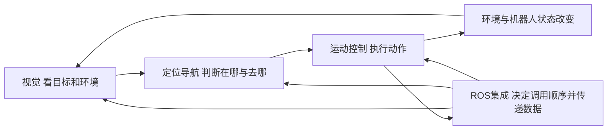

# 零基础第一课与 ROS 速查

用时20分钟，三人一起读、画、解释。读完要能说清：机器人为什么先导航再识别，消息如何让下一步开始，抓取失败应该去哪个模块找原因。

这两天先把练习平台的配置、仿真、调试和报告走通，不必为了备赛另装 ROS 环境或在本机启动真实模型训练。平台中要求的训练/推理步骤仍要完成；“平台训练”与“自行部署真实训练工程”是两件事。

截至2026-10-22，本次会话已核查当前平台，任务13“ROS2基本通信”的虚仿显示未发布；这是本次页面快照，后续以课程页为准。下面补的是官方 ROS2 基础概念，不是任务13的官方步骤、题目或评分答案。任务14的数字状态来自本地第三方方案，经截图核对整理，正式比赛可能采用不同编号。

## 1 先把四模块连成一件事 3分钟

设想有人说：“去桌子边拿苹果，放进蓝盒子，再回来。”

| 模块 | 它回答的问题 | 在取苹果中的作用 | 失败时可能看到什么 |
|---|---|---|---|
| 视觉感知 | 看到了什么、目标在哪里 | 从彩色图找苹果，用深度得到空间信息 | 认错物体、漏检、抓取点偏移 |
| 定位导航 | 我在哪里、要去哪、怎么过去 | 在地图定位，规划到桌子的路线 | 到不了桌边、撞障碍、原地转 |
| 运动控制 | 身体怎样稳定执行动作 | 根据当前姿态与目标调整关节动作 | 摔倒、抖动、走偏、动作不稳 |
| ROS集成 | 现在该调用谁、数据给谁、做完通知谁 | 到桌后才请求视觉，识别后才抓取 | 各模块单独能用，整体却卡住 |

这是“感知→判断→行动→再感知”的循环，不是一条只走一次的流水线。下面的箭头用于理解信息关系；实际调度可以先到桌边再近距离识别。



四模块是正式省赛的分工入口；任务14里的 master/nav/vision/arm 是另一层级的节点划分。不能直接把“arm节点”当成全部“运动控制模块”。具体赛制见[官方规则梳理](01_官方规则梳理.md)。

## 2 用取苹果记住七个词 5分钟

| 词 | 一句话理解 | 取苹果例子 |
|---|---|---|
| Node 节点 | 负责一种功能的工作单元 | master调度；nav导航；vision找目标；arm抓放 |
| Topic 话题 | 发布者发消息，订阅者收到后处理 | master向`_nav`发送“去第一张桌子” |
| Publisher / Subscriber 发布者/订阅者 | 发送某种消息的人 / 订阅它的人 | master发`_grab`；arm订阅`_grab` |
| Service / Request / Response 服务/请求/响应 | 提一个具体请求，拿回对应结果 | master问`_locate`：“苹果在哪里？”vision返回点云 |
| Callback 回调函数 | 事件发生后，系统调用的处理函数 | nav收到目标消息后进入导航回调；到达后进入完成回调 |
| State 状态 | 记录流程现在走到哪一步 | “正在去桌1”“等识别结果”“等抓取完成” |
| TF 坐标变换 | 把同一位置改用另一套坐标描述 | 将相机坐标中的苹果位置换算到机器人基座坐标 |

ROS2节点可以通过话题、服务等交换数据；不能把节点直接等同于一个独立程序文件。节点划分强调职责，程序组织可以不同。[ROS2官方节点说明](https://docs.ros.org/en/foxy/Tutorials/Beginner-CLI-Tools/Understanding-ROS2-Nodes/Understanding-ROS2-Nodes.html)

**Topic与服务：** 发布到话题后，不会自动获得“工作已完成”的响应。任务14用另一个`_finish`话题报告完成。服务则有请求和响应这两个部分；客户端调用也可以采用异步方式，不能理解成“所有节点停下来等”。真实ROS系统还常用Action处理带进度、结果和取消功能的长任务，这一课先掌握平台已经使用的话题与服务。[ROS2官方接口说明](https://docs.ros.org/en/humble/Concepts/Basic/Interfaces-Topics-Services-Actions.html)

**回调与状态：** 回调决定“事件到了，执行哪段逻辑”；状态决定“同样一个完成消息，这次代表哪一步完成”。如果没有状态，master收到`_finish`后就不知道是到桌了、抓完了还是放完了。官方订阅教程中，订阅者接收消息后执行绑定的回调函数。[ROS2官方回调示例](https://docs.ros.org/en/humble/Tutorials/Beginner-Client-Libraries/Writing-A-Simple-Py-Publisher-And-Subscriber.html)

**TF与运动命令：** TF只改变位置的表达方式。算出“苹果在基座前方某处”，还需要规划与机械臂移动指令才会真的伸手。TF库管理坐标系关系，并用于把点、向量等从一个坐标系变换到另一个坐标系。[ROS2官方tf2说明](https://docs.ros.org/en/humble/Concepts/Intermediate/About-Tf2.html)

注意平台里的“创建订阅者”“创建服务端”是不同指令。图上连了一条线只表明控制顺序；变量名、字段名、类型、回调绑定不对，线连得再整齐也不会自动正确。

## 3 一次取物的数据流 2分钟

1. master从语音提取目标：去哪里、拿什么、放哪种颜色盒子。
2. master发布`_nav`。nav收到后导航，到达后发布`_finish`。
3. master收到完成消息，知道现在到了桌1，于是调用`_locate`服务，指定查找“物体：苹果”。
4. vision识别苹果，结合深度取出苹果点云，返回`Point_Cloud`。
5. master把视觉返回的点云转发到`_grab`。这条消息中的点云字段名是`Pcloud`。
6. arm用点云估计抓取位姿，做坐标变换，移动并闭合夹爪，随后发布`_finish`。
7. master推进下一阶段；放置时同样要等相应盒子的位姿，而不是凭苹果的抓取位置去放。

讲给队友听时，要说出“谁发、谁收、内容是什么、成功后谁继续”。参考实现与纠错见[任务14实战攻略](03_任务14实战攻略.md)。

## 4 三个卡点口头推演 3分钟

这些状态码属于任务14参考方案。状态数字本身不是根因，要结合调试面板最后执行函数与变量判断。

| 情景 | 现在在等什么 | 第一轮怎么查 | 什么证据才说明修好了 |
|---|---|---|---|
| 状态一直是1 | 第1次导航完成通知 | nav是否收到正确航点名？忙标志是否变化？到达回调是否发布`_finish`？master是否订阅它？ | master收到完成消息并转到2，随后发出视觉请求 |
| 机器人已到桌边，状态一直是2 | 第1次视觉服务响应 | `_locate`是否创建成服务？请求字段是否为`Detect_Type/Detect_Name`？彩色/深度图是否有值？是否走到服务端响应？ | master的视觉回调1执行，状态到3，并发布`_grab` |
| 手已经动了，状态一直是3 | 第1次抓取完成通知 | arm是否读到`Pcloud`？抓取位姿是否合理？移动完成回调有没有闭爪并发布`_finish`？ | 实际抓起目标，完成消息到达master，状态到4并去第2桌 |

三人轮流当“调度员、执行模块、观察员”。调度员只报状态和最后一条日志；执行模块提出两项检查；观察员说出修好后应看到什么。不能只回答“重启试试”或“参数调大一点”。

## 5 手算一次坐标变换 2分钟

下面数字纯为教学，**不是比赛相机参数**。假设相机坐标系与基座坐标系三个轴方向完全相同；相机原点在基座中的位置为`(0.10, 0.00, 1.00)米`。某物体在相机中的坐标为`(0.20, 0.10, 0.50)米`。

没有旋转时，只需加上平移：

```text
基座中的物体坐标 = 相机中的物体坐标 + 相机原点在基座中的坐标
                = (0.20, 0.10, 0.50) + (0.10, 0.00, 1.00)
                = (0.30, 0.10, 1.50) 米
```

队友复核：再减去相机原点，应该得到原来的`(0.20, 0.10, 0.50)`。如果错误地重复变换一次，会得到`(0.40, 0.10, 2.50)`，位置明显错了。真实相机通常还有旋转，完整关系为`p_基座 = R × p_相机 + t`，不能一律只做加法。

图像上的`(u,v)`是像素位置；相机三维点的`(x,y,z)`是空间位置；机械臂抓取位姿还包括方向。**像素坐标不能直接加上以米为单位的相机平移。** 要先利用深度和相机内参得到相机三维点，再用外参/TF转到基座坐标；抓取方向则需要额外的位姿估计或任务约束。任务14已把部分计算封装为“深度图转点云”“二维点转三维点”“抓取位姿估计”等节点。

## 6 第一题运动控制 五个设置到底是什么 3分钟

官方练习手册的任务1要求配置观察值空间、动作空间、奖励值、重置条件和训练参数，完成训练、推理仿真及报告。先知道每栏的作用，再看第三方数值。以下只教原则，不给未经当前平台核实的固定参数。

| 五要素 | 你要回答的问题 | 平地走路的例子 | 常见误解 |
|---|---|---|---|
| 观测 | 机器人依据什么判断？ | 身体姿态、速度、关节状态、目标速度等；以题面可选项为准 | 观测是输入，不是你希望机器人最终做到的动作 |
| 动作 | 策略输出什么来控制机器人？ | 可能是关节目标角度等，按界面定义选择 | “走到目标”是任务目标，不自动等于底层动作输出 |
| 奖励 | 什么行为加分，什么行为扣分？ | 鼓励跟随目标速度，同时考虑稳定、偏移等 | 只奖励存活可能让它站着不动；只顾前进可能失稳 |
| 重置 | 何时结束这一回合、重新开始？ | 摔倒或达到设定时长等；看题目选项 | 到时间结束不必然等于摔倒失败；它也不是删除训练成果 |
| 训练 | 怎样用反复试验改进策略？ | 训练步数、学习率、批量等控制学习过程 | 训练结束不等于达标，必须再看推理仿真与报告 |

训练时，策略反复“读观测→给动作→收到奖励”；训练算法据此更新策略。推理时，主要用已训练策略执行动作。这解释了为什么训练图表看起来不错，仍要到实际题目场景验证。

第一次练习先用题目允许的配置建立完整基线；记录一个版本后每次只改一个主要因素，重跑并比较。你必须能说出“改哪一栏、希望解决什么现象、怎样判断变好”，而不只是“答案里这么填”。三种模型都需要按官方手册实际仿真后查看报告，别只做完走路就把整题视为完成。依据：[官方练习平台手册](../赛事文件/【练习平台·操作手册】2026年iCAN大学生创新创业大赛“金视线杯”具身智能应用设计挑战赛1.0(2).pdf)p5–11。

## 7 学完后的可选20分钟练习

上面阅读与演练可压缩合并为下面20分钟流程。A/B/C是临时角色，下次互换，不代表正式比赛永久分工。

| 时间 | 立即执行动作 | 谁来做 | 可检验结果 |
|---|---|---|---|
| 0–4分钟 | 在空白纸画四模块和“取苹果”流程，每条箭头写传什么 | A主讲，B画图，C追问 | 图中包含四模块；能指出“到桌后通知”和“识别返回”两个触发点 |
| 4–8分钟 | 用七词表互问，再给`_nav`、`_locate`、相机图像分类 | B主讲，C回答，A纠错 | 说出`_nav`是话题、`_locate`是服务、相机图像是话题数据；解释TF不驱动电机 |
| 8–12分钟 | 轮流抽状态1/2/3的卡点，各说两项检查和一个修复证据 | 三人各答一题 | 能分别定位导航、视觉响应、抓取完成链；不只凭动画判断 |
| 12–15分钟 | 独立算TF示例，互相验算，并说明像素点还缺什么 | C主讲，A/B验算 | 三人都得到`(0.30,0.10,1.50)米`；能说出深度、内参、坐标系 |
| 15–20分钟 | 在练习平台打开任务1题面/配置页，把五要素各写一句；只认清当前界面，不点正式比赛最终提交 | 一人操作，另两人口头核对 | 留下五栏说明、当前任务目标、准备采用的版本名、训练后要核对的仿真和报告项 |

20分钟结束后，由每人用60秒独立讲一遍自己的薄弱点。接着按任务1攻略真正完成第一次“配置→训练→仿真→报告”，记录平台反馈，再进入各自负责模块。正式冲刺建议为A先运动1—3、再视觉4—6，B导航7—9，C优先任务14、按依赖补任务10—12，详见[两天冲刺与三人分工](05_两天冲刺与三人分工.md)。仍讲不清的概念先回到相应例子，不用停下来补整门ROS课程。

## 来源与适用边界

赛制和任务1步骤来自本地官方文件；任务14具体消息、变量和状态来自已核图的本地资料。ROS概念由上述官方文档补充，网页于2026-10-22读取。节点概念页为Foxy历史版本，仅用于稳定的概念解释，不据此选择或安装ROS版本。没有补造任务13题目，也没有把教学数字当作比赛参数。

