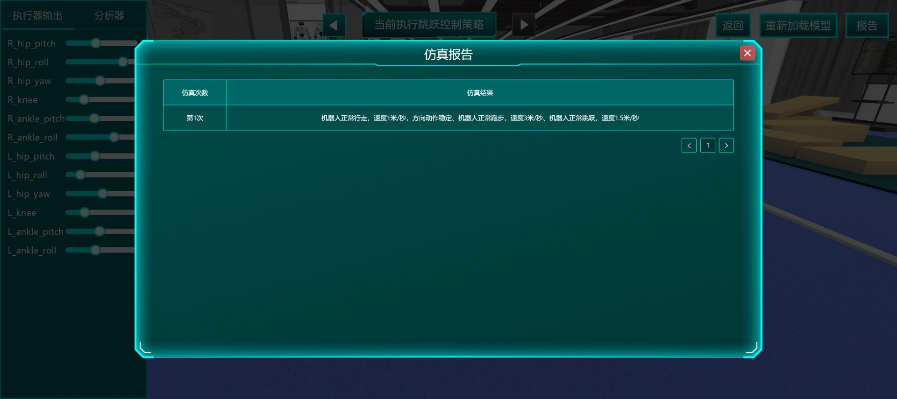

# 本队实操记录

日期：2026-10-22。只登记本账号实际完成的操作，第三方成绩不能填进来。暂未出分写“未取得”，不要写0分，也不要写通过。

## 后续实测入口（2026-10-23更新）

**当前状态：实验已按用户要求暂停。** 本次只整理已存证据、同步学习站并准备跨对话学习上下文，不再运行训练、仿真或修改平台配置。下文未完成项用于理解与未来续接；恢复实操需要用户新的明确指令。任务10当前保存的初始移腕x为0，未恢复0.35；任务12当前保存的规划时间上限为5，未恢复3。所有会锁定实验的最终评分均未提交。

本篇保留首轮环境排查、任务1训练与仿真、源码精读的原始记录。用户随后授权其余任务实测，后续配置、运行报告、排错和未完成项统一写入[12 全任务实测与排错手册](12_全任务实测与排错手册.md)，并链接各模块的独立证据。**判断账号现在做到哪里，请先读12的对应任务及证据日期，不要只按本篇首轮快照判断。**

新版学习入口是[11 速通版完整学习路线](11_速通版完整学习路线.md)：150分钟指首轮理论学习，不包含全部平台操作、训练等待或独立复现。网页已读、训练完成、过程报告和独立掌握分别记录；后续实测仍不提交会锁定实验的最终评分。

### 任务4、7、8、9最新快照（2026-10-23）

下表同步12的已存证据，仅补这四题的最新结果，其他任务仍按12对应章节续接。

| 任务 | 当前已验证事实 | 仍不能认定 |
|---|---|---|
| 4 图像分类 | 27图、ResNet accuracy 0.8371；明亮/昏暗两流程均已连接保存，各7类内部输入已测，10次3D报告已取得。本轮来源类别有8/10对应，两次误判、置信度0.10—0.37。[报告](sources/platform/live_20261022/task4_simulation_report_baseline.txt) | 不是整体准确率80%或80分，不能称全部质量达标；旧昏暗未连通已修复 |
| 7 2D建图 | 客户1仍有86.6%；客户2GMapping＋路线3＋1倍速已完成[79.2%报告](sources/platform/live_20261022/task7_route3_report.txt)。后续Karto整卡0.25m/0.15rad/8m/10m/0.3m＋路线3＋1倍速由85%到99%，约20分钟仍无报告，[配置](sources/platform/live_20261022/task7_c2_karto_route3_config.png)/[停滞](sources/platform/live_20261022/task7_karto_route3_99pct.png)已存 | 79.2%未达>80%；Karto未解决且无准确度，根因未证实。客户1历史86.6%保留；最终评分未提交 |
| 8 2D导航 | 客户1全局3.2rad/s²及局部全套、客户2代价3×3m和全局3.2rad/s²已有回读；客户1代价由现场确认与客户2相同。客户2局部从1.5改1m/s后已关闭面板、从首页重开，[新回读](sources/platform/live_20261022/task8_c2_local_reopened_verified.txt)/[截图](sources/platform/live_20261022/task8_c2_local_reopened_verified.png)确认TEB、1m/s及其余九项保留；[长按拖动截图](sources/platform/live_20261022/task8_longpress_drag_camera_only.png)仍仅充电桩 | 客户2局部保存已核验不等于导航通过。17点未齐，未新增零食架，仿真未启用、无报告；工具拖动只移镜头不证明网站损坏 |
| 9 3D建图与导航 | PCD/PGM已预览，30参数重开回读、十点已保存；`nav9_pgm`首份报告准确度92%，十目标全到达，碰撞/撞人/撞墙或门均0。[报告](sources/platform/live_20261022/task9_simulation_report_baseline.txt) | 点位合理性没有单独评分，不是正式满分；用户独立掌握尚未验证 |

以上均未提交会锁定实验的最终评分。具体配置、失败样本和复练边界以[12实测手册](12_全任务实测与排错手册.md)为准。

### 任务10、12抓取进度快照（2026-10-23）

任务10的15次标定此前已保存，本轮已回读[三组核心矩阵及顶视图腕关节位姿](sources/platform/live_20261022/task10_core_parameters.json)。9图7类检测数据首次提交因登录过期失败，见[历史失败记录](sources/platform/live_20261022/task10_det9_save_expired.txt)；新会话重新标框后，`T10_det9_7class_1023`已成功保存9图，见[保存回读](sources/platform/live_20261022/task10_det9_saved.txt)。检测模型`T10_det_m1_1023`已完成并查看，96.738MB，precision/recall/f1_score/mAP=`0.97/0.993/0.981/0.995`，见[指标](sources/platform/live_20261022/task10_detection_model_metrics.txt)；训练采用完整Mosaic+随机旋转+CutMix+(随机缩放+裁剪)+随机遮挡，batch8、workers1、SGD、学习率0.001、100epoch，见[配置](sources/platform/live_20261022/task10_detection_training_config.txt)。2D抓取数据`T10_pose7_1023`已保存7图、每图1候选：66彩椒、70锅铲、74剪刀、78螺丝刀、82墨镜、88拖鞋、90香蕉，见[列表](sources/platform/live_20261022/task10_pose7_saved.txt)；这是7图基线，不是全部28图，86也是墨镜，不能按连续每4图推算类别。抓取模型`T10_pose2d_m1_1023`已完成并查看，0.275MB；batch16、batches_per_epoch100、workers4、50epoch、Adam、学习率0.001，表单没有增强字段，见[配置](sources/platform/live_20261022/task10_pose2d_training_config.txt)。查看页实际指标为`metric_iou: 1`，见[指标](sources/platform/live_20261022/task10_pose2d_model_metrics.txt)，不改名为accuracy=100%。14节点13边流程已配置并[重开确认连线](sources/platform/live_20261022/task10_flow_reopened_all_edges.png)，首轮7物品报告取得：锅铲、剪刀抓取无碰撞且入盒；香蕉、拖鞋、墨镜没抓到；螺丝刀、彩椒移动时碰到道具，合计2成功5失败，见[完整报告](sources/platform/live_20261022/task10_simulation_report_baseline.txt)。最新仅把初始移腕x从0.35改为0，其余不变，包括lift仍用原位姿；[配置对照](sources/platform/live_20261022/task10_initial_x0_trial.json)的[第二轮报告](sources/platform/live_20261022/task10_simulation_report_initial_x0.txt)已取得：墨镜无碰撞入盒，锅铲抓起后碰盒，香蕉/剪刀/彩椒/拖鞋未抓到，螺丝刀抓取目标错误，只有1/7完整成功。两轮顺序与场景变化，不能把结果差异全部归因于x，也不能称已改善。**暂停时初始x仍保存为0，未恢复0.35；lift仍为0.35。**最终评分未提交；配置与逐项排错见[12任务10](12_全任务实测与排错手册.md)。

任务12已保存15组不同位置/旋转的标定，并确认生成提示；[两组核心矩阵](sources/platform/live_20261022/task12_core_parameters.json)按界面“相机与基座矩阵”“夹爪与腕关节矩阵”原名保存，没有自行指定变换方向或宣称标定误差达标。13图分割模型`T12_seg13_1022`已完成38.684MB，precision/recall/F1/mAP为0.995/0.944/0.969/0.976，见[分割指标](sources/platform/live_20261022/task12_seg13_model_metrics_and_displayed_code.txt)。

抓取数据集`T12_pose20_1023`保存119正、1负共120个位姿；`20`指4场景×5物品各选一个候选检查调整，**不是20个训练样本，也不是120个候选全审核**。6D模型`T12_grasp6d_m1_1023`已完成并查看：S@1=82.15%、S@5=94.75%达到题面阈值；CFR=83.04%低于85%，SLR=33.41%高于20%，未全部达标，见[抓取模型指标](sources/platform/live_20261022/task12_grasp6d_model_metrics_and_displayed_code.txt)。

任务12旧会话曾配置TRAC-IK、四规划组、六姿态、两末端执行器，并实际切换六姿态、执行右臂规划和OctoMap预览，见[历史规划预览](sources/platform/live_20261022/task12_right_arm_planning_octomap.png)。但当时模块提交返回413“当前用户已过期，请重新登录”，见[旧保存失败截图](sources/platform/live_20261022/task12_mechanical_save_session_expired.png)；这些预览不能替代成功保存。

新会话回读机械面板全空，见[空配置截图](sources/platform/live_20261022/task12_new_session_mechanical_empty.png)。本轮已重建TRAC-IK、四规划组、六姿态和双末端：左右臂各link1—7，左右手各为适配法兰与两个gripper连杆；末端父连杆分别`left_arm_link7`、`right_arm_link7`，父规划组为对应手臂，见[恢复基础配置](sources/platform/live_20261022/task12_restored_base_all.png)。双臂按第三方滑杆参考恢复，角度没有数值显示，不从像素反推；手张开link1最左/link2最右，闭合相反，六姿态新截图见12任务12。

点云与规划参数也已恢复为0.02m、2.5m、0.03m、5Hz、下采样2、膨胀2、RRT_Connect、步长0.3、时间上限3、尝试5、速度/加速度缩放0.5/0.5，见[恢复参数](sources/platform/live_20261022/task12_restored_planning_parameters.png)。机械模块提交并确认仍可继续修改后，返回首页、整页刷新、重开基础页，**全部四组、六姿态、双末端及TRAC-IK仍在**，见[刷新回读](sources/platform/live_20261022/task12_mechanical_after_browser_reload.png)。最新状态为失败后恢复并刷新回读成功，不再是当前登录阻断；该模块保存没有锁定最终评分。

新恢复后已实际重做[左臂初始切换](sources/platform/live_20261022/task12_restored_preview_left_arm.png)、[右臂初始切换后的双臂画面](sources/platform/live_20261022/task12_restored_preview_both_arms.png)，并点击右臂“规划并执行”、显示[OctoMap预览](sources/platform/live_20261022/task12_restored_planning_octomap.png)。双手四个张开/闭合切换暂未在新会话重复执行，旧预览只作历史证据。新预览不代表四物品抓放或所有规划无碰撞。

旧实验页的“抓取流程构建”曾反复暗色空白，iframe的src/body为空，两次刷新仍复现，见[历史故障文字](sources/platform/live_20261022/task12_flow_empty_frame.txt)与[截图](sources/platform/live_20261022/task12_flow_empty_frame.png)。后来从已登录课程另进一张新实验页，流程编辑器恢复加载；这已不是当前阻断，根因仍未唯一确定。

本轮已保存14节点14边双分支：左臂初始→右臂初始→相机→实例分割→按仿真指令裁剪→点云→6D→抓取TF→按基座左右条件选对应臂→闭当前臂夹爪→同臂放置→张开；相机另一路→蓝色色块中心→放置TF→汇入放置移腕。分割绑定`T12_seg13_1022`+CPU，6D绑定`T12_grasp6d_m1_1023`，矩阵均为本题核心原值，见[逐节点字段](sources/platform/live_20261022/task12_flow_parameters.json)。

旧`task12_flow_reopened_all_edges.png`实际13边、缺相机→色块，不能以文件名判全齐；补边保存后重开，[最新截图](sources/platform/live_20261022/task12_flow_reopened_14_edges_verified.png)及[箭头数量回读](sources/platform/live_20261022/task12_flow_reopened_edge_count.txt)确认14条。流程仅验证关闭重开保留，不能与机械基础配置的整页刷新检验混为一谈。

首轮[完整4物品报告](sources/platform/live_20261022/task12_simulation_report_baseline.txt)及[截图](sources/platform/live_20261022/task12_simulation_report_baseline.png)现已取得：长颈鹿、包装盒、罐头均“未检测到合理抓取位”，抓取点为空；塑料碗有6D目标，但“规划失败，未找到可行路径”。**本轮0/4完整成功，属于流程已执行而抓放未通过，不是未做仿真或最终0分。** 四行均有蓝盒点`[640,342]`和放置目标`[0.0133,1.212,0.5852] / [0,180,180]`，说明独立颜色分支运行；失败行的目标坐标不能当作实际到达或成功放入。

暂停前已仅把规划时间上限3→5并保存模块，然后启动四物品仿真，见[时间5配置截图](sources/platform/live_20261022/task12_planning_time5_trial.png)。**结果尚未回读，当前保存值仍为5，未恢复3**；不能称已改善或把首轮0/4当第二轮结果，也不期待该改动直接解决三个对象缺失抓取位。字段未显示单位，不自行补单位。CFR/SLR未达、候选未全审及手部四开合未单独复验仍是当前边界。模型、数据、15次标定已有证据保留，两题最终评分均未提交；暂停期间不为取报告或恢复参数而继续操作平台。

### 任务11续接说明（2026-10-23）

任务11已保存实例分割数据集`T11_seg10_1023`，列表确认10图、创建于06:20:06，见[保存列表](sources/platform/live_20261022/task11_seg_dataset_saved.txt)。本轮实际标签包装盒、罐头、水壶、塑料碗、长颈鹿各2图；23实例是逐图操作计数，不是保存列表提供的实例统计。SAM误分背景已清理，逐图检查标签无空白行；本轮是10图基线，不是50图全标。

分割模型`T11_seg_m1_1023`已完成38.684MB并打开“查看”，precision/recall/F1/mAP=0.995/0.944/0.969/0.976，见[模型状态与指标](sources/platform/live_20261022/task11_seg_model_metrics_and_displayed_code.txt)。实际训练为batch8、workers1、SGD、0.001、100epoch，aug1完整选项为“(随机缩放+裁剪)+随机旋转+HSV变换+随机遮挡”，见[训练配置](sources/platform/live_20261022/task11_seg_training_config.txt)。precision达到本题模型质量项阈值，不证明真实物品泛化或整题抓放通过。

抓取数据`T11_pose_default_1023`于06:28:36保存120正、0负，见[默认数据列表](sources/platform/live_20261022/task11_grasp_default_dataset_saved.txt)。实际仅查看四场景总览、选中场景1盒/罐/壶三个候选，未修改默认值，未逐一审核20个场景—物品组合或120个候选。它是默认候选训练链路基线，**不是抓取位姿标注完成**，没有移用任务12数据。

`T11_grasp_default_m1_1023`已完成并查看，S@1 81.99%、S@5 94.59%达到题面阈值；CFR82.83%<85%、SLR33.83%>20%未达，见[6D指标](sources/platform/live_20261022/task11_grasp_model_metrics_and_displayed_code.txt)。实际配置为摩擦0.7、余量6mm、batch8、workers1、20epoch、SGD、0.001，增强完整选项“随机旋转Z轴+随机平移+随机尺度缩放+点抖动”，见[训练配置](sources/platform/live_20261022/task11_grasp_training_config.txt)。

任务11现已实际记录15条标定并确认模块提交，页面提示文件已生成，见[15条记录](sources/platform/live_20261022/task11_calibration_15.png)及[生成提示](sources/platform/live_20261022/task11_calibration_generated.png)。部分拍照点击没有新增记录，本轮按真实编号补足，不能把点击数当记录数。

[核心参数](sources/platform/live_20261022/task11_core_parameters.json)与[截图](sources/platform/live_20261022/task11_core_parameters.png)已保存：顶视腕位置(0.35,1.26,0.34)、角度(0,180,180)；实际字段名为“基座与桌面矩阵”“夹爪与腕关节矩阵”。前者与官方题面“相机与基座矩阵”不一致；后续两物品成功支持本次填值可用于这些操作，但未由此确认字段定义等价或所有变换方向。保留原名原值，不静默改名或自行求逆，完整矩阵见12任务11。

本轮15节点、14条连线现已保存并关闭重开实际验证：初始移腕→拍照→实例分割→图像截取→深度图转点云→6D估计→抓取TF→抓取移腕→闭爪→抬回初始→拍照→蓝色色块中心→放置TF→放置移腕→张爪。两模型使用本题已完成权重，分割计算单元CPU；初始移腕位置(0.35,1.26,0.34)、角度(0,180,180)、50mm/s，抬回40mm/s，抓放移腕均父节点TF、30mm/s。见[逐节点保存参数](sources/platform/live_20261022/task11_flow_parameters_baseline.json)、[修复后重开全部连线](sources/platform/live_20261022/task11_flow_all_edges_persisted.png)。

深度图转点云及两处TF的“相机与基座矩阵”字段，实际填入本题核心页名为“基座与桌面矩阵”的第一矩阵原值，未自行求逆、转置或套用别题；两处TF另填本题夹爪与腕关节矩阵。最新报告中水壶、塑料碗抓放成功，说明这组填值在两次操作中可用；**仍保留界面名称差异，不据此证明矩阵全部方向定义或字段语义等价**。

首次保存失败证据保留：[重开失败截图](sources/platform/live_20261022/task11_flow_reopened.png)只有15个孤立节点、箭头全部消失，当时[文字](sources/platform/live_20261022/task11_flow_reopened.txt)不能证明边存在。原因边界为先前只在连线前点过节点“确定”，连线后没有再次保存；不能笼统写平台自动保存。本轮先恢复A→B一条边，选相机节点→右侧“确定”→出现保存成功，关闭重开确认箭头保留；再恢复其余13边，选末端张爪节点→“确定”，见[保存反馈](sources/platform/live_20261022/task11_flow_save_after_edges.txt)，关闭重开后15节点14箭头全部实际可见。此为关闭重开流程面板验证，尚未验证整页刷新；以后增删边后需再次点“确定”并重开逐边确认。

首次仿真数分钟0%的失败记录保留；连线修复后已取得[完整5物品报告文字](sources/platform/live_20261022/task11_simulation_report_baseline.txt)及[截图](sources/platform/live_20261022/task11_simulation_report_baseline.png)。**水壶、塑料碗均抓取成功、移动过程未发生碰撞、物体成功放入盒子；包装盒、长颈鹿、罐头均“未检测到合理抓取位”，抓取点及后续三类点位全为`[]`。本轮完成五物品验证，2成功3失败，不能称整题通过。**

分割模型高分不能代替抓放结果；120正0负默认候选未经逐一审核、CFR/SLR未达是本基线局限，不能直接认定为三个失败的唯一原因。后续针对失败对象检查分割→裁剪→点云→6D候选，审核位姿并另存调整版重训，再重跑五物品对照。参数与保存排错见[12任务11](12_全任务实测与排错手册.md)。最终锁定评分未提交。

### 任务14双机器人实测快照（2026-10-23）

R1和G1各4节点、19函数、15变量及G1差异均已保存。两轮原配置仿真及一轮G1 false左手抓取减速对照已经完整取得报告，三轮16项任务及说明相同，每轮38函数均标“执行”、没有“未执行”。**R1每轮八项成功；G1每轮六项成功，拿长颈鹿和将长颈鹿放入黄色盒子两项失败。** 完整过程、配置及历史故障见[任务14独立实测记录](sources/platform/live_20261022/任务14实测记录.md)和[12任务14](12_全任务实测与排错手册.md)。

| 轮次 | 唯一对照或配置 | 本轮报告 |
|---|---|---|
| 第1轮 | 原基线，G1 false抓取移动100% | [文字](sources/platform/live_20261022/task14_both_simulation_report_baseline.txt)、[截图](sources/platform/live_20261022/task14_both_simulation_report_baseline.png) |
| 第2轮 | 原配置不变，确认复现 | [文字](sources/platform/live_20261022/task14_both_simulation_report_repeat.txt)、[截图](sources/platform/live_20261022/task14_both_simulation_report_repeat.png) |
| 第3轮 | 仅将G1 false抓取移动100%改50%，提交模块后对照 | [50%参数](sources/platform/live_20261022/task14_g1_left_move50_parameters.json)、[文字](sources/platform/live_20261022/task14_g1_speed50_report.txt)、[截图](sources/platform/live_20261022/task14_g1_speed50_report.png) |

三轮R1均成功完成到一号桌、拿苹果、到二号桌、拿大象、到三号桌、苹果入蓝盒、大象入绿盒和回起点。G1成功完成到一号桌、拿香蕉、到二号桌、到三号桌、香蕉入红盒和回起点；两项失败的报告说明始终为：

- 拿长颈鹿：“目标检测识别正确、6d位姿识别正确、机械臂移动位姿失败、夹爪闭合未抓到”。
- 放入黄盒：“颜色检测识别正确、机械臂移动位姿正确、夹爪释放道具未入盒”。后者可能受前面没抓到影响，但未确认因果，不断言另有放置错误。

G1 [左手分支实际回读](sources/platform/live_20261022/task14_g1_left_branch_readback.json)确认条件读回调Hand，分支1=false、分支2=true；false支Grasp_Hand=left_gripper、Arm_Hand=left_arm，顶层Grasp_Point_Cloud取回调Pcloud，graspnet.tar输入Grasp_Point_Cloud并输出Grasp_Pose1；移动读Arm_Hand/Grasp_Pose1，原速度100%，回调grab_finish_callback。两支抓取TF均已回读为r12_camera→基座，未发现这些字段与预定配置不符；编辑器值不能替代运行时位姿或运动失败诊断。

50%减速没有改变三轮结果，不能把问题归因为速度或声称修复。**已恢复100%并重新打开参数确认**，见[恢复回读](sources/platform/live_20261022/task14_g1_speed100_restored.json)；恢复参数不算第四轮仿真。当前保留原基线及三轮完整结果，G1两项问题为“可复现、原因未定位”，不再盲调；以后有新的实际位姿、运动画面或失败诊断再做针对性验证。

最初0%空Debug、G1仅复制master和面板空白均是更早的历史状态，不能再用于描述当前进度。函数执行、流程100%、R1八项成功、最终满分和用户独立掌握不同；本轮最终评分未提交，不以三轮结果推定正式成绩或总体准确率。

## 环境记录

| 事件 | 观测 | 状态 |
|---|---|---|
| 课程目录 | Chrome已登录，可见任务1—14 | 已核实 |
| 任务13 | 课程页显示虚仿实训未发布 | 本次页面快照，后续可能变化 |
| 首次进入任务1 | 仿真启动页白屏，控制台Network Error | 已保存页面和日志 |
| 网络调整后 | 用户报告成功；已看到任务1 Unity实验首页 | 已核实首页，不等于训练成功 |
| 训练模型构建首次打开 | 只见暗色遮罩；用户手动也复现 | 已保留证据，不归因为自动操作 |
| 训练面板恢复 | 用户重新打开后，本次看到空模型列表和“新建” | 已核实 |
| 三种基线 | walk_baseline_1022、run_baseline_1022、jump_baseline_1022 | 均训练完成，均已打开模型详情查看 |
| 三种对照 | walk_compare_lr1e5_1022、run_compare_lr1e5_1022、jump_compare_lr1e5_1022 | 从对应基线复制，仅把界面学习率改为0.00001；均训练完成并查看 |
| 三基线推理 | 行走、转向、跑步、跳跃动画已检查，三个策略均完成本轮仿真 | 已取得仿真报告，详见下文 |
| 最终评分提交 | 确认框明确提示“提交后实验不可修改，且系统将进行评分” | 已取消，保留可继续练习状态；成绩未取得 |

## 任务1的当前结果与证据

本次已完成六个模型的创建、训练和逐个查看。基线行走创建于15:52:53、跑步16:04:57、跳跃16:06:40；三个学习率对照分别创建于16:26:54、16:28:28、16:28:34。官方任务1要求每种策略至少训练并查看2个模型，因此不能只做走、跑、跳各一个就忽略过程项。

三种基线的首次仿真报告显示：**机器人正常行走，速度1米/秒，方向动作稳定；正常跑步，速度3米/秒；正常跳跃，速度1.5米/秒。** 这是当前基线的仿真报告，不是最终100分成绩。三个学习率对照完成了训练与查看，尚未单独做推理对比；因此不能声称低学习率更好。



本次打开过最终提交确认框，发现提交会锁定练习，已点取消。**为保留给你后续改参数、复练的空间，没有完成评分提交；本账号任务1最终成绩仍为“未取得”。** 不要为了看一个分数，提前锁定仍要练习的实验。首轮记录时，任务2—12、14尚未在本账号逐一跑通，任务13在当时目录快照仍未发布；后续进展请以[12的逐题记录](12_全任务实测与排错手册.md)及所附证据为准。

证据：[仿真报告文字](sources/platform/任务1_首次仿真报告.txt)、[提交锁定提示](sources/platform/任务1_评分提交会锁定实验.png)、[基线训练完成截图](sources/platform/任务1_三模型训练完成.png)、[行走实填配置](sources/platform/任务1_walk_baseline_配置记录.md)。详细步骤、计分过程项见[10 官方任务要求与评分](10_官方任务要求与评分.md)。

## 跑跳配置与对照注意点

跑步和跳跃均勾选该类型界面的全部5项观察量；动作输出为关节目标角度，采用低通滤波+前馈控制，不加动作约束。每次存活奖励+1，速度奖励为“前进方向速度－左右方向速度绝对值”，姿态处罚权重1；跑步的训练后期垂直速度奖励为×2，跳跃为×4。重置条件仍是水平或前后偏转>30度、环境步数>1000。三基线训练参数相同：2000W、0.0001、0.005、2048、3层、每层512、0.995、1000。它们是本次实测基线，不是全部场景的唯一最优配置。

对照实验在界面里只将学习率改为0.00001。查看源码时，行走对照显示0.00001，但跑步/跳跃对照的显示源码仍出现0.0001；跑步显示源码还存在重复声明文本等疑点。**界面显示源码与配置不能无条件视为训练后端实际执行代码。** 本轮保存了各模型面板文本，没有执行或修复这些代码，也没有据此宣称平台训练算法出错。之后研究参数效果，应记录界面配置、模型名和实际推理报告，而不是仅凭源码面板判定。

## 每次练习填写一行

| 时间 | 操作者 | 任务/场景 | 配置版本 | 实际运行结果/成绩 | 最早失败点 | 本次唯一改动 | 复验 | 无答案重做用时 | 证据路径 |
|---|---|---|---|---|---|---|---|---|---|
| 10-22 | Codex示范 | 任务1/走跑跳 | 三种baseline_1022 | 训练、查看、三基线推理及报告完成；评分未提交 | 首次面板加载失败，重进后恢复 | 按三类策略分别配置奖励与观察量 | 当前报告正常；独立复现待做 | 尚未由用户独立重做 | sources/platform/任务1_首次仿真报告.png |
| 10-22 | Codex示范 | 任务1/三种学习率对照 | 三种compare_lr1e5_1022 | 训练与查看完成，未单独推理对比 | 显示源码与界面配置存在不一致 | 仅将界面学习率改为0.00001 | 不推断优于基线 | 尚未由用户独立重做 | sources/platform/ 内各模型显示源码文本 |
| 待填写 |  |  |  | 未取得 |  |  |  |  |  |

## 模块交接

| 模块 | 当前主责 | 当前版本/保存位置 | 已通过项目 | 未通过项目 | 已退出该模块 | 接手人 |
|---|---|---|---|---|---|---|
| 运动控制 | A待填写姓名 |  |  |  |  |  |
| 视觉感知 | A待填写姓名 |  |  |  |  |  |
| 定位导航 | B待填写姓名 |  |  |  |  |  |
| ROS集成 | C待填写姓名 |  |  |  |  |  |

## 一轮练习合格的自定门槛

- [ ] 能从输入讲到最终输出，不只复述按钮位置。
- [ ] 模型/参数/流程已保存，重开后还在。
- [ ] 实际运行过所有要求的子场景，并读完报告。
- [ ] 能指出一次失败最早发生在哪一环，并解释修复。
- [ ] 队友能依据交接独立复现关键过程。

上述为备赛验收，不是官方额外计分规则。

## 任务1：自学后的独立复练清单

你可以先完整阅读HTML，再自行进入平台练习；不需要等待代理逐步发指令。以下是准备好后使用的清单，队友可口头复核：

1. 训练模型构建 → 新建 → 输入一个有意义的名字 → 选择相应策略类型。
2. 逐页处理观察值空间、动作空间、奖励值、重置条件、训练参数，每页说出本策略与行走策略的差异。
3. 练习模型“提交”并确认后，回到模型列表检查名称、类型、创建时间和状态；不能把点过按钮当成已完成。
4. 训练完成后点“查看”，看动画、图表和源码。能在源码里定位观察、动作、奖励、重置和训练配置。
5. 回实验首页 → 推理仿真验证 → 选择本次模型 → 运行，记录动作和报告。任务1要求的三种策略最终都要测试。
6. 所有要求的策略均验证、也不再需要修改本次练习后，再决定是否提交评分。本题练习提交也会提示不可修改；正式比赛的最终提交规则另看官方文件。

复述检查：为什么走路要给目标前进/旋转速度，而跑跳参考观察量不同？为什么存活奖励不能替代速度跟踪？“训练最大步数2000W”“单次交互1000步”和“超过1000步重置”分别控制什么？

对应的实填行走配置：[本次基线记录](sources/platform/任务1_walk_baseline_配置记录.md)。

## 任务1 行走基线源码精读

本节只解读平台“查看源码”面板为 `walk_baseline_1022` 显示的内容；**没有执行、修改或据此验证训练算法实现，也不改变上文的训练/推理/成绩状态。** 来源为[本次平台显示源码](sources/platform/任务1_walk_baseline_平台显示源码.txt)，不是第三方截图或后台接口。下面行号对应该文本。正式题若开放源码参数，先理解这些量控制什么，不把本次取值当唯一答案。

### 动作怎样从网络输出变成关节运动

- **动作平滑系数 `kk=0.9`**（L197—201）：`u_new = 0.9*u_old + 0.1*action`，再计算 `utotal[i] = 2*kb[i]*u[i]`。较大的平滑系数意味着旧动作保留更多、新动作变化更缓；减小系数响应更快，但是否更稳定必须运行验证。它控制每次动作回调的滤波，不能直接把它与物理更新频率混成一个固定响应时间。
- **`kb`是此处的动作幅度增益**：数组为`[40,30,15,15,40,30,40,30,15,15,40,30]`；实际用来乘策略输出。源码注释称其“关节刚度系数”，但它不是下文`xDrive.stiffness`的物理驱动刚度。随后代码还叠加步态前馈项，并对索引1、7的目标分别限幅为[-200,0]、[0,200]。
- **左右腿完整周期约0.6秒仿真时间**（L21、L76、L273—286）：`T1=30`只对应一组腿的30个物理更新步；两组腿依次工作，计数到`2*T1`才回零。因此完整周期是`2*30*0.01 = 0.6s`，每组约0.3s。这个结论依赖显示源码中的`fixedDeltaTime=0.01`与计数逻辑，指仿真时间，不是网页等待时间；也不等于一次动作决策间隔。
- **真正使用的关节驱动参数是刚度500、阻尼50**（L237、L245—252）：调用链是`OnActionReceived → SetJointTargetDeg`，设置`xDrive.stiffness=500`、`damping=50`、`target=目标角`。另一个`SetJointTargetPosition`函数虽写2000/100和`forceLimit=200`，但当前显示的动作调用没有走它，不能把这组数当本次生效参数。
- **步态前馈还有额外量**：`d0=cr*180/3.14`、`dh=40`；目标线速度和角速度均为0且X/Z倾角都小于2度时，`dh=0`。`d0/dh`在公式里用于目标角前馈，并非源码注释所谓“基础/动态阻尼”的`xDrive.damping`。要顺着实际计算用途读，不能只背注释。

### 奖励公式比界面的短标签更具体

源码在每次`FixedUpdate`中计算并`AddReward`（L291—312）。令：

- `tilt_x = abs(EulerTrans(body.eulerAngles[0]))`；
- `tilt_z = min(abs(body.eulerAngles[2]), abs(body.eulerAngles[2]-360))`；
- `vel`为身体局部坐标系线速度，`wel`为局部角速度；
- `vr`为目标前进速度，`wr`为目标旋转速度。

则本次显示的每步奖励可展开为：

```text
r = 1                                  # 存活项
    - 0.1*tilt_x - 0.1*tilt_z           # X/Z倾角惩罚，欧拉角单位为度
    + (1 - 2*abs(wel.y - wr))           # 旋转速度跟踪
    + (1 - 2*abs(vel.z - vr) - abs(vel.x)) # 前进速度跟踪与横向漂移
```

也就是`r = 3 - 各项惩罚`。理想匹配且无倾角/横向漂移时，这个公式的单次奖励是3，而不是只有存活奖励1。所谓“跟踪处罚”并非单独的负误差，它还含`+1`基项与误差倍数2；线速度项另罚横向漂移。界面若写“某项×1”，还应区分外层权重1与公式内部的系数2/0.1。**不要据此宣称界面错误，也不要把显示奖励值当正式评分公式；训练奖励和最终任务评分是两回事。**

跌倒/结束条件（L315—319）为X或Z倾角绝对值超过30度，或`tt>1000`。`tt`每个物理更新加1、每回合归零；按此代码是超过1000次物理更新才结束，约10秒仿真时间。不要把这个阈值与总训练步数2000万、PPO采样长度、网页显示的训练等待时间混为一项。

### 8个界面训练参数之外要认得的量

| 源码/配置项 | 本次值 | 需要理解的作用 |
|---|---:|---|
| `kk` | 0.9 | 动作回调的平滑比例，影响响应与抖动 |
| `T1`与物理步长 | 30、0.01s | 两腿完整周期约0.6s；别把半周期当全周期 |
| `kb`、`d0`、`dh`、特定关节限幅 | 见上文 | 决定网络动作缩放、前馈步态和目标范围 |
| `xDrive.stiffness / damping` | 500 / 50 | 目标角由物理驱动怎样跟随，不是学习率 |
| `buffer_size` | 20480 | PPO更新使用的经验缓冲规模；本值为batch_size 2048的10倍，二者不是同一项 |
| `epsilon` | 0.2 | PPO策略更新的裁剪参数；`epsilon_schedule=linear`意味着配置还指定了线性调度，不能简单理解为全过程永远固定0.2 |
| `lambd` | 0.95 | PPO优势估计中的参数；不同于奖励折扣`gamma=0.995` |
| `num_epoch` | 3 | 每轮经验更新的训练遍数，不是整个任务只训练3轮 |
| `time_horizon` | 1000 | 训练经验序列/回报估计使用的时间跨度配置；数值与界面“单次交互最大步数1000”一致，可能是该选项对应配置，不应直接称为新增隐藏参数；仍须与源码里的`tt>1000`结束条件区分 |
| `normalize` | 策略网络true | 观察归一化设置；不能与视觉图像标准化操作混同 |
| 学习率与熵系数调度 | `linear` | 源码还指定`learning_rate_schedule`和`beta_schedule`，界面显示的初值不足以描述全部训练过程 |
| 场景并行体数 | `numrob=32` | 循环从1到31创建31个克隆，加原体共32个；注释“克隆数量”容易让人误读为额外32个 |

其中`kk`、步态周期、动作增益、驱动刚度/阻尼、奖励内部公式、`buffer_size`、`epsilon`、`lambd`、更新遍数和调度等，是**那8个训练参数下拉框没有完整表达的实现细节**；`time_horizon=1000`则可能对应其中的“单次交互最大步数”，列在这里是为了厘清含义，不能无证据说它完全隐藏。源码参数是否在正式题开放编辑、实际训练后端怎样采用，以正式题面和平台说明为准；这里不推断可修改权限，也不建议为试探参数而破坏已有基线。

### 两个读源码时必须说清的边界

1. **注释不等于实际公式。** `T1`注释叫周期长度，完整循环却到`2*T1`；`kb/d0/dh`注释提到刚度/阻尼，但公式实际把它们用于动作增益/目标角前馈；动作函数注释提到“关节力矩”，当前调用实际写入的是目标角。这些差异应通过调用链解释，不在本次擅自修代码。
2. **观察维度字段值得核对，但尚不能定性为运行错误。** L121把`ObservationNum`设为`9+2*12=33`；`CollectObservations`却还加入`vr/wr/cr`三项和相位sin/cos两项，逐项计数实际为`9+24+3+2=38`。当前显示片段没有说明`ObservationNum`是否用于外部传感器配置，因此只能标记“字段计算与实际加入量不一致，若正式题涉及观察维度需检查实际配置”，不能据此声称平台训练一定有故障。

**给运动负责人的5分钟口述验收：** 指出平滑所在行并解释0.9/0.1；算出0.6秒完整周期；从调用链找到500/50；展开真实奖励并指出横向漂移项；区分`buffer_size`、`time_horizon`、单回合终止阈值和总训练步数。能解释这些之后，再结合当前推理报告判断下一步改哪里；本节不替代推理验证或成绩报告。
