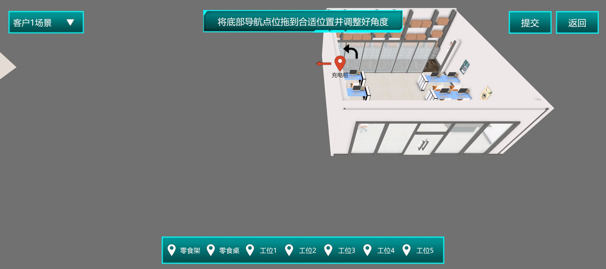

# 全任务实测与排错手册

本轮开始：2026-10-22 17:00（UTC+8），最新离线整理：2026-10-23。本文记录本账号实际配置、运行、报告和故障；第三方参考不等于实测成功。证据位于`sources/platform/live_20261022/`。

**当前执行边界：用户已暂停实验，先自主学习。** 本轮只整理已存证据、同步HTML及准备GitHub学习上下文；不再训练、仿真或修改平台配置。各节“复练”“下一步”是条件性建议，需要用户重新明确授权后才执行。所有会锁定实验的最终评分均未提交。暂停时任务10的初始移腕x仍保存为0（未恢复0.35），任务12的规划时间上限仍保存为5（未恢复3，已启动的对照结果尚未回读），任务14减速试验已恢复100%并回读；不能把这些不同状态混写。

## 任务1 机器人平地走跳跑

实测状态：六模型训练与查看完成，三基线推理正常，最终评分未提交。

已完成内容见[08实操记录](08_实操记录.md)：行走1m/s、跑步3m/s、跳跃1.5m/s。最终提交确认提示不可修改，已取消。继续保留可编辑状态。

## 任务2 机器人复杂地形行走

实测状态：两个模型训练与查看完成，基线仿真正常1.34m/s，最终评分未提交。

17:04创建terrain_baseline_1022，17:05复制为terrain_compare_lr1e5_1022，后者仅把学习率从0.0001改为0.00001。观察量7项全部勾选；动作目标角度、低通滤波+前馈、关节限幅。存活+1，前进方向速度减横向速度绝对值，角速度偏差×1，姿态处罚已确认完整文字为‘训练后期，姿态综合偏转角度*1’。重置为水平或前后偏转>20度、环境步数>1000。训练2000W、学习率0.0001、熵0.005、批量2048、3层×512、折扣0.995、交互1000。

首次面板只有iframe空壳，刷新实验页后重新点击训练模型构建恢复；没有改代理，也没有据此确认唯一根因。训练提交不会锁定整个实验；最终首页提交不点击。

证据：[奖励值](sources/platform/live_20261022/task2_rewards.txt)、[训练参数](sources/platform/live_20261022/task2_training.txt)。

基线报告原文：机器人平缓路、下坡路、上坡路正常行走，1.34m/s，方向和动作稳定流畅。证据：[本次报告](sources/platform/live_20261022/task2_baseline_report.png)。对照模型已训练查看，性能优劣还需单独推理，不凭学习率推断。

## 任务3 机器人复杂动作表演

实测状态：两模型训练与查看完成，100M基线及200M对照均取得仿真报告；三次历史运行舞蹈完成率均100%，动作位置偏差依次6.71、6.74、6.78；最终评分未提交。

模型为dance_baseline_100M_1022、dance_compare_200M_1022，分别训练100M/200M，其余配置相同。勾选躯干姿态、角速度、全部关节角度/角速度；不勾躯干线速度和参考轨迹编码。动作输出关节目标角度，指数移动平均+前馈控制；存活+1、躯干角度偏移×0.01、位置偏移×1。重置选角度偏差>30度或位置偏差>0.3m的联合条件，环境步数>1000。训练学习率0.0003、熵0.005、批量4096、4层×512、折扣0.995、交互最大2000。

第三方图中重置阈值此前被截断，本次从下拉框证实有角度30度、位置0.3m和两者联合三种选项；联合条件是本次基线选择，不假称第三方原图一定选了它。已实际打开预设轨迹数据，并保存首屏样本。100M本次报告显示“舞蹈完成率100%、动作位置偏差6.71、训练步数100M步”，没有自行补百分号单位或最终分数。[报告截图](sources/platform/live_20261022/task3_baseline_report.png)、[训练参数](sources/platform/live_20261022/task3_training.txt)、[重置条件](sources/platform/live_20261022/task3_reset.txt)。

2026-10-23恢复任务3后，再次运行200M对照。最新报告列出了全部三次结果，说明旧中断时的200M运行实际已有结果保留在平台；旧记录“200M推理中/结果尚未保存”不再是当前状态。

| 报告中的仿真次数 | 训练步数 | 舞蹈完成率 | 动作位置偏差 | 证据对应 |
|---|---|---|---|---|
| 第1次 | 100M | 100% | 6.71 | 原基线结果，本次历史报告再次显示 |
| 第2次 | 200M | 100% | 6.74 | 旧中断那次运行，恢复后已回读 |
| 第3次 | 200M | 100% | 6.78 | 本轮重新运行的200M对照 |

[三次结果文字](sources/platform/live_20261022/task3_compare_200M_report_1023.txt)与[最新报告截图](sources/platform/live_20261022/task3_compare_200M_report_1023.png)均已保存。报告没有为动作位置偏差标明单位，以上保留原值，不添加米、厘米或百分号。100%是舞蹈完成率，不是最终100分；这三次结果没有显示200M优于100M，也不足以据此得出训练越长效果越好的结论。最终锁定评分仍未提交。

## 任务4 图像分类识别

实测状态：已保存27图数据集与89MB的ResNet模型，模型accuracy为0.8371；明亮、昏暗两套流程已连接保存，各完成7类内部输入测试，第一轮10次3D识别报告已取得。按本轮来源文件标签逐条核对有8/10对应，但存在两次误判且置信度低，不能称全面通过；最终评分未提交。

本轮续接日期：2026-10-23（UTC+8）。3D运行进度达到100%表示运行完成，不是100分；下文分别记录数据、模型、流程和样本结果，不能用其中一项代替其他项。

### 当前持久保存的数据与训练配置

数据集为`emotion_baseline27_1022`，模型为`emotion_resnet27_1022`。10月23日新页[数据集列表回读](sources/platform/live_20261022/task4_dataset_readback_1023.txt)仍显示27图、1个训练模型，数据创建时间为10月22日17:36:46。旧会话后续尝试补标的20图未持久保存，**当前仍是27图，不是47图**。原[数据集截图](sources/platform/live_20261022/task4_dataset27.png)也与27图一致。

| 项目 | 本次保存配置 |
|---|---|
| 模型 | resnet，分类头7 |
| batch size / number_workers | 4 / 1 |
| 优化器 / 学习率 | SGD / 0.001 |
| 训练轮次 | 15 |
| 数据增强 | 处理流程3：随机裁剪→旋转→颜色抖动 |
| 模型文件 / 状态 | 89MB / 已完成并查看 |
| 平台模型accuracy | 0.8371 |

[模型状态与验证文字](sources/platform/live_20261022/task4_model_accuracy_and_code.txt)及[验证截图](sources/platform/live_20261022/task4_model_accuracy.png)确认上述模型完成和accuracy。训练字段见[参数记录](sources/platform/live_20261022/task4_training_config.txt)。官方模型质量项的高档要求accuracy>0.8，本模型超过该阈值，但尚未提交评分，也不能据此推定每张图片的输出正确。

当前标注标签为生气、厌恶、害怕、开心、平静、悲伤、惊讶；输出可能显示“吃惊”，官方也用“高兴/吃惊”。本节把开心与高兴、惊讶与吃惊按同义类别核对，不为这些叫法新增第8、9类。27图不等于全部100图已标完，也不证明每个人工标签均无歧义。

### 两套流程的当前保存配置

| 流程 | 已连接顺序 | 当前参数 |
|---|---|---|
| 明亮环境 | 图像采集→尺寸变换→标准化→resnet | 尺寸224；均值0.485/0.456/0.406、标准差0.229/0.224/0.225；模型`emotion_resnet27_1022`，CPU，分类头7 |
| 昏暗环境 | 图像采集→亮度调整→亮度均衡→尺寸变换→标准化→resnet | 亮度调整0.2；尺寸224；相同均值/标准差；同一模型、CPU、分类头7 |

亮度调整/均衡用于处理暗图，尺寸变换用于适配模型输入，标准化把输入按指定均值和标准差处理；这些步骤作用不同，不能用“已经把图调亮”替代模型输入检查。0.2是本次实际设置的亮度字段值，不擅自解释为固定曝光档数或20%的物理亮度。

旧记录曾停在“昏暗六节点已建但连线未核实”；本轮已经接续修复并得到输出，当前不再属于未连通状态。前后证据与修复方法见后文。

### 明亮与昏暗流程各7类内部输入测试

以下“明亮/昏暗”指选择的算法流程。第二组使用`angry2`等第二张测试输入，**文件名中的2本身不证明输入是暗光图片**，也不能由这两组不同图片直接推断哪条流程更好。两组各7类都已执行；最终14份结果均有类别与置信度、`error:null`。

| 目标类别 | 明亮流程输入与结果 | 昏暗流程输入与结果 |
|---|---|---|
| 生气 | angry→生气，0.24；[JSON](sources/platform/live_20261022/task4_bright_angry.json) | angry2→生气，0.21；[JSON](sources/platform/live_20261022/task4_dark_angry2.json) |
| 厌恶 | disgust→**平静，0.12，误判**；[JSON](sources/platform/live_20261022/task4_bright_disgust.json) | disgust2→**生气，0.14，误判**；[JSON](sources/platform/live_20261022/task4_dark_disgust2.json) |
| 害怕 | fear→害怕，0.24；[JSON](sources/platform/live_20261022/task4_bright_fear.json) | fear2→害怕，0.24；[JSON](sources/platform/live_20261022/task4_dark_fear2.json) |
| 开心 | happy→开心，0.37；[JSON](sources/platform/live_20261022/task4_bright_happy.json) | happy2→开心，0.33；[JSON](sources/platform/live_20261022/task4_dark_happy2.json) |
| 平静 | neutral→平静，0.28；[JSON](sources/platform/live_20261022/task4_bright_neutral.json) | neutral2→平静，0.19；[JSON](sources/platform/live_20261022/task4_dark_neutral2.json) |
| 悲伤 | sad→悲伤，0.27；[JSON](sources/platform/live_20261022/task4_bright_sad.json) | sad2→悲伤，0.27；[JSON](sources/platform/live_20261022/task4_dark_sad2.json) |
| 惊讶/吃惊 | surprise→吃惊，0.22；[JSON](sources/platform/live_20261022/task4_bright_surprise.json) | surprise2→吃惊，0.20；[JSON](sources/platform/live_20261022/task4_dark_surprise2.json) |

“吃惊”与目标“惊讶”按同义类别对应，证据示例见[明亮surprise截图](sources/platform/live_20261022/task4_bright_surprise.png)。厌恶在两套输入中均发生误判，应优先复查相关标注、样本覆盖与图像处理；目前尚无修复后的对照结果。

### 第一轮10次3D报告：本轮来源标签8/10对应

已保存[完整报告文字](sources/platform/live_20261022/task4_simulation_report_baseline.txt)、[报告截图](sources/platform/live_20261022/task4_simulation_report_baseline.png)和[来源文件名与结果对应表](sources/platform/live_20261022/task4_simulation_report_rows.json)。按对应表中的来源文件类别核对，结果如下；这不是仅凭人脸外观主观判情绪。

| 次序 | 来源文件（含平台标示的明暗） | 模型输出 | conf | 对照来源类别 |
|---:|---|---|---:|---|
| 1 | 男-开心-明.jpg | 开心 | 0.37 | 对应 |
| 2 | 男-悲伤-暗.jpg | 悲伤 | 0.27 | 对应 |
| 3 | 男-平静-明.jpg | 平静 | 0.23 | 对应 |
| 4 | 男-生气-暗.jpg | 生气 | 0.24 | 对应 |
| 5 | 女孩-开心-明.jpg | 开心 | 0.37 | 对应 |
| 6 | 女孩-平静-暗.jpg | **悲伤** | 0.15 | **不对应：平静误为悲伤** |
| 7 | 女-害怕-明.jpg | 害怕 | 0.23 | 对应 |
| 8 | 女-悲伤-暗.jpg | 悲伤 | 0.25 | 对应 |
| 9 | 女-惊讶-明.jpg | 吃惊 | 0.17 | 同义类别对应 |
| 10 | 女-厌恶-明.jpg | **平静** | 0.10 | **不对应：厌恶误为平静** |

这10个样本中有8个与来源类别对应，全部`error:null`。**8/10只描述本轮这组来源文件的比较，不能泛化成模型总体准确率、正式比赛成绩或80分。** 置信度范围0.10—0.37，均未达到官方仿真列出的>0.6与>0.8档位；即使某张类别对了，也不能把置信度质量项忽略。最终评分未提交，本节不补算平台总分。

### 已遇问题与本次解决办法

| 问题 | 证据与处理 | 实际结论 |
|---|---|---|
| 昏暗流程运行后class/conf/error全为null | [原始JSON](sources/platform/live_20261022/task4_dark_angry2_unconnected.json)与[缺首边截图](sources/platform/live_20261022/task4_dark_missing_first_link.png)显示图像采集没有接到亮度调整；补接该边后重新运行 | [修复后截图](sources/platform/live_20261022/task4_dark_angry2.png)返回生气0.21。**error:null不代表链完整，更不代表结果正确**；先检查采集输出是否进入下一节点 |
| 处理流程3只点标题，训练没有真正启动 | 原实测中改点卡片内部，确认出现“✓”后再提交 | 后续模型完成可回读；不能只凭点过标题认定增强已选 |
| 预期15epoch却回读仍为10 | 重新展开下拉选择15，再回读后保存 | 当前训练记录为15；下拉动作与实际保存值要分开 |
| 改标准化后置信度没有改善 | 历史诊断保持模型/输入不变，把六参数临时全设0.5，首图由0.24变0.23，已恢复当前均值/标准差 | 该试验未改善，不保留0.5作为已验证优化；显示训练源码不等于后台实现审计 |
| 后续补20图没有持久保存 | 10月23日新页面列表仍27图，1模型 | 保存/回读才是数据增长证据，不把未提交编辑累计成47图 |

此前面板空白在用户手动重新打开后恢复；一次连线过程又遇工具超时。它们是历史恢复经过，当前两套流程已产生内部和3D结果，不能把旧中断继续写成当前无输出，也不能据此唯一归因于网络或平台服务器。

### 下一轮待优化项

1. 保留本轮模型与全部结果，优先复核“厌恶”和暗光“平静”的训练标签及样本覆盖；补标后提交，再从新页面确认计数与类别，避免重复本次未保存问题。
2. 如果比较亮度/均衡或标准化，使用同一输入、同一权重，只改一个处理因素，比较类别、conf及处理后图像；本次两组不同图片不能当这种对照。
3. 新模型或流程调整后，重新检查两套7类内部输入与原10次仿真失败项；需要实际证据才能把某项标为已改善。
4. 分别记录“有输出”“类别与来源对应”“置信度达到题面要求”，不只看accuracy0.8371、error:null或运行100%。
5. 当前保留可编辑状态，**不点击会锁定实验的最终提交**。

官方数量、两流程、7类测试和仿真计分边界见[任务4指导书](sources/platform/任务4_当前平台指导书.pdf)与[10官方任务要求与评分](10_官方任务要求与评分.md)。

## 任务5 物体目标检测

实测状态：20张四类数据集与96MB的YOLO模型已完成，四项模型验证指标均大于0.8；三条流程已运行四类内部样本，并完成两轮三项3D仿真、取得报告。第二轮人脸与OCR在当前场景改善，低置信度仍存在，不能宣称全部质量达标；最终评分未提交。

本轮实测日期：2026-10-23凌晨（UTC+8）。数据集创建于01:43:45，模型于01:45:55开始训练；随后模型列表已显示“已完成”、文件大小96MB，并已打开“查看”取得模型验证指标。三条流程已运行刀具、药片、人脸、电子屏四类内部测试。此后基线与调整后的两轮3D仿真均运行到100%，两份报告已保存；**这里的100%是运行进度，不是100分。**

### 本题三个用途，不能只搭一条YOLO流程

目标检测回答的是“图里有哪些目标、目标在哪里”，输出包含类别、框与置信度。它与“整张图属于哪一类”的分类不同。任务5要求三个用途：

- **危险品：** 找到刀具、散落药片的位置并识别类别。
- **陌生人：** 先检测人脸，再把人脸区域截取出来交给人脸识别模块，最后判断是否陌生人。YOLO找到脸，不等于已经识别这个人。
- **电子屏读数：** 先检测屏幕上的文字区域，再截取并交给文字识别模块。找到屏幕或文字框，不等于已经得到正确读数。

目前完成了数据基线、模型训练与指标查看、三条流程绑定与内部测试，以及两轮3D报告对照。**模型验证表达到阈值，不能替代逐样本检查：内部测试和第一轮3D都曾出现OCR误读，第二轮只证实当前3D场景的改善。**

### 已保存的四类20图基线

数据集名称为`detect20_fourclass_1023`。[列表截图](sources/platform/live_20261022/task5_dataset20.png)和[列表文字](sources/platform/live_20261022/task5_dataset20.txt)均确认标记图片数量20。按本轮操作记录，样本编号为：

| 主要类别 | 本轮选用的图像编号 | 标注范围 |
|---|---|---|
| 刀具 | 1、6、9、12、15 | 框目标刀具 |
| 人脸 | 53、56、58、61、62 | 框人脸；62中还存在刀具，已另加刀具框 |
| 药片 | 34、35、36、38、40 | 框药片目标区域 |
| 电子屏字符 | 76、77、78、79、81 | **只框字符区域，不框整台设备或整个屏幕外壳** |

编号用于回查本次操作记录，不是把“第几张图”推广为平台永远固定的列表位置。20是本题官方过程项的最低图片数量之一，四类覆盖另计；达到数量不证明每个框都准确，也不保证模型指标达标。本轮没有声称100张数据池已全部标完。

### 已实测可用的框选方法

进入“训练数据构建”，新建或修改数据集后，选择右侧一张图片：

1. 先点左侧“+”进入新增框的操作。
2. 在目标区域依次点击两个对角位置，确定矩形范围。
3. 选择对应类别并确认；回看框是否包住正确目标、类别是否实际保存。
4. 一张图片里有不同类别时，重复“+→两个角→类别”，不要把全部目标包成一个混合大框。图62本次用了人脸和刀具两个框。
5. 保存数据集后，回到列表确认标注图片数和名称，而不是仅凭点过保存按钮判断完成。

**本次遇到的操作问题：** 单纯在图片上拖动，并不能可靠完成新增框；实测需要先点“+”，再依次点两角，随后赋类别。遇到画面只有选中状态或没有框时，先核对是否进入新增框模式，不要盲目重复拖拽。

### 训练完成，四项模型验证指标均超过0.8

模型名为`detect_yolo20_1023`，关联`detect20_fourclass_1023`。使用处理流程1：**Mosaic→HSV变换→图像缩放→水平翻转**，截图有选中“✓”，见[增强选择证据](sources/platform/live_20261022/task5_augmentation_selected.png)。

| 参数 | 本次实际配置 |
|---|---|
| batch size | 1 |
| number_workers | 0 |
| 优化器 | SGD |
| 学习率 | 0.001 |
| 训练轮次 | 150 |
| 模型尺寸 | 小写字母`l`，不是数字`1` |

[训练参数文字](sources/platform/live_20261022/task5_training_config.txt)记录了这些选择；[启动列表](sources/platform/live_20261022/task5_training_started.txt)记录的是训练刚开始时的0%。最新[模型完成与验证文字](sources/platform/live_20261022/task5_model_metrics_and_displayed_code.txt)和[验证截图](sources/platform/live_20261022/task5_model_metrics.png)已确认该模型完成、文件大小96MB，平台给出以下结果：

| 指标 | 平台验证值 | 用来理解的含义 |
|---|---:|---|
| precision | 0.871 | 已检出的目标中有多少检对，关注误报 |
| recall | 0.812 | 应当检出的目标中找到了多少，关注漏检 |
| F1 | 0.840 | 综合precision和recall，二者有一项低就会受影响 |
| mAP | 0.843 | 汇总检测模型在验证集上的平均精度表现；本次页面没有进一步注明IoU口径 |

四项均超过官方对应质量项写出的0.8阈值。这证明本次配置得到上述平台验证结果，不代表已获得任务最终分，也不能保证每次重训或仿真输入都重复这一结果；它是一组已取得模型验证结果的基线，不是已证明的最优参数。

Mosaic用于组合不同图像内容，HSV变换扰动颜色/明暗，缩放和翻转帮助覆盖外观变化；这些是训练增强，不能代替推理时真正需要的尺寸处理或截取节点。训练结束后点“查看”能核对precision、recall、F1、mAP，本次已经完成这一步。官方本题明确四指标分别>0.8对应各自质量项，但其低端零分阈值仍印为“XX”，不要补造完整计分函数。

### 三条流程的已保存结构与当前保留配置

| 流程 | 本次已拖放并连线 | 已保存参数 |
|---|---|---|
| 危险品 | 图像采集→尺寸变换→YOLO | 尺寸600；YOLO权重`detect_yolo20_1023`，设备CPU |
| 陌生人 | 图像采集→尺寸变换→YOLO→图像截取→人脸识别 | 尺寸600，截取目标“人脸”，人脸识别阈值**0.42**，三张人脸模板逐张勾选；YOLO权重`detect_yolo20_1023`，设备CPU |
| 电子屏读数 | 图像采集→尺寸变换→YOLO→图像截取→文字识别 | 尺寸**640**，截取目标“电子屏文字”，文字识别节点无需参数；YOLO权重`detect_yolo20_1023`，设备CPU |

[电子屏流程截图](sources/platform/live_20261022/task5_ocr_flow_connected.png)可见完整连线和保存成功提示，文字识别面板显示“该算法无需设置参数”。“无需设置参数”只针对这个节点，不表示上游检测和截取可以省略。

三个YOLO节点都已分别选择该权重、CPU并保存；不要认为一个流程选择一次会自动替另两个绑定。上表是第二轮后保留的配置：人脸由0.4改为0.42，OCR尺寸由600改为640；危险品和人脸尺寸仍为600。下方内部测试属于调整前历史证据，没有用第二轮结果替换或覆盖。不同材料里的0.4、0.8也不是两条同时必须满足的规则。

### 标签名称与截取选项要按各自页面核对

本次训练标注菜单使用“药片”“电子屏字符”，而截取节点选项出现“药片胶囊”“电子屏文字”。这是**不同界面的命名差异**，不要擅自在数据集里新增同义类别来凑一致，也不要因文字不完全相同就把电子屏截成整块外壳。

检测模型负责输出目标框与类别，图像截取负责把对应区域交给后续识别器。电子屏路径应把文字区域传给OCR，人脸路径应把人脸区域传给识别模块。最终必须运行输入检查截取结果，不能只凭选项名称猜数据是否正确流动。

### 四类内部测试：能返回结果和识别准确要分开

以下是本账号本轮实际运行返回值。`test1/6/14/16`用于回查本次输入，不能与训练数据集编号混用。四次结果均为`error:null`，表示返回中没有记录运行错误，**不表示检测框、类别、身份或读数一定正确**。

| 输入与流程 | 实际输出 | 可以确认与仍需检查 | 证据 |
|---|---|---|---|
| 刀具test1，危险品流程 | 1个“刀具”框，`conf:0.3` | 已返回刀具检测；该单图不能证明危险品全场景准确 | [JSON](sources/platform/live_20261022/task5_knife_test1.json) / [截图](sources/platform/live_20261022/task5_knife_test1.png) |
| 药片test6，危险品流程 | 2个“药片胶囊”框，各`conf:0.75` | 已返回两处检测；输出名称与训练菜单“药片”有差异，按页面实际值记录 | [JSON](sources/platform/live_20261022/task5_pill_test6.json) / [截图](sources/platform/live_20261022/task5_pill_test6.png) |
| 人脸test14，陌生人流程 | 人脸检测`conf:0.04`；`faceRec.stranger:1`，类别“陌生人”，`similarity:0.75` | 检测和身份模块均有输出，但人脸检测置信度很低，尚不能声称身份准确率达标 | [JSON](sources/platform/live_20261022/task5_face_test14_threshold04.json) / [截图](sources/platform/live_20261022/task5_face_test14_threshold04.png) |
| 电子屏test16，读数流程 | 5个“电子屏文字”框，各`conf:0.03`；OCR包括“俊艺”“《札杆〉”“120927”“以选”“01.0 kia” | 输出与画面中的读数明显不符，**此样本读数未准确通过** | [JSON](sources/platform/live_20261022/task5_ocr_test16.json) / [截图](sources/platform/live_20261022/task5_ocr_test16.png) |

precision、recall、F1、mAP描述验证集的汇总表现；这里的`conf`是某个输出框的置信度，`similarity`又是身份模块的另一个返回字段，三者不能互相替代。特别是本次阈值为0.4、返回`similarity:0.75`时，平台仍输出“陌生人”；后续3D报告也呈现较小值对应已知人物、较大值对应陌生人的趋势。**不要仅凭字段名字，就认为similarity一定越大越好。** 本文只记录观察，没有核实其底层定义或精确边界运算。

### 两轮3D仿真：保留基线，按分支修正

第一轮使用人脸阈值0.4、三条流程尺寸600，三项均运行到100%并生成[基线报告文字](sources/platform/live_20261022/task5_simulation_report_baseline.txt)与[基线截图](sources/platform/live_20261022/task5_simulation_report_baseline.png)。报告有结果，但发现妈妈被标为陌生人，电子屏“PM 34”被读成“M 34”。

第二轮保持数据集、模型权重和CPU不变：**人脸分支只把识别阈值0.4改为0.42；OCR分支只把尺寸600改为640；危险品分支不改。** 保存后重新跑完整3D仿真，三项再次到100%，取得[调整后报告文字](sources/platform/live_20261022/task5_simulation_report_threshold042_resize640.txt)与[调整后截图](sources/platform/live_20261022/task5_simulation_report_threshold042_resize640.png)。这是两个分支各改一个参数后一起重跑的对照，不是所有参数都混在一起调整。

| 项目 | 第一轮基线 | 第二轮结果 | 仍不能忽略的局限 |
|---|---|---|---|
| 人脸识别 | 爸爸0.37、女儿0.32被识别；妈妈所在目标为“陌生人”0.40，另两人为“陌生人”0.43、0.47 | 爸爸0.37、妈妈0.40、女儿0.30；另两人为“陌生人”0.42、0.44，分类符合本场景预期 | 表中数值为`similarity`；五个人脸检测`conf`仍均为0.04，当前场景改善不能当作全部人脸质量达标 |
| 危险品检测 | 1刀具，`conf:0.28`；3处药片胶囊，`conf:0.73/0.73/0.65` | 返回目标数量、类别和上述置信度相同 | 该图已有目标输出，仍需按官方完整要求判断，不能把目标个数当成得分 |
| 电子屏读数 | 原图“PM 34”，输出“M 34”，漏P；检测与OCR的`conf`均0.02 | 输出“PM 34”，与本场景原图一致；检测与OCR的`conf`仍0.02 | 只证明这张3D输入文字读对，不证明所有电子屏图都读对，也没有修复此前test16的证据 |

两轮各项返回的`error`均为`null`。第二轮可确认当前仿真场景的人脸分类和电子屏文字比第一轮更符合预期，但**单场景改善不能泛化为所有输入可靠，更不能直接换算成全分**。官方评分原文还有“XX”占位，无法从这些低置信度值反推出唯一分数。

人脸的`similarity`在这组输出中，已知人物约0.30—0.40，陌生人约0.42—0.44；阈值调整后妈妈恢复识别。该观察提示应先用已知/陌生样本验证阈值方向，而不是套用“数值越大越像”的直觉。由于显示值有小数位限制、底层比较规则未核实，不能从恰好0.42的返回值断言平台使用`>`还是`>=`。此外，`faceRec.stranger:1`在第一轮三人被标陌生和第二轮两人被标陌生时都出现，**不要把这个字段当作陌生人数**；人数应查看`faces`列表的逐个类别。

### 已解决的运行问题

- **YOLO下拉NoData：** 训练中曾没有可选权重；训练完成后重新打开列表，三个流程分别选`detect_yolo20_1023`与CPU、保存。本轮已解决，不再把旧空列表记作当前未绑定。
- **人脸运行提示“请选择图片库”：** 只看见模板不等于已选。进入人脸识别参数页，把孩童、男性、女性三张模板逐张点击，确认各自出现绿色勾选，再保存。修复后重新运行test14，取得上表的`faceRec`结果。它解决的是缺少模板选择造成的运行阻断，不是已经验证了全部身份判断正确。
- **OCR有JSON却读错：** 本次在test16和第一轮3D均复现。先看检测框是否准确覆盖字符，再看截取后的字符是否完整清楚，最后对比原图与OCR文字；`error:null`不能替代这一步。3D中的“M 34”在OCR尺寸改为640后变成“PM 34”，但置信度仍0.02，test16也没有重测证据。尺寸640可作为本场景的已测配置，不能说它能修复所有OCR错误。
- **妈妈被识别为陌生人：** 第一轮阈值0.4时出现，保留模板库和人脸尺寸600，仅把人脸阈值调到0.42再仿真，第二轮妈妈恢复、另外两位仍输出陌生人。当前保留0.42；这是本场景的对照结果，不是阈值越大越好的规律。

### 当前未完成项与下一步排错顺序

1. 保留当前数据集、模型、四次内部测试和两轮3D报告；继续复查低置信度人脸及电子屏样本。当前配置为人脸0.42、OCR640、危险品和人脸尺寸600；修改标注或参数时记录变更，用同一测试输入作前后对照。
2. 若YOLO无框或框错，先查权重、输入、尺寸与标注；若有人脸框却身份判断错误，查截取区域、模板是否勾选、人脸识别模块和阈值；若有文字框却读数错误，查字符框是否完整、截取结果、OCR文字。
3. 两轮3D报告已经取得，不再把旧33.3%进度当作当前状态。后续若要判断更广泛的可靠性，应以调整后的配置复测原先失败的test16及其他已知/陌生样本，分别记录框、类别、读数与置信度；这些覆盖验证尚未完成。
4. 停在过程报告，按用户要求**不提交会锁定实验的最终评分**。

本题此前也出现过配置面板空白，用户手动打开新实验页后恢复。该恢复是本次观察，不足以把故障唯一归因于网络或平台服务器。当前实测范围以本节状态和证据为准；官方数量和评分详见[任务5指导书](sources/platform/任务5_当前平台指导书.pdf)与[10官方任务要求与评分](10_官方任务要求与评分.md)。

## 任务6 人体行为识别

实测状态：两套流程已保存，20段四动作数据及30MB的TSM模型已完成，accuracy为0.95407；四动作通用内部测试、三段姿态正负例对照和四场景3D报告均已取得。摔倒仍混淆，多项置信度不足，尚未全部达到质量要求；最终评分未提交。

本轮实测日期：2026-10-23凌晨（UTC+8）。用户手动新开任务6后，识别算法面板恢复，可以正常标注和配置。本次完成数据、训练、两套流程、内部测试及第一轮四场景3D报告；**运行到100%并生成报告，不等于获得100分或识别质量全部达标。**

### 先分清三个层级：应用场景、训练动作、标注选项

**4类应用场景≠本次4个训练动作名称≠页面5个可选标注标签。** 它们回答的问题不同：

| 层级 | 当前证据中的内容 | 如何使用 |
|---|---|---|
| 官方应用目标 | 久坐、室内锻炼、跌倒、危险处攀爬 | 描述机器人最终需要判断的情境；需要通用、个性化两套流程覆盖 |
| 本次训练动作 | 摔倒、跳绳、俯卧撑、打字 | 本轮实际标注的4类；跳绳、俯卧撑都可对应室内锻炼，不能直接把动作标签当成4个不同应用场景 |
| 当前标注菜单 | 摔倒、跳绳、俯卧撑、打字、攀爬 | 菜单有5个选择，不代表本次数据都覆盖了，也不自动决定当前模型能设5类 |
| 当前TSM训练分类头菜单 | 1、2、3、4 | 本轮实际选择4；不能因为标注菜单有5项，就填入界面不提供的5头配置 |

分类头决定模型输出多少类，训练数据中的类别、模型输出和推理时的类别解释必须相互对应。本次使用四类动作与四分类头，已经取得四种动作的内部输出，不能声称“攀爬”已被这个四类模型学会。攀爬由另外的个性化姿态链处理，已测试两段攀爬、一段打字负例并取得3D报告，具体规则和结果见下文。

“打字”是视频动作标签，“久坐”是应用情境；看到一次打字输出，不能直接推定已经完成久坐判断。同样，识别到攀爬动作与判断是否在危险处攀爬也不是同一步。这正是要另外检查个性化流程条件的原因。

### 已保存的20段视频基线

数据集名为`behavior20_fouraction_1023`，创建时间2026-10-23 02:10:02。平台列表保存后的计数为20，见[数据集文字](sources/platform/live_20261022/task6_dataset20.txt)和[数据集截图](sources/platform/live_20261022/task6_dataset20.png)。本轮逐段在页面播放确认动作，实际选取如下：

| 标注动作 | 本轮视频编号 | 数量 |
|---|---|---:|
| 摔倒 | 3、5、7、13、46 | 5 |
| 跳绳 | 1、9、11、15、41 | 5 |
| 俯卧撑 | 6、10、12、18、48 | 5 |
| 打字 | 2、4、8、14、50 | 5 |

这些是20段不同列表视频，不是把同一视频抽20帧冒充20个标注样本。官方说明数据池有50段视频、建议尽量全标，评分表却写“20张图片”；当前页面列表列名也写“标记图片数量”。这里保留原文差异，按实际视频对象与保存计数核对。本轮只做20段四类基线，没有宣称50段已全部标注，也没有标入攀爬样本。

### 可复现的标注和保存步骤

1. 在“训练数据构建”新建数据集，填写名称。
2. 选择右侧一段视频，在页面播放，观察完整动作变化；不要只凭缩略图猜动作。
3. 点击左上角“标签”旁的“+”，选择对应动作，回读保存后的标签。该任务给视频打动作标签，不沿用任务5的目标框标注方式。
4. 逐段完成上表视频，核对每类5段、总共20段；遇到不确定动作，先重新播放确认。
5. 保存后回到列表，核对数据集名称、计数与创建时间。列表里的训练模型数量0是保存数据集时的快照，不能据此判断之后没有提交模型。

### 已完成的TSM训练配置与验证结果

模型名称`behavior_tsm20_1023`，使用数据集`behavior20_fouraction_1023`。TSM用于视频行为识别；本题需要利用一段视频中的动作变化，与任务4只判断一张图片的类别不同。

| 参数 | 本次配置 |
|---|---|
| batch size | 4 |
| number_workers | 1 |
| 优化器 | SGD |
| 学习率 | 0.001 |
| 训练轮次 | 15 |
| 分类头 | 4 |
| 数据处理 | 流程1：视频采样→组多尺度裁剪→组随机水平翻转→dropout |

[训练参数文字](sources/platform/live_20261022/task6_training_config.txt)记录了上述数值；[增强选择截图](sources/platform/live_20261022/task6_augmentation_selected.png)可见流程1的绿色勾选。选择处理流程时要确认卡片实际出现勾选，进入下一页后回读训练轮次与分类头再提交。

视频采样从一段视频中选取若干时刻用于模型输入；“组”裁剪/翻转作用于视频帧组，帮助模型应对画面尺度和方向变化；dropout用于训练时减少对部分特征的过度依赖。它们是训练设置，不等于已经完成通用或个性化推理流程，也不能代替那两套流程所需的节点和条件参数。

[提交后快照](sources/platform/live_20261022/task6_training_started.txt)显示模型创建于02:11:54，当时文件大小和操作仍为“-”，单凭该快照还不足以确认训练质量。随后[模型完成与验证文字](sources/platform/live_20261022/task6_model_accuracy_and_displayed_code.txt)及[验证截图](sources/platform/live_20261022/task6_model_accuracy.png)已确认：模型**30MB、已完成，accuracy为0.95407**，并实际打开了“查看”。后续采用这份更新证据。

官方模型质量项看accuracy：大于0.9对应该项8分，小于0.5为0分，中间等比。本轮0.95407超过其0.9阈值，但还没有提交最终评分；accuracy描述验证集整体正确率，不是每个输入视频的置信度，也不是整题统一通过线。实际动作、个性化条件和四次仿真仍须分别检查。

### 通用流程已连接，TSM推理节点没有单独分类头选项

当前已连接“视频采集→TSM”，TSM节点已选择`behavior_tsm20_1023`与CPU。**本轮推理节点实际只有模型权重和设备选项，没有独立分类头输入。** 四分类头是在训练时设置的；不要在推理节点里寻找不存在的head字段。当前四个动作的内部输出见下表；有文字类别返回不等于已经查明底层类别索引顺序，不需要自行猜编号。

### 四段通用内部测试：摔倒输出不稳定

已回读四份JSON，均为`error:null`，说明返回中没有运行错误。它们是若干带`frame`编号的采样位置输出，**不是对整段视频每一帧的完整人工评估**；下表只统计返回条目，不能推算整体准确率。

| 测试视频 | 返回条目与类别分布 | 返回置信度范围 | 本次结论与证据 |
|---|---|---|---|
| fallfloor1，摔倒 | 11条：5条摔倒、3条跳绳、3条俯卧撑 | 0.26—0.60 | 同一测试片段输出混淆，不能写“摔倒已准确识别”；[JSON](sources/platform/live_20261022/task6_tsm_fallfloor1.json) |
| jumprope1，跳绳 | 9条均为跳绳 | 0.42—0.74 | 这段返回类别一致，但部分置信度较低，不代表所有跳绳输入通过；[JSON](sources/platform/live_20261022/task6_tsm_jumprope1.json) |
| pushup1，俯卧撑 | 17条均为俯卧撑 | 0.73—0.77 | 这段返回类别一致，仍未达到官方仿真高置信度档写出的>0.90；[JSON](sources/platform/live_20261022/task6_tsm_pushup1.json) |
| type1，打字 | 13条均为打字 | 0.71—0.77 | 这段返回类别一致，不代表已完成久坐情境判断；[JSON](sources/platform/live_20261022/task6_tsm_type1.json) / [截图](sources/platform/live_20261022/task6_tsm_type1.png) |

0.95407是平台模型验证accuracy，不能拿它覆盖本次摔倒混淆，也不能把9/9、17/17或13/13直接改写成模型100%准确率。官方仿真置信度计分对应仿真报告，本表来自内部测试；这里用于发现问题，不直接据此算最终分。

后续复查摔倒时，应先观察具体采样位置对应的动作阶段，再查标签、样本覆盖与输入；不要把11条结果当成11段独立视频。当前尚无改进后的对照结果，不能宣称已修复。

### 个性化姿态链：四条规则与三段正负例对照

本轮已连接并保存：**视频采集→姿态估计（CPU）→姿态估计判断**。它先得到人体关节位置，再按配置检查关系；不使用TSM的四分类头识别“攀爬”。判断节点的获取图像频率为**5帧一截**，输出结果设置为“攀爬”。5帧一截不是5Hz，未知道输入帧率时不要直接换算成时间频率。

| 条件类别 | 本次实际保存字段，按UI顺序 | 怎样读这条配置 |
|---|---|---|
| 位置条件1 | 头部→垂直→逐渐变小 | 检查头部在垂直方向的变化趋势 |
| 距离条件1 | 关节1左脚踝→关节2右脚踝→垂直→位置／两个关节大小交替变换 | 检查两脚踝垂直位置的相对大小交替变化 |
| 距离条件2 | 关节1左髋→关节2左手腕→垂直→位置／关节1始终大于关节2 | 检查左髋与左手腕的垂直位置关系 |
| 夹角条件1 | 左手肘→左肩→左髋→在钝角和锐角间交替 | 按界面关节1、2、3顺序配置；保留当前UI文字，不擅自改顺序 |

[距离规则截图](sources/platform/live_20261022/task6_pose_distance_rules.png)和[夹角规则截图](sources/platform/live_20261022/task6_pose_angle_rule.png)已保存。页面虽然把第二组叫“距离条件”，本次所选规律实际是“位置”大小比较，不是人为填一个米数阈值。这里记录的是图像/关键点坐标关系，不能把“垂直数值变小”直接当成世界坐标高度变小；先看当前画面坐标方向和动作过程，再解释其意义。

三段内部测试均返回`error:null`，结果如下。表中真/假分别对应JSON的`true/false`：

| 输入 | match | 头部位置 | 双脚踝位置 | 髋—腕位置 | 夹角 | 返回采样帧数 | 证据 |
|---|---:|---|---|---|---|---:|---|
| climb1，攀爬正例 | 1 | 真 | 真 | 真 | 真 | 15 | [JSON](sources/platform/live_20261022/task6_pose_climb1.json) / [截图](sources/platform/live_20261022/task6_pose_climb1.png) |
| climb2，第二攀爬正例 | 0.75 | **假** | 真 | 真 | 真 | 20 | [JSON](sources/platform/live_20261022/task6_pose_climb2.json) / [截图](sources/platform/live_20261022/task6_pose_climb2.png) |
| type1，打字负例 | 0.5 | **假** | **假** | 真 | 真 | 14 | [JSON](sources/platform/live_20261022/task6_pose_type1_negative.json) / [截图](sources/platform/live_20261022/task6_pose_type1_negative.png) |

**三个输入的`outputs`都仍写“攀爬”，所以这个字符串不能作为动作已经判对的证据。** 应查看`match`匹配值，并逐条检查`position_conditions`、`distance_conditions`、`angle_conditions`的`result`。本组中match=1、0.75、0.5分别伴随4、3、2条条件为真；这是观测关系，不证明它是概率、整体准确率或已知的最终报警阈值。

第二正例只有头部位置条件失败，下一步应定位视频中头部运动及坐标变化，核对“逐渐变小”是否适用于该输入；打字负例仍满足髋腕和夹角两条规则，说明单看这两条无法区分攀爬。不能因为负例match较低就直接写“已成功拒绝所有负例”，也不能为让climb2全真而不经对照就删除头部条件。修改规则后需重跑这三个输入，分别观察真阳性和误触发变化。

### 第一轮四场景3D报告：流程完成，质量问题仍在

本轮3D运行到100%后，已保存[报告文字](sources/platform/live_20261022/task6_simulation_report_baseline.txt)和[报告截图](sources/platform/live_20261022/task6_simulation_report_baseline.png)。报告包含四个场景，各项`error:null`：

| 报告场景 | 实际输出 | 本次判断 |
|---|---|---|
| 打字／久坐场景 | 5条均为“打字”，conf为0.42、0.28、0.34、0.29、0.31 | 类别一致，置信度0.28—0.42，明显不足；不能由模型accuracy高推定该场景高质量 |
| 室内锻炼／跳绳场景 | 5条均为“跳绳”，conf为0.75、0.76、0.76、0.76、0.75 | 类别一致，但低于官方仿真高档写出的>0.90 |
| 摔倒场景 | 3条依次为“摔倒”0.53、“跳绳”0.33、“俯卧撑”0.35 | 同场景存在混淆，尚未修复，不能写摔倒识别通过 |
| 危险处攀爬场景 | match=1；头部、两条位置关系、夹角共4条条件全true；返回23个采样帧编号 | 当前3D输入匹配了全部规则；不能推广到所有攀爬输入，climb2仍有一条false |

打字内部test1的置信度曾是0.71—0.77，而本轮3D场景为0.28—0.42；这是不同输入的表现差异，不能把内部结果替换为3D质量结论。官方通用仿真置信度档位为>90%高档、<60%零分档，中间等比，但本次没有提交最终评分，也没有从这些采样条目补造平台的聚合分数。

本轮可确认的是：两条流程可运行，指定输入和四场景报告已覆盖；**尚不能确认全部质量达标，尤其摔倒类别混淆与打字低置信度需要继续改进。**

### 下一轮改进与续接顺序

保留本轮基线证据后，按实际失败位置改进；**模型指标、采样输出、完整报告和最终评分仍是不同状态**：

1. 模型完成和“查看”已确认，通用流程也已绑定权重。若换到其他未完成模型时仍只有“-”或无可选权重，先核实状态，不能把提交按钮已点当成模型可用。
2. 通用流程四动作均已各测试一段，继续检查摔倒混淆与低置信度；完成四种输入的运行次数不等于四种动作均已准确识别。
3. 个性化三段对照已取得。优先排查climb2的头部位置false；任何规则调整都重跑climb1、climb2和type1负例，检查匹配改善是否增加误触发，不以固定outputs字符串判成功。
4. 通用流程要查看动作名称与置信度；个性化流程要分别查看条件是否触发、判断结果是否正确。没有报错与判断正确要分开记录。
5. 第一轮四场景3D报告已取得。下一轮如调整数据、模型或规则，应与本轮报告比较，检查摔倒是否仍混淆、打字和跳绳置信度、攀爬四条件；不要只看训练accuracy是否继续上升。
6. 保存过程报告，按用户要求**不提交会锁定实验的最终评分**。

当前已完成配置面板恢复、20段基线训练、通用四动作内部测试、个性化三段正负例对照和四场景3D报告。恢复发生在用户手动新开页面后，尚不能唯一归因于网络、浏览器自动操作或平台服务器。后续若出现标签/分类头不一致，应先回读当前菜单、已保存数据和模型类别解释；不要强行把所有5个标签塞进四分类训练，再希望平台自动处理。

官方原文及数量、计分边界见[任务6指导书](sources/platform/任务6_当前平台指导书.pdf)与[10官方任务要求与评分](10_官方任务要求与评分.md)。

## 任务7 机器人2d建图

实测状态：客户1已有86.6%报告；客户2GMapping＋第3路线已完成79.2%，未达官方>80%目标。后续Karto整卡＋第3路线＋1倍速又停99%约20分钟，无新报告；不能称Karto已解决，最终评分未提交。

### 已确认配置

客户1下表取自2026-10-22本账号截图，2026-10-23离线复核；客户2下文另记录10月23日新的现场回读与运行，不能把两种证据日期混为一轮。

| 项目 | 客户1已确认值 | 证据 |
|---|---|---|
| 建图算法 | Karto，卡片有绿色选中勾 | [算法截图](sources/platform/live_20261022/task7-9/task7_c1_karto.png) |
| 最小移动距离 | 0.15m | 同上 |
| 最小转向角度 | 0.1rad | 同上 |
| 回环搜索最大距离 | 3m | 同上 |
| 缓存扫描最大距离 | 5m | 同上 |
| 匹配搜索空间大小 | 0.1m | 同上 |
| 路线 | 第4张路线卡，右下卡有绿色选中勾 | [路线截图](sources/platform/live_20261022/task7-9/task7_c1_route.png) |

这补齐了第三方图里被遮挡的最小移动和最小转向值。路线需覆盖两侧工位、后部区域，并回到已走过位置形成回环；只选择Karto名字不能复现整套结果。

客户2在10月23日先前已现场回读：**GMapping卡片有green-check，参数为粒子260、最大探测6m、线性更新2.6m、角度更新0.6rad、最小匹配100分；当时第4路线卡也有选中标记。** [算法参数回读](sources/platform/live_20261022/task7_customer2_algorithm_readback_1023.txt)保留数值，算法green-check来自本轮主代理现场操作记录；[旧路线回读](sources/platform/live_20261022/task7_customer2_route_readback_1023.txt)明确记有green-check。旧[算法截图](sources/platform/live_20261022/task7-9/task7_c2_gmapping.png)未见勾的缺口由回读补齐。**最新完成运行已改为第3路线，上述五个GMapping参数保持不变。**

此前客户2使用第4路线两次到**99%**；从3倍速降到2倍、1倍并继续等待仍未恢复，报告灰色。[停滞截图](sources/platform/live_20261022/task7_customer2_stalled99.png)保留了99%、1倍速和灰色报告按钮。那两次没有取得完成报告；随后主代理只换第3路线、保持GMapping参数，以1倍速完成100%并取得79.2%报告。换路线后可以完成是实测事实，不足以证明99%的唯一根因就是路线4。

**后续Karto对照已执行：** 保持第3路线与1倍速，改选大场景Karto整卡，最小移动0.25m、最小转角0.15rad、回环搜索8m、扫描缓存10m、匹配空间0.3m。[配置图](sources/platform/live_20261022/task7_c2_karto_route3_config.png)确认本次卡片，路线与运行速度由现场操作记录对应。进度先到85%，随后99%，截至本次更新又持续约20分钟未出报告；[99%截图](sources/platform/live_20261022/task7_karto_route3_99pct.png)可见1倍速和灰色报告按钮。因此Karto不再是“尚未执行的建议”，也没有证据证明它解除卡住或改善准确度。

### 实际运行报告


报告截图左上角显示建图100%，第1次报告写客户1准确度86.6%，超过官方明确的80%地图准确度目标。同一张报告在当时仍写“客户2未进行建图”，不能把客户1结果套到客户2。没有提交最终评分，也不据此推算最终总分；官方大场景20/40分文字冲突仍保留。

最新[报告文字](sources/platform/live_20261022/task7_route3_report.txt)与[报告截图](sources/platform/live_20261022/task7_route3_report.png)同时保留两次已取得结果：

| 平台报告编号 | 本次客户1 | 本次客户2 |
|---|---|---|
| 第1次 | 准确度86.6% | 未进行建图 |
| 第2次（客户2第3路线） | 未进行建图 | 准确度79.2% |

第2次的“客户1未进行建图”描述该次运行，不抹去第1次86.6%的历史证据，也不能当成客户1当前0分。客户2的79.2%未达到官方“高于80%”目标，不能四舍五入成80%或写已通过；最终评分仍未提交。

### 故障与处理

“建图策略制定”曾只出现暗色遮罩，刷新/重进未立即恢复，[故障图](sources/platform/live_20261022/task7-9/task7_blank_strategy_panel.png)保留。用户手动打开后，代理接续到正常面板并完成客户1仿真。已知的是恢复先后关系，尚未确定唯一根因，不能一律归因于网络或平台故障。

降速3→2→1和等待未解除第4路线的99%停滞；主代理日志只有`customer2-gmapping`/`4-4`相关warn、无明确错误，不据此断言算法、路线或网络是根因。**可完成的替代方案为GMapping同参数＋第3路线＋1倍速，但其准确度仅79.2%。** 保留停滞与完成两类证据，不通过最终评分按钮尝试解锁或优化结果。

Karto＋第3路线也出现99%，进一步说明现有证据不足以把问题唯一归因于第4路线或GMapping；这仍不是对平台后端根因的定位。没有新报告时，客户2已取得的准确度仍只有GMapping第3路线的79.2%，不能给Karto填一个推测分数。

### 下一次续接检查

1. 先点第2次报告的“查看地图”，检查79.2%地图是漏覆盖还是墙体重影等失真；没有扫描到的区域不能靠算法参数凭空补出。保留79.2%基线，不重做客户1。
2. Karto整卡对照已经执行并再次卡99%，保留当前配置、时长与截图，不再把同一组合列为新的未试方案，也不无依据延长等待。卡片来源仍可回查[第三方图28](sources/practice_1_12/image28.jpeg)，但参考可读不等于本账号运行有效。
3. 现有界面证据是整卡预设，没有逐数值编辑证据；换一张卡是一个界面选择，但会同时改变算法及多项值，不称严格单参数实验，不凭空指定新的粒子数或更新阈值。对比完成状态、准确度和同区域地图；若地图明确漏区域，先修路线覆盖再评价参数。完整漫游尚无进度/得分证据，不写场景分析满分。
4. 保留可修改练习状态，不点首页最终“提交实验”。

早期复核及来源边界见[导航7—9独立实测记录](sources/platform/live_20261022/导航7-9实测记录.md)；本节另保留第4路线两次99%、GMapping第3路线79.2%、Karto第3路线再次99%的后续结果。

## 任务8 机器人2d导航规划

实测状态：客户1全局/局部和客户2代价/全局已有本轮回读；客户2局部修改后关闭面板、从首页重新进入，最大速度1m/s及其余参数均已回读保留。航点仍仅1个充电桩、17点未齐，仿真未启用且无报告；最终评分未提交。

### 本轮参数回读与保存核验

以下为10月23日本轮回读值。客户1全局/局部、客户2代价地图/全局有独立回读文件；客户1代价地图与客户2一致，由主代理现场确认，未另存客户1代价页面文字。客户2局部此前编辑后未捕获成功提示，**现已关闭面板，从首页重新打开并依次查看客户2代价、全局、局部页，确认局部1m/s及其余九项仍保留**，不再属于候选保存待确认。全局重开后仍为A*、允许未知、旋转/退后/等待、最大旋转1、最小0.4、旋转加速度3.2。官方仍按两客户合计48参数计分；界面25控件/客户不用于改写官方数量，保存核验也不代替仿真或评分。

| 组/字段 | 客户1本轮回读/现场确认 | 客户2本轮回读（局部已重新打开核验） |
|---|---|---|
| 代价地图：机器人半径 | 0.34m | 0.34m |
| 膨胀半径 | 0.5m | 0.5m |
| 障碍物检测范围 | 5.5m | 5.5m |
| 障碍物检测高度 | 1.5m | 1.5m |
| 观察源 | 激光雷达、相机 | 激光雷达、相机 |
| 全局地图更新频率 | 1Hz | 1Hz |
| 局部地图更新频率 | 10Hz | 10Hz |
| 局部地图滚动窗口 | 开启 | 开启 |
| 滚动窗口尺寸 | 3m×3m（现场确认同客户2） | 3m×3m |
| 全局：寻路算法 | A* | A* |
| 允许进入未知区域 | 允许 | 允许 |
| 恢复行为 | 旋转、退后、等待 | 旋转、退后、等待 |
| 最大旋转速度 | 1rad/s | 1rad/s |
| 最小旋转速度 | 0.4rad/s | 0.4rad/s |
| 旋转加速度限制 | 3.2rad/s² | 3.2rad/s² |
| 局部：规划器算法 | TEB | TEB |
| 最大移动速度 | 1.5m/s | **1m/s** |
| 最大旋转速度 | 1rad/s | 1rad/s |
| 加速度限制 | 2.5m/s² | 2.5m/s² |
| 目标位置容忍范围 | 0.25m | 0.25m |
| 目标朝向容忍范围 | 0.2rad | 0.2rad |
| 最大粒子数 | 1500 | 1500 |
| 触发更新最小角度 | 0.3rad | 0.3rad |
| 触发更新最小距离 | 0.25m | 0.25m |
| 激光雷达最大范围 | 20m | 20m |

客户2局部最大移动速度是本轮**从1.5主动改成1m/s**，其他局部字段保持不变；新证据确认重新打开后是1m/s，不是1.5，也不是沿用10月22日旧截图推定保存。

本轮证据：[客户1全局回读](sources/platform/live_20261022/task8_c1_global_readback.txt)、[客户1局部回读](sources/platform/live_20261022/task8_c1_local_readback.txt)、[客户2代价回读](sources/platform/live_20261022/task8_c2_costmap_readback.txt)、[客户2全局回读](sources/platform/live_20261022/task8_c2_global_readback.txt)、[客户2局部重新打开回读](sources/platform/live_20261022/task8_c2_local_reopened_verified.txt)、[重开截图](sources/platform/live_20261022/task8_c2_local_reopened_verified.png)。[旧候选编辑](sources/platform/live_20261022/task8_c2_local_candidate.txt)仅保留修改过程，当前保存结论以上述新回读为准。

原先六处截图空白/遮挡的信息已有本轮可读值，客户2局部保存也已补上重新进入核验，不能继续沿用“候选未确认”的旧状态。10月22日旧图中的客户2全局1.5rad/s²是历史状态，本轮回读为3.2rad/s²；目标朝向仍0.2rad，不按第三方0.25rad替换。历史图保留：[C1代价](sources/platform/live_20261022/task7-9/task8_c1_costmap.png)、[C1全局](sources/platform/live_20261022/task7-9/task8_c1_global.png)、[C1局部](sources/platform/live_20261022/task7-9/task8_c1_local.png)、[C2代价](sources/platform/live_20261022/task7-9/task8_c2_costmap.png)、[C2全局](sources/platform/live_20261022/task7-9/task8_c2_global.png)、[C2局部](sources/platform/live_20261022/task7-9/task8_c2_local.png)。

### 17航点和实际运行状态

客户1有8点：1充电桩、2零食架、3零食桌、4—8为5个工位旁柜子。任务链是1→2取零食→3摆放/领取→按需到4—8配送→2归还剩余→1。本题不需要实现抓取或人脸识别。

客户2有9点：1前台充电桩、2门口迎宾、3文化墙、4—8为5个参观部门门口、9会议室，结束返回1；部门只在门口介绍，不深入办公区。依据[需求原文](sources/platform/live_20261022/task7-9/task8_customer_requirements.txt)、[客户1图](sources/platform/live_20261022/task7-9/task8_customer1_requirements.png)、[客户2图](sources/platform/live_20261022/task7-9/task8_customer2_requirements.png)。客户2保存图上部被裁切，具体第5—8门口位置须回完整题面确认，不猜坐标。



草稿图仅显示已拖出“充电桩”，底部仍有零食架、零食桌、工位1—5。最新[长按后只移动镜头的截图](sources/platform/live_20261022/task8_longpress_drag_camera_only.png)仍只有充电桩，零食架未新增；该点位置/朝向是否合格尚未验证。**17航点仍未齐，仿真当前未启用，没有两场景导航报告，不能写到点、避障或任务8通过。**

### 故障与处理

上轮拖动底栏航点时，有时只平移场景镜头。后续每次拖动必须确认出现新增点及正确名称，再用黑色旋转图标调朝向；不能按鼠标拖动次数当成点位数量。官方手册要求考虑底盘半径和与墙、门、桌椅、柜子的距离，模块右上角“提交”用于保存导航点，与首页锁定实验的最终提交不同。

本轮工具尝试长按1800ms、释放后再发drag，只移动了场景镜头，未新增零食架。用户已确认手工长按拖动可用，图钉和文字均可作为按住位置；工具尚不能稳定把长按与后续移动保持为同一拖拽手势。**这说明本次工具操作未成功，不证明网站功能损坏。** 仍需以实际新标记和保存回读为准，不能按拖动次数或用户说明登记17点完成。

下拉选项也存在快速点击后值不符的风险：应关闭菜单读回框内值、保存、重开核对，而不是只记录想选的数值。

### 下一次续接检查

1. 客户2局部1m/s与其余九项已经重新打开确认，保留当前配置；后续如再修改，重新保存并回读。客户1代价页可补存独立文字或截图，不因补证覆盖已有值。
2. 继续补齐8+9航点，先确认一次持续长按拖动确实新增标记；工具只移动镜头时不重复计数、不臆判平台故障。完成后保存并重开检查名称、数量、位置和朝向。
3. 分别做两客户仿真，记录17个目标的到达情况及碰撞次数，保存报告。参数填好、点位存在和实际可达是三个不同状态。
4. 不提交首页最终评分。完整逐点需求表与来源见[导航7—9独立实测记录](sources/platform/live_20261022/导航7-9实测记录.md)。

## 任务9 机器人3d建图与导航

实测状态：本次十目标导航跑通：nav9_pgm准确度92%，十目标全部到达，碰撞/撞人/撞墙或门均0次；地图预览、30参数回读和十点保存证据齐。最终评分未提交，用户独立复现与掌握尚未验证。

### 地图完成与预览证据

创建PCD时输入`nav9_baseline_1023`，实际列表可见名为`nav9_basel`，创建时间**2026-10-23 02:48:34**。仍不判定名称变短是字段限制还是显示截断，也不据此重建同名地图。

| 对象 | 已确认结果 | 证据 |
|---|---|---|
| `nav9_basel` PCD | 列表为“已完成（自建）” | [完成列表](sources/platform/live_20261022/task9_pcd_completed.txt) |
| PCD预览 | 点云加载完成，2,700,785 points，模式BINARY | [预览文字](sources/platform/live_20261022/task9_pcd_preview.txt)、[预览截图](sources/platform/live_20261022/task9_pcd_preview.png) |
| `nav9_pgm` PGM | 转换完成，列表为“已完成（转换）”，已实际预览 | [两地图列表](sources/platform/live_20261022/task9_maps_completed.txt)、[PGM预览](sources/platform/live_20261022/task9_pgm_preview.png) |

BINARY是预览器显示的点云模式，不是地图准确度；文件存在、点云可加载和导航地图质量是不同结论。本轮首次导航报告另给出`nav9_pgm`准确度92%，详见下文。

### 建图策略与转换

已选第2参数卡，并在完成地图的“策略”中回读到以下六项；这比仅有四卡候选列表更明确。[策略回读文字](sources/platform/live_20261022/task9_strategy_readback.txt) · [回读截图](sources/platform/live_20261022/task9_strategy_readback.png)。

| 建图字段 | 已保存回读值 |
|---|---|
| 点云采样间隔 | 3 |
| 特征点滤波尺寸 | 0.35m |
| 地图滤波尺寸 | 0.45m |
| 优化迭代次数 | 4 |
| 激光检测距离 | 60m |
| IMU噪声权重 | 0.1 |

路线为第1张/左上卡，[选中图](sources/platform/live_20261022/task9_route1_selected.png)与第三方image37逐图相符。已保存[详情文字](sources/platform/live_20261022/task9_route1_description.txt)及[详情截图](sources/platform/live_20261022/task9_route1_description.png)：1→文化墙→2、进3、公共区4—7两遍、8/9、会议10、休闲区后回1；公共区走左斜坡，休闲区走上斜坡，转角先转向再前进。**路线区域1—11不是11个导航点。**

转换时主代理现场确认手动选择**第2卡：分辨率0.05m、Z轴1—2m、半径0.1m内少于10**，再点确定生成`nav9_pgm`。这是本轮实际操作记录，不是转换后详情回读；[配置文字](sources/platform/live_20261022/task9_pgm_conversion_config.txt)和[截图](sources/platform/live_20261022/task9_pgm_conversion_config.png)列出四张候选卡，本身不单独证明选中状态。转换完成和预览另有上述证据；界面没有展开的完整滤波动作仍不补猜。

### 30个导航参数已保存并重开回读

从首页“导航规划”完成四页，提交后关闭，再重新打开逐页读取；下表为已回读值，不再只是候选参考。证据：[代价地图](sources/platform/live_20261022/task9_nav_costmap_readback.txt)、[规划器与恢复](sources/platform/live_20261022/task9_nav_planner_readback.txt)、[控制器](sources/platform/live_20261022/task9_nav_controller_readback.txt)、[AMCL](sources/platform/live_20261022/task9_nav_amcl_readback.txt)。这次提交是可修改的策略保存，未提交首页最终评分。

| 序号 | 页面 | 字段 | 已保存回读值 |
|---:|---|---|---|
| 1 | 代价地图 | 机器人半径 | 0.34m |
| 2 | 代价地图 | 膨胀半径 | 0.5m |
| 3 | 代价地图 | 障碍物检测范围 | 5.5m |
| 4 | 代价地图 | 障碍物检测高度 | 1.5m |
| 5 | 代价地图 | 全局地图更新频率 | 1Hz |
| 6 | 代价地图 | 局部地图更新频率 | 10Hz |
| 7 | 代价地图 | 局部地图滚动窗口 | 开启 |
| 8 | 代价地图 | 滚动窗口尺寸 | 3m×3m |
| 9 | 规划器与恢复行为 | 寻路算法 | A* |
| 10 | 规划器与恢复行为 | 允许进入未知区域 | 允许 |
| 11 | 规划器与恢复行为 | 目标位置容忍度 | 0.5m |
| 12 | 规划器与恢复行为 | 恢复行为 | 旋转、退后、等待 |
| 13 | 规划器与恢复行为 | 最大旋转速度 | 1rad/s |
| 14 | 规划器与恢复行为 | 最小旋转速度 | 0.4rad/s |
| 15 | 规划器与恢复行为 | 旋转加速度限制 | 3.2rad/s² |
| 16 | 规划器与恢复行为 | 等待时间 | 3s |
| 17 | 控制器 | 前进速度范围 | 0.5—1.2m/s |
| 18 | 控制器 | 旋转速度范围 | 0.4—1rad/s |
| 19 | 控制器 | 前进加速度限制 | 2.5m/s² |
| 20 | 控制器 | 旋转加速度限制 | 3.2rad/s² |
| 21 | 控制器 | 目标位置容忍范围 | 0.25m |
| 22 | 控制器 | 偏离路径惩罚 | 32 |
| 23 | 控制器 | 靠近障碍惩罚 | 0.10 |
| 24 | 控制器 | 目标转向权重 | 32 |
| 25 | AMCL | 最大粒子数 | 1500 |
| 26 | AMCL | 里程计噪声等级 | 中 |
| 27 | AMCL | 激光地图匹配距离 | 2m |
| 28 | AMCL | 定位更新激光束 | 60 |
| 29 | AMCL | 触发更新最小角度 | 0.3rad |
| 30 | AMCL | 触发更新最小距离 | 0.25m |

规划页目标容忍0.5m与控制页0.25m是不同字段，不能因为名字接近就改成一样。参数可回读说明保存成功，不能直接当作实际导航已通过。

### 十个航点已保存，合理性未单列评分

主代理先放6个草稿点，用户手动补4个；用户提示位置和方向可能不对。随后主代理对照第三方图38调整方向，实际点击黑色弯箭头每次旋转90°。工具长按拖点不稳定、会变成平移镜头，用户手工可以完成；因此不把自动拖动次数当新增点数。

下表方向指[本次俯视图](sources/platform/live_20261022/task9_ten_waypoints_orientation_adjusted.png)画面中的上/下/左/右，不是世界坐标轴或罗盘方向。

| 航点 | 本轮调整后的画面朝向 |
|---|---|
| 充电桩 | 向下 |
| 公司门口 | 向左 |
| 文化墙 | 向左 |
| 部门1 | 向上 |
| 部门2 | 向上 |
| 部门3 | 向上 |
| 部门4 | 向上 |
| 部门5 | 向右 |
| 会议室 | 向左 |
| 休闲区 | 向左 |

已提交航点并返回表格，`nav9_pgm`航点数量为**10**，证据：[保存后表格文字](sources/platform/live_20261022/task9_ten_waypoints_saved.txt)、[表格截图](sources/platform/live_20261022/task9_ten_waypoints_saved.png)。十点实际到达由下文报告证实；但该报告未单列“点位设置合理性”分数，不能据此断言每点坐标和朝向均取得该项满分。

### 首次导航完成报告与复练边界

“仿真验证”选择`nav9_pgm`，以充电桩为初始位、1倍速运行。[启动画面](sources/platform/live_20261022/task9_navigation_started.png)及[第1次报告文字](sources/platform/live_20261022/task9_simulation_report_baseline.txt)、[完成报告截图](sources/platform/live_20261022/task9_simulation_report_baseline.png)均已保存；截图左上显示导航完成100%。

| 报告项目 | 第1次实际结果 |
|---|---|
| 加载地图 | `nav9_pgm` |
| 地图准确度 | 92% |
| 到达目标 | 公司门口、文化墙、休闲区、部门1、部门2、部门3、部门4、部门5、会议室、充电桩，全部“到达” |
| 期间发生碰撞 | 0次 |
| 撞人 | 0次 |
| 撞墙或门 | 0次 |

因此可以确认**本配置在本次仿真中完成十目标导航且报告无碰撞**。92%超过[官方任务9指导书](sources/platform/任务9_当前平台指导书.pdf)中PGM准确度>90%的地图质量门槛；它不是正式比赛总分，也不证明所有构建、场景漫游和点位合理性分项都满分。最外层最终评分未提交，最终成绩未取得；用户能否脱离参考独立复现尚未验证。

复练保留当前地图、30参数和十点，先从已有对象重开核对；若修改某个点或参数，记录修改后是否仍十点到达及碰撞变化。此前`Debugger unattached`为控制连接中断，现有保存结果已恢复并完成运行，不能继续把旧75%/90%当当前进度，也不为获得分数提前锁定实验。

## 任务10 2d平面抓取

实测状态：标定、两套数据和两模型已保存完成；14节点13边流程已重开确认。首轮7物品报告为2成功5失败，锅铲/剪刀无碰撞入盒；初始移腕x从0.35改为0后的第二轮为1成功6未完整成功，只有墨镜无碰撞入盒。两轮物品顺序与场景发生变化，不能把全部结果差异归因于x。**暂停时x仍保存为0，未恢复0.35**；最终评分未提交。

本节更新于2026-10-23，包含此前15次标定和核心参数、首轮检测数据保存失败、新会话两套数据与两模型、流程保存回读、首轮7物品报告和初始x单变量试验。旧截图只能说明当时的状态；继续实操时保留已经保存的结果，不从头覆盖。

### 已经实际做到哪里

任务10采用R1 Pro、眼在手上。已移动和旋转腕关节，完成15次拍照记录；[记录列表截图](sources/platform/live_20261022/task10-12/task10_calibration_15.png)明确显示到“标定记录15”。标定模块保存后，页面显示“标定文件已生成，请前往‘抓取流程构建’查看”，见[生成结果](sources/platform/live_20261022/task10-12/task10_calibration_generated.png)。

这证明记录数量达到15且平台生成了标定文件，**不证明标定质量已经获得满分，也不证明抓取成功**。本轮已经回读并保存三个核心矩阵；检测数据首轮由4图补到9图后提交过期，随后在新会话重新标框并成功保存9图7类。2D抓取7图基线也已保存，两模型均已完成并查看指标；完整14节点13边流程已重开确认，首轮七物品仅2项完整成功，数据保存、模型验证、抓放结果仍须分别判断。

### 9图7类检测数据：首轮失败，重新标注后保存成功

本轮各图均编辑1个框。下表是首次核对留下的图号、类别与框位置；单张截图仅证明当时编辑。新会话重新标注后的持久保存证据另见下方数据列表，不能混用两轮状态。

| 原图编号 | 类别 | 本轮框数 | 逐图证据 |
|---|---|---:|---|
| `taggingimg1`、`taggingimg2` | 彩椒 | 各1 | [图1](sources/platform/live_20261022/task10_box1_verified.png)、[图2](sources/platform/live_20261022/task10_box2_verified.png) |
| `taggingimg11`、`taggingimg12` | 锅铲 | 各1 | [图11](sources/platform/live_20261022/task10_box11_verified.png)、[图12纠正后](sources/platform/live_20261022/task10_box12_corrected.png) |
| `taggingimg21` | 剪刀 | 1 | [图21](sources/platform/live_20261022/task10_box21_verified.png) |
| `taggingimg31` | 螺丝刀 | 1 | [图31](sources/platform/live_20261022/task10_box31_verified.png) |
| `taggingimg39` | 墨镜 | 1 | [图39](sources/platform/live_20261022/task10_box39_verified.png) |
| `taggingimg47` | 拖鞋 | 1 | [图47](sources/platform/live_20261022/task10_box47_verified.png) |
| `taggingimg60` | 香蕉 | 1 | [图60](sources/platform/live_20261022/task10_box60_verified.png) |

锅铲第12图旧框落在背景，见[错位截图](sources/platform/live_20261022/task10_unsaved_box_misaligned.png)。本轮删除错框后，点击“+”进入标注，从物体左上拖到右下，**再点右下结束框选**，选择类别并确认；纠正后的截图已核对框住锅铲。其余8图也分别截图核对框住目标。这个操作顺序可用于恢复后的补画，不能跳过结束框选和类别确认。

首轮提交名称`T10_det9_7class_1023`时，平台提示“当前用户已过期，请重新登录！”，当时列表没有成功对象，见[历史失败文字](sources/platform/live_20261022/task10_det9_save_expired.txt)与[错误截图](sources/platform/live_20261022/task10_det9_save_expired.png)。输入过名称并不等于当次创建成功。

新会话模型面板恢复后，重新标注9图7类并提交成功。[保存列表文字](sources/platform/live_20261022/task10_det9_saved.txt)与[截图](sources/platform/live_20261022/task10_det9_saved.png)显示`T10_det9_7class_1023`、标记图片数量9、创建时间2026-10-23 08:20:12；因此现在可以确认9图检测数据已保存，不能继续沿用首轮“无成功对象”的当前结论。该列表当时的训练模型数为0，后续模型启动见下一节；9图保存也不代表数据量、质量或模型已达到全部验收要求。

### 检测模型已完成：完整增强配置与四项指标

`T10_det_m1_1023`现已完成并查看，模型大小96.738MB；早先75%只是训练中快照，不再作为当前状态。配置见[文字](sources/platform/live_20261022/task10_detection_training_config.txt)与[截图](sources/platform/live_20261022/task10_detection_training_config.png)，完成与验证指标见[查看页文字](sources/platform/live_20261022/task10_detection_model_metrics.txt)与[截图](sources/platform/live_20261022/task10_detection_model_metrics.png)。

| 字段 | 本次配置 |
|---|---|
| 数据集 | `T10_det9_7class_1023` |
| 数据增强 | `Mosaic+随机旋转+CutMix+(随机缩放+裁剪)+随机遮挡` |
| batch size | 8 |
| number_workers | 1 |
| 优化器 | SGD |
| 学习率 | 0.001 |
| 训练epoch | 100 |

| 查看页指标 | 本次值 |
|---|---:|
| precision | 0.97 |
| recall | 0.993 |
| f1_score | 0.981 |
| mAP | 0.995 |

这是本次训练基线，增强组合应完整记录，不简写成仅“Mosaic”或省掉随机遮挡。模型指标与实际抓取链分开验收，不能由这四个值认定物品已抓起或放入；后续直接引用已完成模型，不重复启动同名训练。

### 2D抓取7图基线已保存，不是全部28图

本次编辑7张抓取图，每图1个候选，抓取点、夹爪开度与旋转均有截图。数据`T10_pose7_1023`已在[保存列表文字](sources/platform/live_20261022/task10_pose7_saved.txt)与[截图](sources/platform/live_20261022/task10_pose7_saved.png)回读为标记图片数量7、训练模型数0、创建时间2026-10-23 08:31:53；因此抓取数据已保存，抓取模型在该次列表回读时尚未训练。

| 实际图号 | 对象 | 本次候选数 | 点位、开度和旋转证据 |
|---|---|---:|---|
| 66 | 彩椒 | 1 | [彩椒](sources/platform/live_20261022/task10_pose2d_pepper.png) |
| 70 | 锅铲 | 1 | [锅铲](sources/platform/live_20261022/task10_pose2d_spatula.png) |
| 74 | 剪刀 | 1 | [剪刀](sources/platform/live_20261022/task10_pose2d_scissors.png) |
| 78 | 螺丝刀 | 1 | [螺丝刀](sources/platform/live_20261022/task10_pose2d_screwdriver.png) |
| 82 | 墨镜 | 1 | [墨镜](sources/platform/live_20261022/task10_pose2d_glasses.png) |
| 88 | 拖鞋 | 1 | [拖鞋](sources/platform/live_20261022/task10_pose2d_slipper.png) |
| 90 | 香蕉 | 1 | [香蕉](sources/platform/live_20261022/task10_pose2d_banana.png) |

图号与类别按实际图像确认，**不能按连续每4张推算一类**：本次另见86仍是墨镜，不能把它误作拖鞋。本轮仅标了上表7张，不是全部28张抓取图；各一候选、截图与保存成功也不保证抓取点质量达标，仍需模型指标和7道具完整抓放验证。

### 2D抓取模型已完成：保留metric_iou原字段

`T10_pose2d_m1_1023`已完成并查看，模型大小0.275MB，训练数据为`T10_pose7_1023`。训练配置见[文字](sources/platform/live_20261022/task10_pose2d_training_config.txt)与[截图](sources/platform/live_20261022/task10_pose2d_training_config.png)。

| 字段 | 本次配置 |
|---|---|
| batch size | 16 |
| batches_per_epoch | 100 |
| number_workers | 4 |
| 训练epoch | 50 |
| 优化器 | Adam |
| 学习率 | 0.001 |
| 数据增强字段 | 本次表单没有该字段，不照搬检测模型的增强组合 |

查看页明确显示 **`metric_iou : 1`**，见[指标文字](sources/platform/live_20261022/task10_pose2d_model_metrics.txt)与[截图](sources/platform/live_20261022/task10_pose2d_model_metrics.png)。本文沿用实际指标名，不能直接改名为“accuracy=100%”，也不能写成7件物品全部成功或最终满分。表单没有增强选项也不等于证明训练内部完全没有增强；实际填写参数以上表和配置截图为准，不用查看页源码的默认值替换本轮表单值。

### 可复现的标定步骤

1. 首页进入“手眼标定”，观察左下相机预览和位置/旋转六组加减按钮。
2. 改变腕关节的位置与方向，让标定板完整保留在预览中。各次姿态要有变化，不能重复拍15张完全相同的视图。
3. 点击一次“拍照并记录”，等“数据记录中”结束，并确认右侧新增一条记录，再继续移动。列表超出可见区域时滚动检查编号。
4. 确认记录到15后，点击标定页面右上“提交”，辨认提示是“提交当前标定数据”，再保存。这里保存的是标定模块，不是首页锁定评分的“提交实验”。
5. 看到生成提示后，进入“抓取流程构建→核心参数”，分别读取**相机与腕关节、基座与桌面、夹爪与腕关节**矩阵，保留完整数值与页面字段名。前两项来自本次标定；界面没有写明变换方向时不自行加箭头、命名方向或求逆，不能拿第三方半张矩阵或单位阵替代。

实操画面红色的两组三元数是单次拍照时的位姿显示，**不是三个标定矩阵**；页面未在该画面说明单位，不按猜测将其解释成毫米或角度。已有15次结果应先检查是否仍在，勿无理由重做。

### 本轮已回读的核心参数

[核心参数JSON](sources/platform/live_20261022/task10_core_parameters.json)与[截图](sources/platform/live_20261022/task10_core_parameters.png)保留了页面字段。顶视图拍照腕关节位置为`(0.35,1.26,0.34)`，角度为`(0.00,180.00,180.00)`；页面当前截图未给出其单位，本文不额外补单位。

**相机与腕关节矩阵：**

```json
[[0.9616,-0.1211,-0.2465,0.0459],
 [0.2631,0.1492,0.9532,-0.0947],
 [-0.0787,-0.9814,0.1753,-0.0031],
 [0,0,0,1]]
```

**基座与桌面矩阵：**

```json
[[1,-0.0018,-0.0073,0.3808],
 [0.0017,1,-0.0088,0.8986],
 [0.0073,0.0087,0.9999,0.5091],
 [0,0,0,1]]
```

**夹爪与腕关节矩阵：**

```json
[[1,0,0,0],
 [0,1,0,0.065],
 [0,0,1,0],
 [0,0,0,1]]
```

以上按当前字段名原样记录，既没有把“相机与腕关节”改写成未经确认的方向，也没有把任务12眼在手外矩阵搬来。本轮已把这三组本题矩阵填入抓取与放置坐标变换；填入和回读仍不能证明矩阵质量满分或所有物品可抓放。本轮没有另存标定误差报告。

### 已保存并重开的14节点13边流程

完整链为：**初始移腕→拍照→目标检测→按仿真指令截取目标→2D抓取位姿→坐标变换→移腕抓取→闭爪→抬/移腕→拍照→蓝色盒中心→放置坐标变换→移腕放置→开爪**。保存后重开已看到14节点及13条连线，见[连线回读截图](sources/platform/live_20261022/task10_flow_reopened_all_edges.png)；逐节点参数见[本轮配置JSON](sources/platform/live_20261022/task10_flow_parameters.json)。

| 节点/字段 | 首轮实际配置 |
|---|---|
| 初始移腕 | 手动设置；位置`(0.35,1.26,0.34)`，角度`(0,180,180)`，速度50mm/s；位置与角度沿用本题核心页原值 |
| 目标检测 | `T10_det_m1_1023`，CPU |
| 图像截取 | 仿真抓取指令，不固定为某一类物品 |
| 抓取位姿检测 | `T10_pose2d_m1_1023`，CPU |
| 抓取坐标变换 | 上文三组本题矩阵，安全高度字段0.05 |
| 抓取移腕 | 父节点坐标变换，速度30mm/s |
| 抬/移腕（lift） | 手动设置；仍为`(0.35,1.26,0.34)`与`(0,180,180)`，速度40mm/s |
| 色块检测 | 蓝，色块中心 |
| 放置坐标变换 | 同三组本题矩阵，安全高度字段0.1 |
| 放置移腕 | 父节点坐标变换，速度30mm/s |

页面明确标注移动速度为mm/s；本节不据此反推位置、角度或安全高度字段未显示的单位。闭爪、开爪与两次拍照属于链中必需节点；模型训练指标再高，也不能跳过实际运行确认。

### 首轮七物品报告：2成功、5失败

[首轮完整报告文字](sources/platform/live_20261022/task10_simulation_report_baseline.txt)与[截图](sources/platform/live_20261022/task10_simulation_report_baseline.png)已保存，逐物品结果如下；这是过程报告的计数，不是最终评分。

| 报告顺序 | 物品 | 原报告结果 |
|---:|---|---|
| 1 | 螺丝刀 | 手臂移动过程中碰到了道具 |
| 2 | 香蕉 | 没有抓到物体 |
| 3 | 锅铲 | 抓取成功、移动过程未发生碰撞、物体成功放入盒子 |
| 4 | 拖鞋 | 没有抓到物体 |
| 5 | 剪刀 | 抓取成功、移动过程未发生碰撞、物体成功放入盒子 |
| 6 | 墨镜 | 没有抓到物体 |
| 7 | 彩椒 | 手臂移动过程中碰到了道具 |

这直接说明检测四指标和抓取`metric_iou:1`不能代替应用成功。两件入盒、三件未抓到、两件移臂碰到道具，须按不同最早失败环节排查；不能把七件均出现抓取点解释成七件均抓取成功。

### 最新配置对照：只改初始移腕x，第二轮1/7完整成功

参考[第三方图47](sources/practice_1_12/image47.jpeg)，仅将首个“移动手腕”的x由0.35改为0，见[本次参数](sources/platform/live_20261022/task10_initial_x0_trial.json)。初始位置变为`(0,1.26,0.34)`，角度仍`(0,180,180)`、速度仍50mm/s；**lift保持原`(0.35,1.26,0.34)`与40mm/s，两模型、三矩阵、安全高度和其余配置不变**。

第二轮[完整报告文字](sources/platform/live_20261022/task10_simulation_report_initial_x0.txt)及[截图](sources/platform/live_20261022/task10_simulation_report_initial_x0.png)已取得，不能继续写成报告待取得。

| 第二轮顺序 | 物品 | 原报告结果 |
|---:|---|---|
| 1 | 香蕉 | 没有抓到物体 |
| 2 | 剪刀 | 没有抓到物体 |
| 3 | 墨镜 | 抓取成功、移动过程未发生碰撞、物体成功放入盒子 |
| 4 | 锅铲 | 抓取成功、道具移动时碰到了盒子 |
| 5 | 彩椒 | 没有抓到物体 |
| 6 | 螺丝刀 | 抓取目标错误 |
| 7 | 拖鞋 | 没有抓到物体 |

第二轮仅墨镜完整成功，即**1/7完整成功**；锅铲虽抓起但碰盒，不计完整成功。两轮七件顺序和场景发生变化，虽然主动只改了初始x，也不能据此认定所有改善或退化都由x造成。现有证据不支持“改x已修复”或“初始x=0优于0.35”。**暂停时初始x仍保存为0，没有执行恢复0.35；lift仍为0.35。** 若日后获准实操，先核对现存值，再决定是否恢复基线；本文整理没有改动平台。

### 已遇到的问题和处理

| 现象 | 已验证的处理 | 避免的误判 |
|---|---|---|
| 拍照后立即截屏，列表似乎没有变化 | 等实际画面和记录列表更新后再判断；最终已确认15记录并生成文件 | 不连点拍照，也不把一帧延迟当保存失败 |
| 模型构建曾出现暗色空白面板 | 早期用户手动恢复过；本轮新会话已成功打开并完成检测、抓取数据保存 | 旧空白截图不能证明当前仍不可用，也不能据恢复先后关系断定唯一根因 |
| 早期文件名包含`no_record` | [该图](sources/platform/live_20261022/task10-12/task10_calibration_no_record.png)实际已显示“标定记录1”，以画面内容为准 | 文件名不优先于图像证据 |
| 锅铲第12图的框落在背景 | 删除旧框，点“+”进入标注，拖左上至右下后再点右下结束，选择类并确认；截图已核对纠正 | 选中类别或出现一个框，不代表框住了物体；纠正也不代表数据集已保存 |
| 首轮9图检测数据提交时提示用户过期 | 新会话重新标框后保存成功，已回读`T10_det9_7class_1023`的9图列表 | 保留首轮失败历史，但不能用旧失败覆盖后续成功；不覆盖既有标定与矩阵 |
| 按图号规律猜测抓取类别 | 按实际图像确认7类代表图；86也是墨镜，本轮拖鞋用88 | 不把编号间隔当类别分组规则，不把7图候选说成已完成全部28图 |
| 模型指标较高但首轮只有2件完整成功 | 两轮完整报告已归档，初始x改为0后的第二轮只有1件完整成功 | `metric_iou:1`不是7物品成功；物品顺序/场景变化，不能把结果变化全部归因于x；碰撞、抓错与未抓到分别定位 |

### 以后获准恢复实操时的检查顺序

当前先学习，不继续跑实验。以后若用户重新授权，先回读初始x（最后保存为0）及lift位置，保留两轮报告与两套数据、两模型、三矩阵和14节点13边基线，不重复从头建立。要比较配置，尽量保持场景与目标顺序一致，并明确每次改动、假设和结果。碰到道具、没有抓到、抓错目标、没有入盒是不同失败边界，不能只看模型指标决定修复完成。

官方数据池分别有65张目标图、28张抓取图，覆盖墨镜、拖鞋、锅铲、螺丝刀、剪刀、香蕉、彩椒7类；“数量足够”没有给可直接搬用的20图最低数，不能套任务4/5的数量。当前9图检测、7图抓取是各覆盖7类的已保存基线，不是全部图片都标完，也不是已经满足全部数据量、质量或模型验收要求的结论。

完整链已运行两轮，但尚未七件全部成功。学习时分别理解“检测、抓取点、抓起、移动、放入”，道具顺序变化时应使用仿真指令截取目标；**不提交最终锁定评分**。官方要求与详细参数入口见[任务10指导书](sources/platform/任务10_当前平台指导书.pdf)、[操作字段索引](sources/platform/任务10-14_实测操作索引.md)、[抓取独立实测记录](sources/platform/live_20261022/抓取10-12实测记录.md)。

## 任务11 6d位姿估计抓取

实测状态：10图分割及默认120正0负的6D基线均已训练查看，CFR82.83%、SLR33.83%未达，候选未逐一审核。15条标定已保存并生成文件；连线后再点节点面板“确定”的保存修复已重开验证15节点14箭头。完整5物品报告已取得：水壶、塑料碗抓放成功且报告无碰撞；包装盒、长颈鹿、罐头未检测到合理抓取位，本轮2成功3失败。核心第一矩阵填入流程“相机与基座矩阵”字段，在两次成功操作中可用，但核心“基座与桌面矩阵”的名称差异及方向定义仍未澄清；最终评分未提交。

### 本次实际证据与边界

已记录模型入口当时的[暗色空白现象](sources/platform/live_20261022/task10-12/task11_model_blank.png)，用户之后明确报告模型面板已经打开。当前应该先读取恢复后的列表，不为了复现旧故障反复刷新，更不能据旧图认定此题一直无法操作。

上一轮离线复核没有本账号任务11数据与模型成功证据；本轮已确认10图分割基线、默认候选6D基线、15条标定生成及15个节点参数配置。首次重开时箭头消失的故障已保留；后续在连线后点击节点面板“确定”，重新打开实际看到全部14条箭头，并取得完整5物品报告。保存默认候选只证明抓取数据与训练链路建立，不证明完成了位姿标注要求；报告中的2成功3失败才是当前基线的实际抓放结果，不能把模型高分或画布完整写成整题通过。

### 本轮10图分割基线已保存，模型已完成

数据集`T11_seg10_1023`的[列表文字](sources/platform/live_20261022/task11_seg_dataset_saved.txt)及[截图](sources/platform/live_20261022/task11_seg_dataset_saved.png)确认：标记图片数量10，创建于2026-10-23 06:20:06。列表当时训练模型数0是训练前快照，后续已有下述完成模型，不能据旧0认定没有训练。

本轮实际标签和图片覆盖为：

| 当前菜单类别 | 已标图片数量 |
|---|---:|
| 包装盒 | 2 |
| 罐头 | 2 |
| 水壶 | 2 |
| 塑料碗 | 2 |
| 长颈鹿 | 2 |

五类各2张来自本轮逐图操作记录，总计10图与保存列表一致。标注过程手动计数为**23个实例**，这不是保存列表提供的实例统计字段；不能据该数宣称平台已独立回读23个实例。操作中已删除SAM误分背景，逐图检查10张左侧标签没有空白“×”行；[首图三个实例已赋类](sources/platform/live_20261022/task11_first_image_three_labeled.png)是其中一个样例，不能代替所有图的独立复核。

数据池有50图，本轮只保存10图基线，没有全量标注。官方“碗盘/玩具”与当前“塑料碗/长颈鹿”属于题面泛称与具体对象名称，不另加同义类别。

`T11_seg_m1_1023`创建于06:21:18，关联`T11_seg10_1023`，38.684MB、已完成并实际打开“查看”。[状态与指标文字](sources/platform/live_20261022/task11_seg_model_metrics_and_displayed_code.txt)和[指标截图](sources/platform/live_20261022/task11_seg_model_metrics.png)显示：

| 指标 | 本轮平台验证值 |
|---|---:|
| precision | 0.995 |
| recall | 0.944 |
| F1 | 0.969 |
| mAP | 0.976 |

precision超过题面分割质量项的0.95阈值，但这是当前平台模型验证结果，不证明50图全部完成、真实物品泛化可靠或5道具全部抓放成功。后续完整报告实际为2成功3失败，详见本节末；最终评分仍未取得。

### 默认抓取候选基线已保存，但没有完成标注审核

数据集`T11_pose_default_1023`创建于2026-10-23 06:28:36，[列表文字](sources/platform/live_20261022/task11_grasp_default_dataset_saved.txt)与[截图](sources/platform/live_20261022/task11_grasp_default_dataset_saved.png)确认**120个正样本、0个负样本**。本次没有修改预设正负标签、开合、深浅或偏转值，按默认候选直接建立训练链路基线。

本轮实际查看范围仅为四个场景总览，以及场景1中盒、罐、壶各一个候选被点击选中。证据为[场景1盒](sources/platform/live_20261022/task11_grasp_scene1_selected_box.png)、[场景1罐](sources/platform/live_20261022/task11_grasp_scene1_selected_can.png)、[场景1壶](sources/platform/live_20261022/task11_grasp_scene1_selected_kettle.png)，以及[场景2总览](sources/platform/live_20261022/task11_grasp_scene2_overview.png)、[场景3总览](sources/platform/live_20261022/task11_grasp_scene3_overview.png)、[场景4总览](sources/platform/live_20261022/task11_grasp_scene4_overview.png)。

**点击选中不等于已经调整。** 本轮没有逐一审核4×5个场景—物品组合，也没有检查120个候选；不能把120正0负写成“120个姿态都合理”或“抓取位姿标注已完成”。本题对象独立命名和保存，没有把任务12的候选调整或数据计数移入任务11。

### 6D默认基线已完成，碰撞与打滑两项未达

`T11_grasp_default_m1_1023`关联`T11_pose_default_1023`，创建于06:32:20，已完成并点击“查看”，见[模型状态与指标文字](sources/platform/live_20261022/task11_grasp_model_metrics_and_displayed_code.txt)、[指标截图](sources/platform/live_20261022/task11_grasp_model_metrics.png)。

| 指标 | 本轮结果 | 官方题面阈值 | 对照 |
|---|---:|---:|---|
| S@1（题面S1） | 81.99% | ≥75% | 达到阈值 |
| S@5（题面S5） | 94.59% | ≥90% | 达到阈值 |
| 无碰撞率CFR | 82.83% | ≥85% | **未达** |
| 打滑风险率SLR | 33.83% | ≤20% | **未达** |

前两项达到阈值不抵消后两项，也不能补足尚未执行的位姿审核。保留本默认基线，后续逐候选检查碰撞、接触和夹持，调整并另存可区分版本，再对照四指标与5道具实际抓放；当前没有调整后改善证据或最终得分。

### 为什么不能照搬任务10

任务11是R1 Pro、**眼在手外**。目标从单纯二维框选，变成实例分割后结合深度得到点云，再估计6D抓取位姿。6D表示位置与方向都要确定；“看见物体”不等于机械臂已经知道夹爪应该从哪个方向接近。

官方题面要求使用本题标定得到的“相机与基座矩阵”，不能复用任务10的眼在手上矩阵；但本轮核心页实际显示“基座与桌面矩阵”，差异详见下节，尚不能自动认定两字段等价。流程中的“深度图转点云”“坐标变换”是本编辑器提供的封装节点，应先核对字段映射；不要把任务14的简化图中某一分支没有TF，机械搬过来删除本题字段。

### 15条有效标定已保存，核心字段名差异仍待确认

本轮实际拍照记录达到15条，见[标定列表截图](sources/platform/live_20261022/task11_calibration_15.png)；确认标定模块提交后，页面显示[标定文件已生成](sources/platform/live_20261022/task11_calibration_generated.png)。本次有部分拍照点击没有增加列表，已按实际记录编号补足，**不能拿点击次数当作成功记录数**。应改变位置/旋转、观察标定板与记录反馈，确认新增后再继续。此处是标定模块保存，不是最终评分提交；记录数与生成提示也不能独立证明标定质量满分。

[核心参数JSON](sources/platform/live_20261022/task11_core_parameters.json)和[界面截图](sources/platform/live_20261022/task11_core_parameters.png)已回读。顶视图拍照腕关节位置为`(0.35,1.26,0.34)`，角度为`(0,180,180)`；按页面原值保留，不补猜截图未标出的单位。

**界面实际字段“基座与桌面矩阵”：**

```json
[[0.9957,-0.0012,0.093,0.3194],
 [0.0813,0.4966,-0.8641,1.441],
 [-0.0452,0.868,0.4946,0.1281],
 [0,0,0,1]]
```

**界面实际字段“夹爪与腕关节矩阵”：**

```json
[[1,0,0,0],
 [0,1,0,0.065],
 [0,0,1,0],
 [0,0,0,1]]
```

官方任务11p9—10在深度图转点云、坐标变换中要求“相机与基座矩阵”，而本次核心页标题确为“基座与桌面矩阵”。本轮将核心页第一矩阵原值填入深度图转点云、抓取和放置坐标变换的“相机与基座矩阵”字段，未求逆、转置或套任务10/12值；两处坐标变换另填本题“夹爪与腕关节矩阵”。后续报告中水壶、塑料碗完成抓放，支持**这组填值在这两次操作中可用**。这仍不能证明两个字段名称在定义上等价，也不能由两次成功反推出所有矩阵的变换方向；继续保留核心原名、流程字段名和实际值。遇到异常先检查数据与各节点输出，不能因名称不同随意求逆或交换矩阵。

### 标定与两类数据的复现要求

本题要求**15组不同位置/旋转的手眼标定**，本轮已完成记录与模块保存。复现时逐次调整腕关节、确认标定板完整可见、拍照并等待新增记录，再换姿态；不能连续拍15张相同画面。读取核心参数时保留实际名称，当前“基座与桌面”与题面“相机与基座”的映射待核实，不自行求逆或套任务10/12矩阵。

实例分割池为**50张图、五类物品**，官方类别称包装盒、罐头、碗盘、玩具、水壶，当前菜单五个实际名称见上表。SAM后逐实例点选→“+”赋类→回读左侧文字；清理背景误轮廓，检查有无只显示删除符号但类别为空的标签行。图片数、实例数、覆盖类别数分别记录，不能把三者相加，也不能把10图基线称为50图全部完成。

抓取位姿数据是**4场景×5物品**，每物品有多个候选。默认正样本不保证合理；先看接触位置、开合、插入深浅、方向及与桌面/邻物关系，无效候选置负，可修复的调整后再检查。每场景每物品都需覆盖，记录候选总数和正负数；20个场景—物品组合不是20个位姿样本。其他题的颜色观察不自动证明本题图例，先观察本题正负切换和保存结果。

### 两模型训练参数：本题已保存并查看

分割列由本账号[训练配置文字](sources/platform/live_20261022/task11_seg_training_config.txt)和[截图](sources/platform/live_20261022/task11_seg_training_config.png)确认；6D列由本题[训练配置文字](sources/platform/live_20261022/task11_grasp_training_config.txt)和[截图](sources/platform/live_20261022/task11_grasp_training_config.png)确认。两模型均已完成，数据审核与实际抓放边界见上文。

| 字段 | 实例分割模型 | 6D抓取位姿估计模型 |
|---|---|---|
| 权重名称 | `T11_seg_m1_1023` | `T11_grasp_default_m1_1023` |
| 选择数据集 | `T11_seg10_1023` | `T11_pose_default_1023` |
| batch size | 8 | 8 |
| number_workers | 1 | 1 |
| epoch | 100 | 20 |
| 优化器 | SGD | SGD |
| 学习率 | 0.001 | 0.001 |
| 摩擦系数μ | 参考界面无此字段 | 0.7 |
| 碰撞余量 | 参考界面无此字段 | 6mm |
| 数据增强 | aug1完整选项：`(随机缩放+裁剪)+随机旋转+HSV变换+随机遮挡` | `随机旋转Z轴+随机平移+随机尺度缩放+点抖动` |

分割增强末尾“随机遮挡”和6D增强末尾“点抖动”均已在本题完整回读，不再依赖任务12或第三方截断文本。两模型完成、查看及流程内绑定均已执行；完整五物品报告为2成功3失败，不能只看模型列表或保存提示判定质量。

官方分割质量项为precision>0.95；6D为S1≥0.75、S5≥0.9、CFR≥0.85、SLR≤0.20。S1/S5高不能抵消碰撞率或打滑风险不达标，也不等于实际5物品已经抓放成功。

### 连线后再点“确定”，15节点14边已重开验证

以下链路已连出15节点、14条边，连线后再保存，并关闭重开实际核对全部箭头，见[修复后重开完整画布](sources/platform/live_20261022/task11_flow_all_edges_persisted.png)。节点参数见[本轮逐节点回读](sources/platform/live_20261022/task11_flow_parameters_baseline.json)。**只在连线前保存节点参数，不足以保存后来新增的边；本轮有效操作是连线完成后再点“确定”。** 参考来源仍保留[第三方完整图59](sources/practice_1_12/image59.png)及官方p8—10。

```text
初始移腕→相机拍照→实例分割→图像截取→深度图转点云→6D抓取估计
→抓取坐标变换→抓取移腕→闭爪→抓取后移腕→相机拍照
→色块检测→放置坐标变换→放置移腕→开爪
```

| 节点/字段 | 本轮已保存值 |
|---|---|
| 初始移腕 | 手动设置；50mm/s；位置(0.35,1.26,0.34)；角度(0,180,180) |
| 两次相机拍照 | 分别位于检测前与抓取后移腕之后；当前界面均无需参数 |
| 实例分割 | `T11_seg_m1_1023`，计算单元CPU |
| 图像截取 | 仿真抓取指令；道具顺序随机，不能固定只截一种 |
| 深度图转点云 | “相机与基座矩阵”字段填上节核心页第一矩阵原值；本轮两物品操作可用，字段语义仍未澄清 |
| 6D抓取估计 | `T11_grasp_default_m1_1023`；参数证据未显示独立计算单元字段，不补造该项 |
| 抓取坐标变换 | “相机与基座矩阵”填本题第一矩阵原值；“夹爪与腕关节矩阵”填本题第二矩阵原值；本轮两物品操作可用，字段方向定义不据此推断 |
| 抓取移腕 | 父节点坐标变换；30mm/s |
| 闭爪 | 当前界面无需参数 |
| 抓取后移腕 | 手动设置；40mm/s；位置(0.35,1.26,0.34)；角度(0,180,180) |
| 色块检测 | 蓝；色块中心 |
| 放置坐标变换 | 与抓取坐标变换填同一组本题两矩阵；两次成功放入盒子，名称差异仍保留 |
| 放置移腕 | 父节点坐标变换；30mm/s |
| 开爪 | 当前界面无需参数，不套任务14的80%或Hand编号 |

首次失败过程：先保存各节点参数，再连接14条边，却没有在连线后再次点“确定”。虽然[当时完整画布](sources/platform/live_20261022/task11_flow_15nodes_14edges.png)有14箭头，关闭重开后的[失败截图](sources/platform/live_20261022/task11_flow_reopened.png)只见15个孤立节点，箭头全部消失；[失败时文字](sources/platform/live_20261022/task11_flow_reopened.txt)不能证明边存在。此前误称“重开14边保留”的观察已经撤回，不再以“截图未渲染”解释该失败。

本轮修复步骤已实际完成：

1. 先恢复“初始移腕→相机拍照”一条边，选中相机节点，点击右侧“确定”，等待“保存成功”；关闭重开，确认这一条箭头保留。
2. 恢复其余13条边，选中末端“张开夹爪”节点，点击右侧“确定”；[保存提示文字](sources/platform/live_20261022/task11_flow_save_after_edges.txt)记录了成功反馈。
3. 再关闭重开，15节点和14条箭头均实际可见，见[全部连线保留截图](sources/platform/live_20261022/task11_flow_all_edges_persisted.png)。逐边核对起终点与箭头方向，不能只数节点。

这组前后对照支持的操作结论是：**本轮必须在新增连线之后再点击节点面板的“确定”，该操作使当前整张图的连线得以保存。** 不笼统声称平台会自动保存，不推断后台存储实现；验证范围是关闭并重开流程面板，尚未做整页刷新后的持久化检验。

首次仿真数分钟停在0%的失败记录仍保留；连线修复后的运行已取得下述完整5物品报告。前后现象说明这次保存修复后流程能够继续执行，但不据此证明之前0%只有一个原因。仍须逐物品读报告，不能用运行进度代替成功数量、模型质量或最终成绩。

### 完整5物品报告：2成功、3未找到合理抓取位

本轮[报告文字](sources/platform/live_20261022/task11_simulation_report_baseline.txt)与[报告截图](sources/platform/live_20261022/task11_simulation_report_baseline.png)已保存，五行均有结果：

| 目标物品 | 报告结果 | 输出证据与边界 |
|---|---|---|
| 包装盒 | 未检测到合理抓取位 | 抓取点、抓取腕位置、色块点、放置腕位置均为`[]` |
| 水壶 | 抓取成功、移动过程未发生碰撞、物体成功放入盒子 | 有抓取点、抓取腕位、色块点与放置腕位 |
| 塑料碗 | 抓取成功、移动过程未发生碰撞、物体成功放入盒子 | 有抓取点、抓取腕位、色块点与放置腕位 |
| 长颈鹿 | 未检测到合理抓取位 | 上述四类点位均为`[]` |
| 罐头 | 未检测到合理抓取位 | 上述四类点位均为`[]` |

水壶抓取点为`[[0.3872,1.0101,0.2412],[0,36.503,180]]`，放置腕位置/角度为`[0.8147,1.212,0.3228] / [0,180,180]`；塑料碗抓取点为`[[0.1479,0.997,0.3237],[0,216.8428,180]]`，放置腕位置/角度为`[0.8098,1.212,0.3228] / [0,180,180]`。这是报告回读值，不是供所有对象固定复用的目标位姿，也不补猜报告未标出的单位。

**本轮完成五物品验证，结果为2成功、3失败，未达到全任务质量要求。** 失败三行的有效抓取点尚未产生，不能写成“已经抓起但放置失败”；仅凭最终报告也不能唯一归因于分割、裁剪、点云或6D模型中的某一个节点。应对失败对象逐级检查实例是否正确、裁剪对象是否随指令变化、深度/点云是否合理，以及候选是否存在碰撞、过深或夹持不稳。

本基线使用未经逐一审核的120正0负默认候选，且CFR82.83%、SLR33.83%仍未达阈值，这些是明确局限。后续应审核4场景×5物品和各候选，对无效姿态置负、可修复姿态调整后另存重训，再在同一流程重跑五物品对照。不能把默认候选未审计直接当作三次失败的唯一已证原因，也不能因分割precision0.995和训练完成就宣称全通过。两次成功仅支持当前流程及填入矩阵在这些操作中可用；名称和方向定义仍以原始字段保留。最终锁定评分未提交。

运动参数参考图：[60](sources/practice_1_12/image60.png)、[61](sources/practice_1_12/image61.png)、[62](sources/practice_1_12/image62.png)、[63](sources/practice_1_12/image63.png)。速度单位明确为mm/s，位置与角度单位须按当前UI读取，不能由速度单位反推。任务11不使用任务12的规划组条件选臂界面，不把两题运动节点混用。

官方连线限制：图像截取上游只能是实例分割；深度转点云夹在图像截取与6D抓取估计之间；色块和6D结果经坐标变换后接移动手腕；选“父节点坐标变换”的移动节点前必须确有该坐标变换。模型节点官方只列权重，不能擅加别题的尺寸变换流程。即使点云与坐标节点各有矩阵字段，也只按本题字段填，不额外叠一层自造TF。

### 可直接续接的操作顺序

1. 保留已保存的分割数据/模型与默认抓取数据/模型，回读现存对象后继续，不重建同名基线。
2. 15条标定与核心值已保存；先核对实际“基座与桌面矩阵”如何对应题面“相机与基座矩阵”，不重做标定来掩盖尚未解释的字段差异。
3. 分割10图基线已保存；如后续分割或抓取反馈不足，再按实际五类补标，提交后回读计数与类别。SAM只给轮廓，不能替代赋类。
4. 默认抓取数据已保存，但标注审核未完成。逐一检查4个场景、每场景5件物品的预设姿态，将无效姿态标负，对仍可修复的正样本调整开合、深浅与偏转；另存区分基线和调整版，不能只凭夹爪颜色全选或全删。
5. 两模型已完成并查看；抓取CFR82.83%与SLR33.83%未达，候选调整后重训并比较四指标，不能只看前两项或训练完成状态。
6. 连线保存已修复，续接先回读现存15节点、14条箭头与参数，不重建重复节点。以后增删连线后，选一个节点再点右侧“确定”，等待保存成功，然后关闭重开逐边核对；若刷新整页，还须另行核对对象和连线。
7. 保留本轮2成功3失败报告作为基线。优先诊断包装盒、长颈鹿、罐头没有合理抓取位的问题；修改数据或参数后记录版本并重跑全部5物品，对照最早变化环节，不只复跑成功对象。停在过程报告，不点首页最终评分提交。

以上步骤与参数索引用于复现和改进当前基线；本轮已有两物品成功证据，但没有五物品全成功或最终评分。依据：[官方任务11指导书](sources/platform/任务11_当前平台指导书.pdf)、[任务10—12操作索引](sources/platform/任务10-14_实测操作索引.md)、[独立实测记录与故障边界](sources/platform/live_20261022/抓取10-12实测记录.md)。

## 任务12 路径规划避障抓取

实测状态：两模型、119正1负抓取数据、15组标定和核心矩阵已有成功保存证据；6D的CFR83.04%、SLR33.41%未达标。机械配置从过期保存失败中恢复并整页刷新回读保留；双臂初始、右臂规划与OctoMap已重验，手部四开合暂未单独复验。14节点14边双分支已保存重开核对，首轮4物品报告已取得：长颈鹿、包装盒、罐头无合理抓取位；塑料碗有6D目标但规划失败，0/4完整成功。暂停前已仅将规划时间上限3→5保存并启动对照，结果未回读；当前保存值为5，未恢复3。最终评分未提交。

### 13图分割模型已经完成并查看

[数据集列表截图](sources/platform/live_20261022/task10-12/task12_dataset_13_saved.png)明确显示`T12_五类13图_基线_1022`、标记图片数量13，创建时间为2026-10-22 17:55:21。它修正了旧记录“尚未保存”的状态。此前操作记录包括包装盒5图、罐头2图、水壶2图、塑料碗2图，并补入长颈鹿样本；后续仍应从数据集列表回查类别覆盖，不仅凭名称中的“五类”断言标注质量。

已保存的[训练配置截图](sources/platform/live_20261022/task10-12/task12_seg_training_config.png)显示：

| 项目 | 可以从截图确认的值 |
|---|---|
| 权重文件名 | `T12_seg13_1022` |
| 数据集 | `T12_五类13图_基线_1022` |
| batch size / workers | 8 / 1 |
| 优化器 / 学习率 | SGD / 0.001 |
| 训练epoch | 截图仍展开50/100/150选项，**不能从该图确认最后保存值** |
| 增强 | 截图文字被截断，不能只凭图片补全 |

前代理当时交接称：最终选100 epoch，完整增强为“(随机缩放+裁剪)+随机旋转+HSV变换+随机遮挡”，并已启动训练。旧配置截图本身仍保留上述边界，但2026-10-23已经从当前模型列表和“查看”取得新的完成证据，**不再是只有启动口述的状态**。

[模型完成与验证文字](sources/platform/live_20261022/task12_seg13_model_metrics_and_displayed_code.txt)和[指标截图](sources/platform/live_20261022/task12_seg13_model_metrics.png)确认：`T12_seg13_1022`、数据集`T12_五类13图_基线_1022`、文件大小38.684MB、状态已完成，指标为：

| 指标 | 平台验证值 |
|---|---:|
| precision | 0.995 |
| recall | 0.944 |
| F1 | 0.969 |
| mAP | 0.976 |

precision超过官方本题分割模型质量项写出的0.95阈值；这是模型验证结果，不证明每次实际分割都准确，也不代表6D抓取、避障或整题通过。数据仍是13图基线，本轮没有重建该模型或宣称50图全量完成。

### 已实测的SAM标注步骤

模型构建→实例分割数据集→新建/修改→选择右侧图片→SAM→等轮廓生成→点一个目标实例→左侧“+”→选正确类别→确定；每个实例重复。保存前核对左栏实际出现的类别文字。

[包装盒样例](sources/platform/live_20261022/task10-12/task12_sam_labels_sample.png)显示三个独立轮廓与三个“包装盒”标签，证明该样例已逐实例赋类。SAM曾把饼干、杯碟或植物等非目标也切出来，这些误轮廓需要清理；不是所有自动轮廓都应该保留。

**两个已验证的坑：**

- SAM产生空白标签行时，缩略图也可能已经显示绿勾。绿勾只能说明产生了标注对象，不等于每个实例都有正确类别。
- 下拉菜单动画期间直接点选可能落到相邻类别。本次曾误选后纠正；可靠路径是展开后读取实际高亮项，用方向键移动到目标，Enter，再核对下拉显示值，最后确认并回读左侧标签。

13图是首轮基线，不能写成官方建议的50张全部标注。后续根据实际模型质量和仿真反馈补充样本；不以截图中的绿勾数量代替类别与轮廓检查。

### 抓取数据已重新保存：20个对象检查不等于20个样本

旧会话有场景调整截图，但本轮[抓取数据集列表回读为空](sources/platform/live_20261022/task12_grasp_dataset_empty_readback.txt)，没有可沿用的已保存抓取数据对象。因此重新进入四场景，对每场景的五件物品各选一个候选位姿做检查调整，再提交保存为`T12_pose20_1023`。

本轮场景证据：[场景1五物品](sources/platform/live_20261022/task12_pose_scene1_five_objects_reviewed.png)、[场景2五物品](sources/platform/live_20261022/task12_pose_scene2_five_objects_reviewed.png)、[场景3五物品](sources/platform/live_20261022/task12_pose_scene3_five_objects_reviewed.png)、[场景4五物品](sources/platform/live_20261022/task12_pose_scene4_five_objects_reviewed.png)。这些记录覆盖4×5=20个“场景—物品”检查对象，**不是120个候选都已逐一审核质量**。

[保存后列表文字](sources/platform/live_20261022/task12_pose20_dataset_saved.txt)与[列表截图](sources/platform/live_20261022/task12_pose20_dataset_saved.png)确认创建时间2026-10-23 03:56:19，正样本119、负样本1，合计120个抓取位姿。名称中的`pose20`是本次20个对象检查的记号，不能把它误写成“20个训练样本”。大部分候选仍保留默认正标签，119个正样本不表示119个位姿都经人工验证合理。

唯一改为负样本的是场景3倒放玩具下方、朝向桌面的候选。**本题本轮实测正样本显示蓝色、负样本显示红色**，场景3截图可见其红色候选；这补充了此前只有第三方截图、无法确定颜色图例的缺口。颜色表示当前标签，不代替几何检查；仍需根据是否穿桌、碰撞、开合与插入方向判断，不可按颜色批量保留或删除。

实际调整入口是点击候选夹爪，使用正/负样本、张开点/闭合点、往里点/往外点、左转点/右转点。单次操作后观察夹爪与物体关系；此前快速连续点击会把相机视角带到桌面下面，切换场景可恢复观察视角。看不清时先恢复视角，不继续盲调。

### 6D抓取模型已完成，两项质量指标仍未达标

已保存[训练参数文字](sources/platform/live_20261022/task12_grasp6d_training_config.txt)和[配置截图](sources/platform/live_20261022/task12_grasp6d_training_config.png)：

| 字段 | 本轮实际选择 |
|---|---|
| 权重文件名 | `T12_grasp6d_m1_1023` |
| 数据集 | `T12_pose20_1023` |
| 摩擦系数μ | 0.7 |
| 碰撞余量 | 6mm |
| 数据增强完整选项 | 随机旋转Z轴＋随机平移＋随机尺度缩放＋点抖动 |
| batch size / number_workers | 8 / 1 |
| 训练epoch | 20 |
| 优化器 / 学习率 | SGD / 0.001 |

增强末尾“点抖动”已从本轮完整文字回读，不再只知道第三方截图的省略号前缀。提交后曾显示训练中0%；随后已经完成并打开“查看”，[模型状态与指标文字](sources/platform/live_20261022/task12_grasp6d_model_metrics_and_displayed_code.txt)和[指标截图](sources/platform/live_20261022/task12_grasp6d_model_metrics.png)确认`T12_grasp6d_m1_1023`关联`T12_pose20_1023`、创建于03:58:16，状态已完成。

| 平台指标 | 本轮结果 | 官方题面要求 | 本次对照 |
|---|---:|---:|---|
| Top-1成功率S@1（题面S1） | 82.15% | ≥75% | 达到阈值 |
| Top-5成功率S@5（题面S5） | 94.75% | ≥90% | 达到阈值 |
| 无碰撞率CFR | 83.04% | ≥85% | **未达** |
| 打滑风险率SLR | 33.41% | ≤20% | **未达** |

训练完成与前两项达到阈值，不能掩盖CFR、SLR未达。本轮保留此模型作基线；120个位姿没有全部逐候选质量审查，后续首轮4物品仿真实际0/4完整成功，因此不能称抓取质量全面通过或推定实际得分。

下一轮优先复核剩余默认正候选：针对CFR检查穿桌、与物体/邻物碰撞和进近方向；针对SLR检查夹持位置、开合与深浅是否合理。这是基于失败指标安排的排查方向，尚未证明某一个字段是唯一原因。调整后保存为可区分的版本、重新训练和查看四指标，再用实际抓放验证，不只观察S@1/ S@5。

**名称输入故障：** Canvas输入框使用逐字输入时曾丢失名称前缀；Ctrl+A全选后粘贴完整名称能够保存。输入后先回读整个字段，提交后再从列表核对，避免只看输入动作就误认名称完整。

### 本题15组标定已保存，核心矩阵已回读

本轮按界面位置与旋转按钮改变腕关节姿态，每次确认标定板完整可见后拍照，完成15组不同位置/旋转记录，**不是连续拍15次同一姿态**。[15条记录截图](sources/platform/live_20261022/task12_calibration_15.png)显示记录到15并保留标定板预览；提交本题标定后，[生成提示截图](sources/platform/live_20261022/task12_calibration_generated.png)明确显示“标定文件已生成”。这一步是保存标定模块，没有提交最终评分。

本次可复现的操作注意点：

1. 位置/旋转加减按钮长按会连续移动。应逐次改变、释放按钮、查看板的完整性，再拍照，不按住后不看画面地持续移动。
2. 拍照按钮短点有时没有新增记录；本次按住约1秒后释放，再等待右侧新增记录，能够完成记录。以列表新增为准，不把按了按钮直接等同保存，也不快速连拍重复姿态。
3. 达到15组后在标定模块提交，确认生成提示，再去抓取流程构建的核心参数页读取矩阵。当前没有单独误差报告，不能由15条与生成提示断言标定质量满分。

[核心参数JSON](sources/platform/live_20261022/task12_core_parameters.json)与[截图](sources/platform/live_20261022/task12_core_parameters.png)已保存。界面字段名为“相机与基座矩阵”和“夹爪与腕关节矩阵”，未明确指定变换方向，以下沿用原名，不自行加方向、转置或求逆。

**相机与基座矩阵：**

```json
[[0.9963,-0.0023,0.086,0.0142],
 [0.0671,0.6471,-0.7594,1.4404],
 [-0.0539,0.7624,0.6449,0.1295],
 [0,0,0,1]]
```

**夹爪与腕关节矩阵：**

```json
[[1,0,0,0],
 [0,1,0,0.065],
 [0,0,1,0],
 [0,0,0,1]]
```

这是任务12本次核心参数，不能因同为抓取题就使用任务10的相机与腕关节矩阵替代。本轮已在本题深度图转点云、抓取与放置坐标变换节点按同名字段完整填入，保存字段见下文参数JSON。首轮报告能输出蓝盒放置目标和塑料碗6D目标，但没有完整抓放成功，不能由数值非空确认坐标链全部正确。

### 机械配置失败后已恢复，整页刷新回读成功

任务12是银河通用S1、眼在手外。旧会话曾建立四规划组、六内置姿态、两末端执行器，并做功能预览，但保存时登录过期。新会话回读机械面板为空后，本轮已重建以下配置并完成模块提交；返回首页、整页刷新、再打开机械基础页，TRAC-IK、四组、六姿态、双末端仍在，见[刷新后回读截图](sources/platform/live_20261022/task12_mechanical_after_browser_reload.png)。**最新状态是失败后恢复并刷新回读成功；新配置已重验左右臂初始姿态与右臂规划预览，双手四个开合仍未重复执行，不能用旧预览替代。**

| 配置对象 | 本轮实际配置 |
|---|---|
| IK求解器 | TRAC-IK |
| 左手臂规划组 | `left_arm_link1`至`left_arm_link7` |
| 右手臂规划组 | `right_arm_link1`至`right_arm_link7` |
| 左手规划组 | `left_adapter_flange_link`、`left_gripper_link1`、`left_gripper_link2` |
| 右手规划组 | `right_adapter_flange_link`、`right_gripper_link1`、`right_gripper_link2` |
| 左手臂初始 / 右手臂初始 | 分别绑定左手臂 / 右手臂规划组，通过各自7个滑杆设置 |
| 左手张开、左手闭合 | 绑定左手规划组 |
| 右手张开、右手闭合 | 绑定右手规划组 |
| 左末端执行器 | 左手；父连杆`left_arm_link7`；父规划组左手臂 |
| 右末端执行器 | 右手；父连杆`right_arm_link7`；父规划组右手臂 |

恢复后的基础配置见[四组六姿态双末端截图](sources/platform/live_20261022/task12_restored_base_all.png)，臂姿态见[本轮恢复左臂滑杆](sources/platform/live_20261022/task12_restored_left_arm_pose.png)、[本轮恢复右臂滑杆](sources/platform/live_20261022/task12_restored_right_arm_pose.png)。双臂按第三方滑杆参考恢复并存图；两个末端执行器的父连杆明确为左右`arm_link7`，不沿用第三方截断图中的未知末尾。旧会话[四组及右手连杆展开图](sources/platform/live_20261022/task12_four_groups_right_hand_links.png)保留作历史对照，不能替代刷新后的新证据。

**关节设置只有滑杆，没有显示可抄录的完整角度数值。** 保留本轮滑杆截图，不从像素位置反推角度，不填造0°/90°/180°。恢复后的手部张开采用夹爪link1滑杆最左端、link2最右端，闭合相反；端点数值仍未知。新配置截图：[左开](sources/platform/live_20261022/task12_restored_left_hand_open.png)、[左合](sources/platform/live_20261022/task12_restored_left_hand_closed.png)、[右开](sources/platform/live_20261022/task12_restored_right_hand_open.png)、[右合](sources/platform/live_20261022/task12_restored_right_hand_closed.png)。

[本轮恢复的避障规划参数截图](sources/platform/live_20261022/task12_restored_planning_parameters.png)回读如下，数值与旧草稿一致：

| 参数 | 本轮填写值 |
|---|---|
| 感知模块 | 点云 |
| 八叉树地图分辨率 / 最大感知距离 / 安全距离 | 0.02m / 2.5m / 0.03m |
| 更新频率上限 | 5Hz |
| 点云下采样步长 / 膨胀倍率 | 2 / 2 |
| 规划算法 | RRT_Connect |
| 采样步长 | 0.3，当前截图没有标单位 |
| 规划时间上限 | 3，当前截图没有标单位 |
| 规划尝试次数 | 5 |
| 速度缩放 / 加速度缩放 | 0.5 / 0.5 |

规划组决定哪些连杆受控制，组姿态是可调用的关节配置，末端执行器把手与对应手臂绑定；IK负责由目标位姿求关节配置，规划器还要处理路径与障碍。参数填齐、预览动作发生和服务端保存成功是三个不同结论。

### 恢复后双臂切换、右臂规划已重验；四开合仍待复验

新恢复后已在“功能预览”选择左手臂及左手臂初始并点“切换”，随后选择右手臂及右手臂初始再切换，见[恢复后左臂切换](sources/platform/live_20261022/task12_restored_preview_left_arm.png)和[恢复后双臂画面](sources/platform/live_20261022/task12_restored_preview_both_arms.png)。右臂点击“规划并执行”后显示OctoMap，见[恢复后右臂规划预览](sources/platform/live_20261022/task12_restored_planning_octomap.png)。这些是新会话可见的功能预览证据，**不证明四物品抓放成功、所有目标可达或所有路径无碰撞**。

新会话暂未重复执行左手张开/闭合、右手张开/闭合四个切换。旧会话曾逐一切换六姿态，以下保留为保存失败前的历史证据；旧手部预览不能当成本次恢复后已复验：

| 实际预览 | 证据 |
|---|---|
| 左手臂初始 | [左臂切换](sources/platform/live_20261022/task12_preview_left_arm.png) |
| 右手臂初始 | [随后右臂也切换、两臂画面](sources/platform/live_20261022/task12_preview_both_arms.png) |
| 左手张开 / 闭合 | [张开](sources/platform/live_20261022/task12_preview_left_hand_open.png) / [闭合](sources/platform/live_20261022/task12_preview_left_hand_closed.png) |
| 右手张开 / 闭合 | [张开](sources/platform/live_20261022/task12_preview_right_hand_open.png) / [闭合](sources/platform/live_20261022/task12_preview_right_hand_closed.png) |

旧会话随后选择右手臂，点击“规划并执行”，观察右臂移动到黄色目标，并显示OctoMap，见[历史右臂规划与OctoMap截图](sources/platform/live_20261022/task12_right_arm_planning_octomap.png)。当前右臂预览已另有上述新证据，历史截图保留作对照；两轮预览都不能代替四物品的实际抓放，后续首轮报告也确实出现了规划失败。

### 保存失败历史与本轮恢复验证

完成预览后，点击机械臂控制模块“提交”并确认，页面返回：**“服务器错误：413；当前用户已过期，请重新登录！”**，见[保存失败截图](sources/platform/live_20261022/task12_mechanical_save_session_expired.png)。这是模块配置保存失败，不是最终实验评分提交；本轮没有点击最终评分。

当时从课程重新进入仍提示用户过期，新练习入口到达空学号、密码的登录页，无法继续。旧状态为“本地配置与预览已做，保存失败/持久化未确认”，不能因当时预览成功或已点提交就追记为保存完成。页面413伴随明确登录过期文案，不能只按通用HTTP状态码另猜为文件太大。

恢复后的新会话进入机械面板时，IK未选、规划组/姿态/末端列表全空，见[新会话空配置](sources/platform/live_20261022/task12_new_session_mechanical_empty.png)。这次实际回读明确需要重建机械配置，不再停留在“可能仍保留”的假设。此前数据集、两模型及15次标定有各自成功保存证据，机械模块空白不意味着它们也未做。

本轮恢复并验证的顺序为：重建TRAC-IK、四规划组、六姿态、两个末端→恢复全部点云与RRT_Connect参数→点击机械模块“提交”→确认提示保存后仍可继续修改→返回首页→整页刷新→重开机械基础页。新[刷新后截图](sources/platform/live_20261022/task12_mechanical_after_browser_reload.png)确认四组、六姿态、双末端及TRAC-IK仍在，最新持久化结论已升级为成功。该模块提交不是锁定实验的最终评分提交；最终评分仍未点。

验证范围要分清：上述刷新后回读确认基础配置对象保留，恢复时的规划参数有独立截图；恢复后的左右臂切换、右臂规划与OctoMap显示已重验，双手四个开合尚未单独重复执行。后续已有完整四物品过程报告，但0/4完整抓放成功，不能把预览完成与任务成功混为一谈。

### 流程加载故障已恢复：从课程另进新实验页

此前在旧实验页点击“抓取流程构建”，反复只有暗色遮罩，没有节点编辑器；可见iframe的`src`、`body`为空，两次旧页刷新后仍复现，见[故障文字](sources/platform/live_20261022/task12_flow_empty_frame.txt)及[暗色空白截图](sources/platform/live_20261022/task12_flow_empty_frame.png)。这些是历史加载失败证据，不能继续作为当前流程入口不可用的结论。

本轮从已登录课程重新进入另一张新实验页，再点“抓取流程构建”后编辑器正常加载，随后完成下述节点、参数和连线。可复现的恢复路径是从正常课程入口重新进入实验，不能把旧页连续刷新当作已有效修复；但该前后现象仍不能唯一判定后台、网络或会话机制的根因。未保存含登录参数的实验完整URL。

### 14节点14边双分支已配置保存并重开核对

以下方案原经官方指南及第三方图74—81核查，现已在本账号实际配置。四个移动手腕、两处坐标变换，共14节点；最新[重开后完整截图](sources/platform/live_20261022/task12_flow_reopened_14_edges_verified.png)与[可见箭头数量回读](sources/platform/live_20261022/task12_flow_reopened_edge_count.txt)确认14条边。逐节点保存字段见[参数JSON](sources/platform/live_20261022/task12_flow_parameters.json)。

| 编号 | 节点 | 本轮实际保存参数 |
|---|---|---|
| A | 移动手腕 | 切换规划组姿态→左手臂→左手臂初始 |
| B | 移动手腕 | 切换规划组姿态→右手臂→右手臂初始 |
| C | 相机拍照 | 无需设置参数；分出实例分割与色块检测两条线 |
| D | 实例分割 | `T12_seg13_1022`；计算单元CPU |
| E | 图像截取 | 仿真抓取指令 |
| F | 深度图转点云 | 本题“相机与基座矩阵”，原值完整填入 |
| G | 6D抓取位姿评估（当前菜单名） | `T12_grasp6d_m1_1023`；回读未见独立计算单元字段 |
| H | 抓取坐标变换 | 本题相机与基座矩阵＋夹爪与腕关节矩阵 |
| I | 移动手腕 | 规划执行坐标变化→条件选择；基座左侧选左手臂、右侧选右手臂 |
| J | 闭合夹爪 | 刚在移动的手臂的执行器→闭合 |
| K | 色块检测 | 蓝→色块中心 |
| L | 放置坐标变换 | 与H相同的本题两矩阵 |
| M | 移动手腕 | 规划执行坐标变化→手动选择→刚在移动的手臂 |
| N | 张开夹爪 | 刚在移动的手臂的执行器→张开 |

```text
A → B → C
C → D → E → F → G → H → I → J → M → N
C → K → L → M
```

M当前保留J和L两条入线，分别涉及闭爪后的执行顺序与放置目标；C有两条出线，分别进入实例分割与色块检测。官方明确移动手腕允许多个上游，但没有说明底层是否自动按AND等待；实际仿真仍需检查先闭爪再放置，不能仅凭两条入线推断运行语义。放置与开合沿用同一实际执行臂，不根据盒子位置重新选另一手。画布上连线交叉不等于在该交点连接节点，回读时检查箭头实际端口。

本轮曾出现一个容易误判的遗漏：旧文件[task12_flow_reopened_all_edges.png](sources/platform/live_20261022/task12_flow_reopened_all_edges.png)名称带`all_edges`，但画面实际只有13条边，缺少**相机C→色块检测K**。随后已补这条边、保存并重开，最新可见DOM中`algorithm-arrow`数量为14，截图也呈现相机到色块分支。状态以新`14_edges_verified`图和数量回读为准，不能用旧文件名证明完整性。节点数、箭头数和每条边的起终点必须分别核对。

当前确认的是流程面板关闭重开后的保存状态；不要把机械基础页整页刷新成功的证据移作流程整页刷新验证。模型权重均为本题自有模型，三处相机与基座字段、两处夹爪与腕字段均使用本题核心矩阵原值，没有跨题移用或自行求逆。

本轮实例分割节点实际回读权重及CPU，6D节点回读权重；没有独立尺寸变换节点，不搬任务4的224或任务5的600/640节点。显示分割源码中的640和模型尺寸默认值也不等于此处另有尺寸参数已核实。参考完整图与条件参数见[图74](sources/practice_1_12/image74.png)、[图76](sources/practice_1_12/image76.png)、[图80](sources/practice_1_12/image80.png)。

### 首轮4物品报告：三件无抓取位，一件规划失败

本轮[基线报告文字](sources/platform/live_20261022/task12_simulation_report_baseline.txt)和[截图](sources/platform/live_20261022/task12_simulation_report_baseline.png)已取得，流程实际执行了四个物品的验证，结果如下：

| 目标 | 抓取分支输出 | 报告结果 |
|---|---|---|
| 长颈鹿 | 抓取点`[]`，抓取腕最终移动位`[]` | 未检测到合理抓取位 |
| 塑料碗 | 抓取点`[[0.4281,1.1784,0.5241],[357.8509,180,107.5]]`；对应腕目标同值 | 规划失败，未找到可行路径 |
| 包装盒 | 抓取点`[]`，抓取腕最终移动位`[]` | 未检测到合理抓取位 |
| 罐头 | 抓取点`[]`，抓取腕最终移动位`[]` | 未检测到合理抓取位 |

**四行都输出蓝盒色块点`[640,342]`，以及放置腕目标`[0.0133,1.212,0.5852] / [0,180,180]`。** 这说明本轮独立的颜色检测→放置坐标分支已经运行；即使抓取分支没有合理位姿，该分支仍有结果。报告字段虽叫“腕关节最终移动位”，在失败行中也不能把这个计算目标写成机械臂已实际到达、物品已放入。

本轮结果是**0/4完整抓放成功**，不是没有做仿真，也不是最终0分。三个对象最早可确认的失败在合理抓取位尚未产生；需继续检查实例/裁剪/点云/候选链，不能仅凭空列表唯一归因于某个模型。塑料碗已得到6D目标，但规划器未找到可行路径，不能把目标非空当作可达或已经抓起。两类失败应分开诊断；增加规划时间不会直接补出其他三个对象缺失的抓取位。

### 规划时间配置对照：3→5已保存并启动，结果未回读

暂停前已**只把机械避障规划的“规划时间上限”由3改为5，保存模块后启动四物品仿真**，见[时间5配置截图](sources/platform/live_20261022/task12_planning_time5_trial.png)。其余感知、算法、步长、尝试次数、速度/加速度、模型、矩阵和流程保持不变，意在检验给规划器更多搜索时间是否改变塑料碗结果。**结果尚未回读，当前最后保存值为5，未恢复3**；字段未标单位，不自行补单位。不能把首轮0/4套成第二轮结果，也不能因为已经启动就写运行完成或改善。

这不是已确认的修复：若目标不可达、碰撞约束或输入有问题，更长时间也可能仍失败。取得新报告后逐物品与基线比对，再决定下一步；CFR/SLR未达和候选未全审仍须独立处理，不能通过同时更换多个参数掩盖原因。

**以后获准恢复实操时：** 先保留并回读已启动的时间5对照结果，避免直接重跑覆盖；确认当前时间仍为5，再决定是否恢复3。保留机械配置、14节点14边和首轮报告，逐行比较后再考虑手部四开合复验，以及缺失抓取位、规划失败与CFR/SLR问题。当前实验暂停，不为补报告或恢复参数自行操作平台。最终评分未提交，不能由流程执行或目标坐标非空宣称整题通过。

参考与证据：[任务12官方指导书](sources/platform/任务12_当前平台指导书.pdf)、[参数及原图索引](sources/platform/任务10-14_实测操作索引.md)、[此前独立实测记录](sources/platform/live_20261022/抓取10-12实测记录.md)、[此前13张截图哈希](sources/platform/live_20261022/task10-12/evidence_manifest_20261023.json)。旧独立记录和哈希覆盖此前过程，新模型与抓取数据进度以本节新证据为准。

## 任务13 ROS2基本通信

实测状态：2026-10-22 17:02再次确认平台未发布，无法进入正式实训。

课程卡明确显示‘虚仿实训（未发布）’。仅提供07中的通信概念课，不将其当成已实测任务。证据：[本轮页面](sources/platform/live_20261022/task13_unpublished.png)。

## 任务14 功能模块改造与集成

实测状态：双机器人已完成两轮原配置仿真及一轮G1左臂抓取减速对照，三轮16项结果相同，每轮38函数均标执行；R1八项全部成功，G1六项成功、抓长颈鹿与放入黄盒两项失败。左手分支字段已回读，未发现与预定配置不符；100%改50%未修复，已恢复100%并重开回读。R1/G1各19函数15变量及G1差异已保存；当前保留三轮结果，问题可复现、原因未定位，不再盲调。最终评分未提交，不能称R1已满分、G1通过或总体准确率；首次0%空Debug是历史中断记录。

本节更新于2026-10-23，包含配置保存、恢复过程及最新双机器人基线报告。**函数存在、提交成功和执行标记均不能替代实际任务结果。** 本次已取得R1八项成功、G1两项失败的过程证据，下面保留配置与历史问题供复练。[完整实测记录](sources/platform/live_20261022/任务14实测记录.md) · [初轮续接检查单](sources/platform/live_20261022/task14/RESUME_CHECKLIST_20261023.md) · [字段与原图操作索引](sources/platform/任务10-14_实测操作索引.md)。初轮检查单中的未完成项须结合本节最新结果，不重复搭建。

### 已实际保存的内容

已查看`hand_eye_r1.yaml`、`hand_eye_g1.yaml`、`waypoints.yaml`。界面资源的两机器人标定参数与操作索引一致；航点包括起点、一号桌、二号桌、三号桌。[R1标定资源](sources/platform/live_20261022/task14/06_r1_hand_eye_resource.png)、[G1标定资源](sources/platform/live_20261022/task14/07_g1_hand_eye_resource.png)、[航点资源](sources/platform/live_20261022/task14/08_waypoints_resource.png)。

R1四节点共19个函数已创建，包含4个默认init与15个自定义回调：

| 节点 | 已创建函数 | 已建立共享变量 | 功能保存证据 |
|---|---|---|---|
| master | init；set_wakeup_keywords_callback；nav_arm_finish_callback；vision_detect_response_callback1、2、3、4 | master_work_status：数字；master_task_dictionary：字典 | 7函数体均已保存；状态机17块16边，四响应各2块1边；本次报告均标执行 |
| nav | init；nav_target_message_callback；nav_finish_callback | nav_navigation_status：布尔；nav_navigation_name：字符 | 3函数体已保存并标执行，本次导航子任务成功 |
| vision | init；get_camera_rgb_callback；get_camera_depth_callback；vision_detect_request_callback | Vision_Color_Image、Vision_Depth_Image：图像；Vision_Box：数字数组；Vision_Point：点；Vision_Point_Cloud：点云；Vision_Pose：位姿 | 6变量及4函数体已保存并标执行；视觉服务8块7边，分项结果见报告 |
| arm | init；grab_message_callback；deploy_message_callback；grab_finish_callback；deploy_finish_callback | Grasp_Point_Cloud：点云；Grasp_Pose1、Grasp_Pose2：位姿；Grasp_Hand、Arm_Hand：字符 | 5函数体已保存并标执行；R1抓放成功，G1长颈鹿相关两项失败 |

**master init已保存的链：** 设置唤醒词“你好小星”，绑定`set_wakeup_keywords_callback` → 创建`_nav`发布者（字符字段`Navigation_Address`）→ 创建`_grab`发布者（布尔`Hand`、点云`Pcloud`）→ 创建`_deploy`发布者（布尔`Hand`、位姿`Fpose`）→ 创建`_finish`订阅者，绑定`nav_arm_finish_callback`。函数编辑页明确返回“提交成功”。[master init连线图](sources/platform/live_20261022/task14/10_master_init_graph.png)。

**nav init已保存的链：** 初始化航点 → 创建`_finish`发布者（布尔字段`is_Finish`）→ 创建`_nav`订阅者，绑定`nav_target_message_callback`。函数编辑页明确返回“提交成功”。继续搭建arm发布者时应沿用`is_Finish`的大小写，避免另建一套不一致字段。[nav init完整连线图](sources/platform/live_20261022/task14/11_nav_init_complete_graph.png)。原记录中的`09_nav_init_partial_graph.png`只是中间版本，不能拿它代表最终保存的init。

### 本轮新增保存：两个nav回调、master唤醒、vision四函数

| 函数 | 已配置的指令链 | 本轮证据 |
|---|---|---|
| `nav_target_message_callback` | `nav_navigation_name`←回调`Navigation_Address` → 条件`nav_navigation_status=false` → 忙标志手动1 → 导航到变量`nav_navigation_name`，完成回调`nav_finish_callback`；4块3边 | [连线图](sources/platform/live_20261022/task14_nav_target_connected.png)、[保存后文字](sources/platform/live_20261022/task14_nav_target_saved.txt)；现场确认已提交成功，但归档文字未捕捉到成功提示 |
| `nav_finish_callback` | 忙标志`nav_navigation_status`手动0 → 发布`_finish.is_Finish`手动1；2块1边 | [保存截图](sources/platform/live_20261022/task14_nav_finish_saved.png)、[文字](sources/platform/live_20261022/task14_nav_finish_saved.txt)含“提交成功” |
| `set_wakeup_keywords_callback` | 提取任务信息至`master_task_dictionary` → 发布静态TF`r11_camera` → `master_work_status`手动1 → 发布`_nav.Navigation_Address`，取字典具体key`target1-1`；4块3边 | [保存截图](sources/platform/live_20261022/task14_wakeup_saved.png)、[文字](sources/platform/live_20261022/task14_wakeup_saved.txt)含“提交成功” |
| vision `init` | 订阅彩色图绑定`get_camera_rgb_callback` → 订阅深度图绑定`get_camera_depth_callback` → 创建`_locate`服务绑定`vision_detect_request_callback`；3块2边 | [保存截图](sources/platform/live_20261022/task14_vision_init_saved.png)、[文字与6变量表](sources/platform/live_20261022/task14_vision_init_saved.txt)含“提交成功” |
| `get_camera_rgb_callback` | 单块变量赋值：`Vision_Color_Image`←回调参数`color_image` | [保存文字](sources/platform/live_20261022/task14_rgb_callback_saved.txt)含“提交成功”，该变量引用次数1 |
| `get_camera_depth_callback` | 单块变量赋值：`Vision_Depth_Image`←回调参数`depth_image` | [保存文字](sources/platform/live_20261022/task14_depth_callback_saved.txt)含“提交成功”；[重开参数截图](sources/platform/live_20261022/task14_depth_callback_readback.png)确认3个字段仍正确，RGB/Depth引用次数各1 |
| `vision_detect_request_callback` | 条件按回调`Detect_Type`分支1`=物体`、分支2`=颜色`；物体为目标检测→深度图转点云→服务端响应，颜色为颜色检测→二维点转三维点→TF→服务端响应；8块7边 | [保存图](sources/platform/live_20261022/task14_vision_detection_saved.png)、[保存后文字](sources/platform/live_20261022/task14_vision_detection_saved.txt)确认结构与函数名；现场确认已保存，归档未捕捉成功提示 |

本轮R1静态TF按已核资源填写：相对“基座”，位置`0.0930,0,1.5270`，旋转`0,0.9250,0`。[字段中间图](sources/platform/live_20261022/task14_static_tf_fields.png)显示名称与坐标系选择，但下拉遮住部分数字，不能称为完整数值回读。`_locate`的[字段图](sources/platform/live_20261022/task14_locate_service_fields.png)确认请求为字符`Detect_Type`、`Detect_Name`，响应为位姿`Pose`、点云`Point_Cloud`；两个相机话题分别为`/camera/color/image_raw`、`/camera/depth/image_raw`。

**视觉服务响应的当前填写：** 两个分支的响应都绑定`Pose=Vision_Pose`、`Point_Cloud=Vision_Point_Cloud`，UI要求两行完整。物体分支后续只消费点云，颜色分支后续只消费位姿；本次链路已执行到响应，没有报告非消费字段错误，但仍不能由保存成功推断每个字段的值都有效。物体分支没有TF，颜色分支的位姿先转到基座系再返回。

以上是编辑与保存证据；实际运行另见下方最新报告，已确认R1本次八项成功和G1两项失败，不将保存记录独立作为运行通过依据。

### arm五函数的已保存结构与参数

| 函数 | 已保存的指令链 | 证据与边界 |
|---|---|---|
| `init` | 初始化规划组→创建`_finish`发布者（布尔`is_Finish`）→订阅`_grab`绑定抓取回调→订阅`_deploy`绑定放置回调；4块3边 | [图](sources/platform/live_20261022/task14_arm_init_saved.png)、[文字及5变量表](sources/platform/live_20261022/task14_arm_init_saved.txt)；现场确认提交成功，归档未捕捉提示 |
| `grab_finish_callback` | 闭合变量`Grasp_Hand`指定夹爪→发布`_finish.is_Finish=1`；2块1边 | [图](sources/platform/live_20261022/task14_grab_finish_saved.png)、[文字](sources/platform/live_20261022/task14_grab_finish_saved.txt)含提交成功 |
| `deploy_finish_callback` | 张开变量`Grasp_Hand`指定夹爪80%→发布`_finish.is_Finish=1`；已保存并补回读2块1边 | 初次[文字](sources/platform/live_20261022/task14_deploy_finish_saved.txt)两块、[图片](sources/platform/live_20261022/task14_deploy_finish_saved.png)一块存在时序差异；随后[重开回读图](sources/platform/live_20261022/task14_deploy_finish_readback.png)与[文字](sources/platform/live_20261022/task14_deploy_finish_readback.txt)确认2块1边完整，不需重建 |
| `grab_message_callback` | 接收点云→Hand双分支→每支赋夹爪/臂名→抓取位姿估计→TF→移动；12块11边 | [图](sources/platform/live_20261022/task14_grab_message_saved.png)、[文字](sources/platform/live_20261022/task14_grab_message_saved.txt)记录提交成功 |
| `deploy_message_callback` | 接收位姿→Hand双分支→每支赋夹爪/臂名→移动；8块7边，无TF | [图](sources/platform/live_20261022/task14_deploy_message_saved.png)、[文字](sources/platform/live_20261022/task14_deploy_message_saved.txt)记录提交成功 |

**抓取链当前参数：** `Grasp_Point_Cloud`接回调`Pcloud`；Hand false/0为左支、true/1为右支，各支把`Grasp_Hand`设为`left_gripper/right_gripper`，`Arm_Hand`设为`left_arm/right_arm`。两支均选`graspnet.tar`，输入`Grasp_Point_Cloud`、输出`Grasp_Pose1`；再将`Grasp_Pose1`从`r11_camera`转到基座；机械臂移动读`Arm_Hand`、`Grasp_Pose1`，速度100%，完成回调`grab_finish_callback`。

**放置链当前参数：** `Grasp_Pose2`接回调`Fpose`；Hand仍按相同左右映射设置夹爪与臂；移动读`Arm_Hand`、`Grasp_Pose2`，速度100%，完成回调`deploy_finish_callback`。这条链没有TF，因为放置位姿已由vision转到基座系。闭爪或张开80%后才发布完成；实际抓放是否成功以最新分项报告为准，完成消息执行本身不能替代验收。

### master最后五函数已保存：R1达到19/19

完成状态机的[保存文字](sources/platform/live_20261022/task14_master_state_machine_saved.txt)及四个响应的[1](sources/platform/live_20261022/task14_vision_response1_saved.txt)、[2](sources/platform/live_20261022/task14_vision_response2_saved.txt)、[3](sources/platform/live_20261022/task14_vision_response3_saved.txt)、[4](sources/platform/live_20261022/task14_vision_response4_saved.txt)均记录“提交成功”。R1由此达到19/19函数体保存；随后已模块提交并进行首次未完成的仿真尝试，见下节。配置保存、模块提交、运行结果和最终评分仍是不同状态。

| 响应函数 | 第一块：状态赋值 | 第二块：发布字段 | 图 |
|---|---:|---|---|
| `vision_detect_response_callback1` | 3 | `_grab`：Hand手动0，Pcloud读回调Point_Cloud | [1](sources/platform/live_20261022/task14_vision_response1_saved.png) |
| `vision_detect_response_callback2` | 6 | `_grab`：Hand手动1，Pcloud读回调Point_Cloud | [2](sources/platform/live_20261022/task14_vision_response2_saved.png) |
| `vision_detect_response_callback3` | 9 | `_deploy`：Hand手动0，Fpose读回调Pose | [3](sources/platform/live_20261022/task14_vision_response3_saved.png) |
| `vision_detect_response_callback4` | 11 | `_deploy`：Hand手动1，Fpose读回调Pose | [4](sources/platform/live_20261022/task14_vision_response4_saved.png) |

四响应按现场确认各2块1边。响应2/3图只显示变量赋值一块，同名文字却记录两块及提交成功，因此需补回读完整连线；不能把这两张中间图当完整流程证明，也不据此推断保存丢失。

`nav_arm_finish_callback`的[保存总图](sources/platform/live_20261022/task14_master_state_machine_saved.png)显示17块16边。按现场配置，条件读取`master_work_status`，依次判断`=1、=3、=4、=6、=7、=9、=11、=12`；分支顺序为：

| 当前状态 | 两块执行顺序 |
|---:|---|
| 1 | 状态2→请求_locate：物体、target1-2、响应callback1 |
| 3 | 状态4→发布_nav：target2-1 |
| 4 | 状态5→请求_locate：物体、target2-2、响应callback2 |
| 6 | 状态7→发布_nav：target3-1 |
| 7 | 状态8→请求_locate：颜色、target3-2、响应callback3 |
| 9 | 状态10→请求_locate：颜色、target3-3、响应callback4 |
| 11 | 状态12→发布_nav：target4 |
| 12 | 播报“任务顺利完成”→状态0 |

这些目标取自`master_task_dictionary`的对应key；请求字段Detect_Type/Detect_Name，导航字段Navigation_Address。[条件图](sources/platform/live_20261022/task14_master_state_conditions.png)是只填到第6支的中间版本，7/8支尚空，不代表最终值；下一次仿真前补回读最后两支。不要把状态2/5/8/10误接到完成消息分支，它们等待视觉服务响应。

### 首次模块提交与仿真：没有取得有效过程报告

R1函数保存后已提交节点模块，并回到主页；[主页截图](sources/platform/live_20261022/task14_r1_module_submitted_sim_enabled.png)显示“仿真验证”按钮已经可用。首次进入仿真后，现场进度为0%，打开Debug时“函数指令执行过程”和“变量值预览”均为空。[Debug文字](sources/platform/live_20261022/task14_r1_first_sim_debug_empty.txt)只有表头，[截图](sources/platform/live_20261022/task14_r1_first_sim_debug_empty.png)显示空变量表。

这一次中途返回，未生成仿真报告，也未最终评分。空Debug原因尚未查明，不能据此判断函数丢失或确定某段代码出错。它是历史上的未完成尝试；后续双机器人已完成一轮流程并取得下面的报告，不能再以空表描述当前进度。

### 最新双机器人基线报告：R1八项成功，G1六项成功

后续完成G1差异保存并再次提交模块，现场流程运行到100%后取得[完整报告文字](sources/platform/live_20261022/task14_both_simulation_report_baseline.txt)、[报告截图](sources/platform/live_20261022/task14_both_simulation_report_baseline.png)和[任务行JSON](sources/platform/live_20261022/task14_both_simulation_report_rows.json)。函数汇总核得38条函数均标“执行”，没有未执行条目。100%是流程进度，执行标记也不等于每项动作成功；最终评分未提交。

| 环节 | R1本次结果 | G1本次结果 |
|---|---|---|
| 到达一号桌 | 成功 | 成功 |
| 第一次抓取 | 拿到苹果：成功 | 拿到香蕉：成功 |
| 到达二号桌 | 成功 | 成功 |
| 第二次抓取 | 拿到大象：成功 | **拿到长颈鹿：失败** |
| 到达三号桌 | 成功 | 成功 |
| 第一次放置 | 苹果入蓝盒：成功 | 香蕉入红盒：成功 |
| 第二次放置 | 大象入绿盒：成功 | **长颈鹿入黄盒：失败** |
| 回到起点 | 成功 | 成功 |

G1抓长颈鹿的报告原因为“目标检测识别正确、6d位姿识别正确、机械臂移动位姿失败、夹爪闭合未抓到”；放黄盒为“颜色检测识别正确、机械臂移动位姿正确、夹爪释放道具未入盒”。后者可能受未抓到影响，但当前不能确认因果。结果按本次R1八项、G1六项成功两项失败表述，**不转换成总体准确率，也不推定正式或最终成绩。**

过程轨迹显示G1第二次响应在185.701s，186.004s抓取函数执行到移臂，190.155s仍执行闭爪与完成消息，随后继续后面的任务。因此即使回调和`_finish`正常执行，仍须用“确实抓到/放入”的报告验收。此前空Debug已不代表这次完整运行，不需要因旧空表重新搭建节点。

**原配置第二次复测已完成。** [复测报告文字](sources/platform/live_20261022/task14_both_simulation_report_repeat.txt)与[截图](sources/platform/live_20261022/task14_both_simulation_report_repeat.png)的16项任务及说明与首轮逐字相同，函数汇总同样为38条执行、0条未执行。上表的R1八项成功、G1六项成功及两项失败在两轮均出现；上述时间戳只属于首轮。这两轮形成了重复出现的过程证据；随后已完成下文的分支参数回读和50%速度对照。两轮相同不等于定位了根因，也不保证以后每次都相同。

**第三轮已完成左臂抓取减速对照，结果未改善。** [实际参数回读](sources/platform/live_20261022/task14_g1_left_branch_readback.json)确认条件Hand的分支1=false、分支2=true，顶层Grasp_Point_Cloud取回调Pcloud；false支Grasp_Hand=left_gripper、Arm_Hand=left_arm；graspnet.tar输入Grasp_Point_Cloud、输出Grasp_Pose1；移动读Arm_Hand/Grasp_Pose1、速度100%、回调grab_finish_callback。结合两支r12_camera→基座的TF回读，未发现这些编辑字段与预定配置不符，但仍没有TF后运行位姿和失败诊断。

只将该false支移动速度改为50%并提交模块，[50%参数](sources/platform/live_20261022/task14_g1_left_move50_parameters.json)和[第三轮报告文字](sources/platform/live_20261022/task14_g1_speed50_report.txt)/[截图](sources/platform/live_20261022/task14_g1_speed50_report.png)已归档。第三轮16项结果及说明仍与前两轮相同，38函数执行、0未执行。减速没有修复两项失败，不能归因速度或声称改善；随后已恢复100%并重开参数，[恢复回读](sources/platform/live_20261022/task14_g1_speed100_restored.json)确认100，Arm_Hand、Grasp_Pose1和grab_finish_callback保留。恢复参数不等于又完成一轮仿真，当前报告共三轮。

### 本次遇到的问题与实际处理

| 现象 | 实际处理及结果 | 复练时怎样检查 |
|---|---|---|
| Unity首页正常，点“ROS节点编写”却只有暗色遮罩与空白内嵌页 | 刷新实验、重开课程实验、初始化完成后再点均曾复现；用户手动激活后新标签显示真正节点列表，随后接续编辑成功 | 先看节点列表和函数控件是否出现；首页正常不能当面板恢复。不要持续刷新已经加载并有未保存编辑的页面 |
| 快速选变量类型后，nav_navigation_name被误存为数字 | 本次未引用的误建变量已删除并重建为字符，表格复核正确；编辑时类型选择未展开，不能假定原变量类型可直接修改 | 下拉动画结束后用上下键移动高亮、Enter选择，再回读选中值；保存后再核对变量表。以后若变量已被引用，先查依赖，不直接照搬删除操作 |
| nav创建订阅者时只能看到_finish，没有_nav | 先将master的三个发布者配置保存，再回nav，订阅菜单出现_nav/_grab/_deploy | 菜单缺话题时先查对应发布者是否已经创建并保存，不要先改消息名称 |
| RGB回调中“回调函数参数赋值”的具体值下拉显示“No Data” | 当时vision init尚未绑定相机订阅回调；补齐两个订阅及_locate服务并保存后，回到RGB函数已能选择color_image，随后RGB/Depth两回调分别保存成功 | 先在init声明通信并绑定回调、保存，再写回调函数。这里是参数选项缺失，不表示相机运行后没有图像；不要把color_image手动输入成普通字符串 |
| 视觉条件已填“物体”“颜色”，函数仍显示“未完成” | 两个分支都还要显式选比较运算符`=`；补选后按分支1=物体、分支2=颜色完成8块7边并保存 | 同时核对判断来源Detect_Type、每支运算符、比较文本；只填文本不够。设置后不交换分支连线顺序 |
| G1 master复制后，response1发布齿轮使内嵌编辑页空白 | 登录恢复后仍复现并记录filter TypeError；先复制G1其余vision/nav/arm后再次打开，参数面板恢复，response1 Hand=1已保存 | 先补齐相关节点与通信定义，再修改响应参数；这是本次恢复顺序，尚未证明某个缺字段是filter异常的唯一根因，不从空白推断配置丢失 |
| 保存后的覆盖层未消失就继续拖放，可能漏操作或出现重叠占位 | 已清理本次两个未配置的重复订阅占位，后续按单次操作核对画布 | 等可见“提交成功”和覆盖层退出，核对函数名、块数量及连线后再继续 |

空白面板的证据：[初次空白](sources/platform/live_20261022/task14/01_node_editor_blank_overlay.png)、[刷新后空白](sources/platform/live_20261022/task14/02_node_editor_blank_after_reload.png)、[重开后空白](sources/platform/live_20261022/task14/03_node_editor_blank_after_course_reopen.png)、[初始化就绪后仍空白](sources/platform/live_20261022/task14/04_node_editor_blank_after_ready_retry.png)、[恢复后的节点列表](sources/platform/live_20261022/task14/05_ros_node_list_restored.png)。这些观测没有确定网络、代理、GPU或自动操作中的哪一项是唯一根因。本轮没有修改代理，也没有用后台接口绕过节点编辑器。

回调参数恢复证据：[绑定后RGB参数图](sources/platform/live_20261022/task14_rgb_parameter_after_binding.png)显示目标变量`Vision_Color_Image`、赋值类型“回调函数参数赋值”、参数`color_image`。这张中间图仍标“未完成”，只证实选项恢复；后续保存以表中的两份“提交成功”文字为证。最初“No Data”来自现场操作记录，函数保存仍不等于摄像头已经实际输入图像。

Depth的“查看源码”曾只输出“变量赋值”注释，不能据此判断配置丢失。重新打开参数后仍是`Vision_Depth_Image`／回调函数参数赋值／`depth_image`，以参数回读和保存记录确认配置，后续报告也标记该函数执行；显示模板不能替代这些证据。

### G1发布参数空白的实际恢复顺序

使用Chrome正常自动填充后，[课程登录已恢复](sources/platform/live_20261022/course_login_restored_1023.png)，新开的任务14能打开ROS节点并看到G1 master7函数。随后再次进入response1，函数图本身为2块1边，但点“发布话题”齿轮会使内嵌编辑页空白；[控制台诊断](sources/platform/live_20261022/task14_g1_publish_editor_error.json)记录`TypeError: Cannot read properties of undefined (reading 'filter')`。这说明登录恢复本身尚未消除这个可复现的齿轮问题。

接着先从R1向G1分别复制vision、nav、arm，回读[函数清单](sources/platform/live_20261022/task14_g1_other_nodes_copied.txt)确认vision4/nav3/arm5函数存在。再开G1 response1发布齿轮，正常显示`_grab`、`Hand/Pcloud`和回调字段`Point_Cloud`，已把Hand改1并保存，[文字](sources/platform/live_20261022/task14_g1_response1_saved.txt)及[完整2块1边截图](sources/platform/live_20261022/task14_g1_response1_saved.png)已归档；保存成功由现场确认，归档未抓到提示。

结合此前RGB回调“No Data”恢复案例，复练可先复制全部相关节点、回读通信定义及回调绑定，再集中修改响应参数。**目前只证实补齐其他节点后该面板恢复；缺少_locate/回调字段是排查假设，未定位filter访问的具体对象，不写成唯一根因或官方强制复制顺序。**

### 最短续做路线

下面是针对最新两项失败的续做计划，不是新的成功记录。保留本次基线和已经成功的其他项目，不重复创建节点。

1. **保留本次报告与R1成功配置。** 登录和编辑器已恢复，两机器人配置已保存；R1八项成功是本场景事实，不是最终满分或用户独立掌握证明。
2. **Hand=0编辑字段已核，转查运行值。** false支夹爪、机械臂、点云、模型、位姿与回调均已实际回读，与预定配置一致；不再把这次参数核对列为未完成。下一步看实际Arm_Hand、TF后Grasp_Pose1及第二桌运动过程，编辑参数不能代替运行数据。
3. **减速未修复，已恢复100%基线。** 检测与6D识别已在报告判正确，最早失败为第二抓移臂；报告没有IK/碰撞原因，暂不定因。100%已恢复并回读，本轮保留两轮100%及一轮50%证据，不继续盲调。后续若获得TF后位姿、实际臂运动、可达性或碰撞诊断，再依据新证据改单项，不同时反转Hand/arm或改全局TF。
4. **抓取恢复后再查黄盒放置。** 当前颜色与放置移动判正确，先确认放置前确有长颈鹿、抓放为同一手，再判断是否仍释放未入盒。新报告逐项对照8+8结果，所有操作停在配置、仿真和过程报告，不误点最终评分。

本轮离线复核未发现已证实的G1差异遗漏：四Hand、静态TF、走路模型、vision颜色TF与arm两抓取TF均与可见参考图对应。G1完整arm左右手赋值及额外移臂参数没有更完整原图可据；第三方文字本就存在左右映射错位，不能直接据此全局反转。第一物体香蕉抓放成功、第二物体长颈鹿失败，只能帮助聚焦第二次移臂，不能单独证明左臂配置错误或某个TF值错误。显示源码模板的疑点同样不能直接当作本次运行根因。

进一步核对[arm保存总图](sources/platform/live_20261022/task14_g1_arm_grab_saved.png)，两分支都是两次赋值→抓取位姿估计→TF→机械臂移动，12块11边没有可见断边。总图本身不显示具体字段，上面新增的实际参数回读才确认false支选择left_arm。两支TF回读均为Grasp_Pose1、r12_camera→基座，未发现其中一支漏改r11_camera；master response2参数证实Hand=0、Pcloud取Point_Cloud。不能据此把未取得的运行位姿或运动原因补猜为已知。

G1四节点已分别从R1复制，[新函数清单](sources/platform/live_20261022/task14_g1_other_nodes_copied.txt)确认nav3、vision4、arm5，加上master7共19函数；后续参数和保存文字已回读master2/nav2/vision6/arm5，共15变量。[官方p4](sources/task14/任务14指导书/page-04.png)的方向是R1源节点到G1同职责目标节点。以下差异已逐项保存并参加上面两轮仿真，结果为G1六项成功、两项失败，不能从保存表本身推定全部正确。

G1已保存的差异为：唤醒“你好小宇”；master静态TF`r12_camera`相对基座，位置`0.0364,0,1.2256`、旋转`0,0.8727,0`；四个视觉响应Hand=`1/0/1/0`；nav init加载`walk.rknn`、速度`/cmd_vel`、里程计`/odom`；vision颜色TF与arm抓取两支TF源=`r12_camera`、目标=基座。没有再同时反转arm左右手分支。

| 新保存项 | 当前图形参数与结构 | 证据 |
|---|---|---|
| master response2/3/4 | Hand分别0/1/0；response2的Pcloud取Point_Cloud，response3/4的Fpose取Pose | 参数JSON：[2](sources/platform/live_20261022/task14_g1_response2_parameters.json)、[3](sources/platform/live_20261022/task14_g1_response3_parameters.json)、[4](sources/platform/live_20261022/task14_g1_response4_parameters.json)；保存文字：[2](sources/platform/live_20261022/task14_g1_response2_saved.txt)、[3](sources/platform/live_20261022/task14_g1_response3_saved.txt)、[4](sources/platform/live_20261022/task14_g1_response4_saved.txt) |
| nav init | 初始化航点→加载走路模型→创建发布者→创建订阅者，4块3边；walk.rknn、/cmd_vel、/odom | [参数](sources/platform/live_20261022/task14_g1_walk_parameters.txt)、[保存文字](sources/platform/live_20261022/task14_g1_nav_init_saved.txt)、[连线图](sources/platform/live_20261022/task14_g1_nav_init_saved.png) |
| vision颜色TF | Vision_Pose，源r12_camera→基座；物体分支未加TF | [参数](sources/platform/live_20261022/task14_g1_vision_tf_parameters.txt)、[保存文字](sources/platform/live_20261022/task14_g1_vision_saved.txt)、[图](sources/platform/live_20261022/task14_g1_vision_saved.png) |
| arm两抓取TF | 两处均为Grasp_Pose1，源r12_camera→基座 | [左](sources/platform/live_20261022/task14_g1_arm_left_tf_parameters.txt)、[右](sources/platform/live_20261022/task14_g1_arm_right_tf_parameters.txt)、[保存文字](sources/platform/live_20261022/task14_g1_arm_grab_saved.txt)、[图](sources/platform/live_20261022/task14_g1_arm_grab_saved.png) |

response3/4、nav、vision、arm保存文字均含“提交成功”；response2由现场确认，归档文字未抓提示。nav为插入模型块重建了无参数的“初始化航点”，原发布/订阅消息配置保留，执行顺序以实际连线图为准。

[G1 master显示源码回读](sources/platform/live_20261022/task14_g1_master_displayed_source_readback.txt)同时显示四响应1/0/1/0及上述静态TF值，与图形参数可辅助对照；该文本仍是存在模板疑点的显示材料，不能当作可运行源码或后台正确执行的证据。

**已实际完成的G1范围：** master从R1复制后，现场回读7函数和2变量；[init保存文字](sources/platform/live_20261022/task14_g1_master_init_saved.txt)与[唤醒回调保存文字](sources/platform/live_20261022/task14_g1_master_wakeup_saved.txt)均含“提交成功”，并列出字典`master_task_dictionary`与数字`master_work_status`。init已改唤醒“你好小宇”；唤醒回调TF名称、相对基座、位置`0.0364,0,1.2256`和旋转`0,0.8727,0`均在现场逐个回读后保存。具体输入回读来自现场操作记录，归档文字只显示函数及保存状态。

此前的[空白编辑面板](sources/platform/live_20261022/task14_g1_response_panel_blank.png)已按上述过程恢复。G1差异保存和再次模块提交后，已取得上面两轮相同的R1八项/G1六项成功报告；G1两项失败仍待解决，不能写任务14全部通过。登录恢复不改变任务12旧页413保存失败的历史事实，任务12后来已独立恢复并成功保存、整页刷新回读，详见本题最新记录，不能沿用其旧失败作为当前状态。

### 查看源码的边界与最终验收

已保存的[master init界面生成源码](sources/platform/live_20261022/task14/master_init_generated_ui.txt)出现部署消息沿用`_grabMessage`、订阅示例使用`self.callback`、消息字段描述嵌在Python等疑点。因此它仅作界面辅助核对材料，**不是可直接执行的ROS工程，也不能据此断言后台实际执行错误或擅改正确图形参数**。最终应以图形参数、函数调试轨迹和本账号当前仿真报告验证。

同一时期任务12页面出现413过期提示，但任务14本批函数仍有提交成功的现场回报与上述保存证据。不同实验页的状态不能互相替代；不从任务12过期推断任务14配置丢失，也不把当前保存成功扩展成重新登录后的持久性或仿真结果。

当前已有三轮双机器人过程报告，R1八项成功、G1同两项失败，100%原基线已恢复并回读。结论保留为**可复现、原因未定位**，不扩大为满分或完全通过，也不继续盲调。供以后有新证据时续接：状态1/4/7/12停住先查导航；2/5/8/10查视觉；3/6查抓取；9/11查放置。本次实际重点是G1第二抓移臂失败；**本轮不提交最外层会锁定实验的最终评分。**
