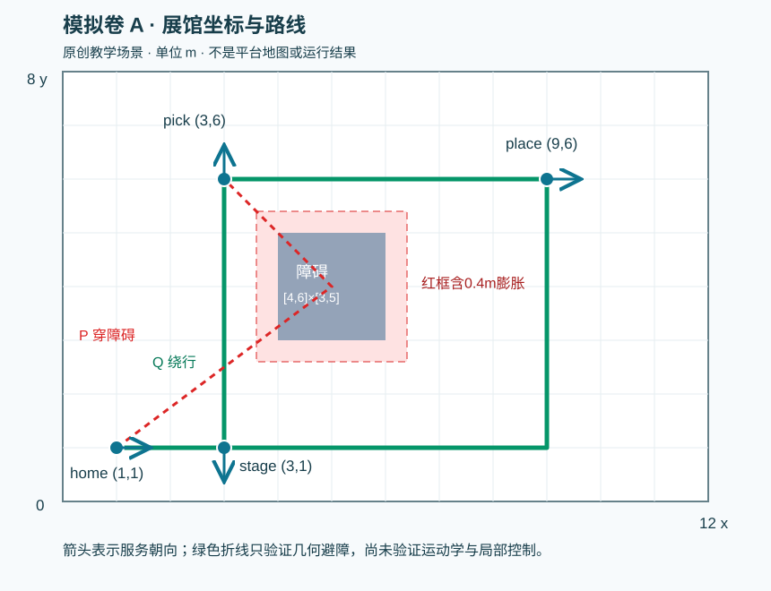

# 模拟卷 A：标准答案与平台操作对照

编制：2026-10-23。对应[14 省赛模拟卷A](14_省赛模拟卷A_机器人展会表演.md)。**本卷是原创赛前演练，下面是本卷题设下可核对的答案和自评分标准，不是官方未开放赛题的答案。** 未启动新的训练或仿真；文中真实练习结果均来自暂停前已归档的[12 实测手册](12_全任务实测与排错手册.md)。

先做题，再核答案。每题把“纸面正确、平台配置已保存、真实报告验证、仍未验证”分开记录。纸面100分不代表官方100分，也不代表你已经独立跑通机器人。全部新场景坐标和模型候选只在本卷成立；不能把它们直接填进真实任务9地图或任务14机械配置。

## 1 自评分总表与答案边界

| 模块 | 小题与分数 | 合计 |
|---|---|---:|
| M 运动 | M1 6、M2 8、M3 6 | 20 |
| N 导航 | N1 6、N2 10、N3 9 | 25 |
| V 视觉 | V1 8、V2 6、V3 6 | 20 |
| R 集成 | R1 12、R2 8、R3 9、R4 6 | 35 |
| 全卷 | 13小题 | **100** |

答案分三类：

- **确定答案**：由本卷条件唯一或直接确定，例如选模型A、地图240×160、四个yaw、坐标变换结果、约定的状态顺序和接口字段。按题设逐项核对。
- **满足约束的方案**：例如避障折线有多条，排错第一项检查也可能不同。能说明依据、满足全部约束并给出有效复验，允许等价答案，不要求背本文措辞。
- **实际练习参考**：任务3训练参数、任务9导航参数、任务14图形流程是同题已用过的配置。它们可以帮助复刻操作，但不自动成为新地图、新机器人或正式比赛的最优值。数据、模型、标定和运行失败另有边界。

以下每题分值都是本卷教学评分，不是官方模块权重。

本卷模型选择、栅格尺寸、yaw、障碍膨胀、坐标变换等确定数值已有[离线计算核对记录](sources/mock_20261023/offline_answer_checks.json)。该核对只是计算验证，不是机器人仿真或平台运行结果。

## 2 M：运动控制答案（20分）

### M1 构建决策单（6分）

**答案：** 先读机器人信息与预设舞蹈动作轨迹，再配置“观察值空间→动作空间→奖励值→重置条件→训练参数”，提交模型训练。模型完成后实际点击“查看”，核对名称、参数/状态及可用结果，再从仿真入口选择该模型运行，最后读舞蹈完成率、偏差与训练步数报告。这些阶段不能省略成“提交了模型，所以动作已经成功”。

对应练习任务3的真实机器人是H1。本账号基线如下；这是旧练习配置，**不是为抽象机器人E训练出来的新权重**。

| 项目 | 已保存的任务3基线 |
|---|---|
| 模型名 | `dance_baseline_100M_1022` |
| 观察量 | 躯干姿态、躯干角速度、全部关节角度、全部关节角速度；不勾躯干线速度与参考轨迹编码 |
| 动作输出 | 关节目标角度 |
| 平滑/控制 | 指数移动平均＋前馈控制 |
| 奖励 | 存活+1；躯干角度偏移惩罚系数0.01；位置偏移惩罚系数1 |
| 重置 | 角度偏差>30度或位置偏差>0.3m的联合条件；环境步数>1000 |
| 最大训练步数 | 100M |
| 学习率 / 批量 | 0.0003 / 4096 |
| 其他已记参数 | 熵正则0.005；4层、每层512；折扣0.995；单次交互最大步数2000 |

“环境步数>1000”的重置与“单次交互最大步数2000”是两个不同字段，照其实际名称记录，不能看见两个数就擅自改成一致。界面显示源码只能辅助理解，不证明后台逐行执行了这份代码。

参考轨迹为动作提供目标，前馈把参考动作信息用于控制，策略输出和关节反馈帮助修正偏差；平滑用于减少指令突变。不能只记下“关节角度”四个字而忽略这个输入—输出关系。

H1权重不能未经核对直接部署给E或G1：机器人关节数量与顺序、动作空间维度/尺度、观察向量顺序与归一化、关节限位、驱动和身体动力学可能不同；参考动作和模型运行格式也可能不匹配。即使文件能加载，也不意味着动作含义或控制效果正确。先确认题目提供的机器人与模型适配合同，再决定加载、迁移或重新训练。

原证据：[训练参数](sources/platform/live_20261022/task3_training.txt)、[重置条件](sources/platform/live_20261022/task3_reset.txt)、[三次历史报告](sources/platform/live_20261022/task3_compare_200M_report_1023.txt)。真实报告100M完成率100%、偏差6.71，两个200M报告偏差6.74、6.78；报告没给偏差单位，不把它们偷换成本卷M2人工表格的百分比。**三次运行报告不是三种舞蹈分别验证的证明。** 本题30度/0.3m是训练重置条件，不是官方推理评分中的偏差档位。

**评分点，共6分：** 完整操作顺序1分；四项观察量及两个未选项1分；关节目标角度和指数移动平均＋前馈1分；30度/0.3m联合重置及环境步数条件1分；100M、0.0003、4096三关键训练值1分；说明至少两类具体适配差异，明确不能直接换机器人加载1分。部分漏项可在该评分点内酌情给半分，不能把100%完成率写成最终100分。

### M2 模型选择（8分）

**选择A。** 本卷同时约束完成率、每一段偏差和训练预算，三项必须都满足，不是只挑偏差最小者。

| 候选 | 判断 | 依据 |
|---|---|---|
| A | 可以进入后续验证 | 三段均100%，7.1%/7.4%/7.8%都≤8%，100M≤100M |
| B | 不能按当前预算采用 | 动作偏差更小，但200M超过100M预算；“质量更好”不能覆盖资源约束 |
| C | 不能采用 | 第二段只有92%完成率，未达到每段100%；不能用三段平均完成率掩盖这一段失败 |

选A后仍要观察：是否中途倒地、打滑或明显失衡；关节是否突变、抖动或动作超限；是否自碰撞/碰到场地障碍；是否顺利结束并可进入下一动作阶段。题目只给了三个汇总指标，没有把全部物理现象都列出，因此选型合格仍不等于现场整链验证完成。

**评分点，共8分：** 选择A并逐项对照三条件2分；指出B只因预算不满足、不是偏差不合格2分；指出C第二段92%违反逐段完成要求2分；给出至少两种具体物理检查并说明仍需运行验证2分。只答“A”未解释，第一评分点最多1分。

### M3 奖励与新增参数（6分）

**正确公式：**

```python
reward = alive - w_pose * pose_error_sq - w_smooth * action_delta_sq
```

两种误差都非负、权重为正，要让误差越小越有利，就应作为扣分项。原公式给了正号，会使较大偏差和较大突变在这两个项上得到更高奖励。只奖励存活，则站着不倒但不跟随舞蹈也可能很有利；跟踪目标、动作平滑和存活应共同体现。具体权重过大或过小会改变取舍，题设没有要求猜一组唯一最优数值。

| 参数 | 正确理解 | 本题中不应混淆的对象 |
|---|---|---|
| `buffer_size` | 在相应训练实现中，收集一批经验后用于更新策略的经验规模；需读具体实现确认统计单位、采样与更新方式 | 不是机械臂缓存目标位置数，也不是关节刚度 |
| `batch_size` | 一次小批量学习更新用多少训练样本；通常从已收集经验中组成批次 | 不是机器人一次迈多少步，也不是运动速度 |
| PPO clip | 对新旧策略动作概率比的变化进行截断约束，在目标函数中抑制更新过猛；常见clip范围由一个ε控制 | 不是裁剪图像、夹爪开度或关节角限幅 |

PPO clip不等于“把所有网络参数直接限制在一个数值区间”；它作用于策略更新目标中的概率比。`buffer_size`、`batch_size`以及训练最大步数各回答不同问题，不用某个字段的默认值代替其他字段。

**评分点，共6分：** 两个惩罚符号正确2分；解释仅存活奖励的目标遗漏1分；buffer_size、batch_size、PPO clip的含义各1分。只说“调大更好”或把它们解释成机械控制参数不得该点分。

## 3 N：定位导航答案（25分）

### N1 建图与算法变化（6分）

**栅格宽240、高160。**

```text
宽 = 12m ÷ 0.05m/格 = 240格
高 =  8m ÷ 0.05m/格 = 160格
```

若以二维数组表示，一般可以写成160行×240列，但本卷问的是宽×高，答案为240×160。零起始的列索引通常是0—239、行索引0—159；不要因为原点计一次而多加一格。这里的世界y朝上，不意味着某个图像文件的行号也朝上，实际地图格式还需要核对原点、分辨率及图像坐标约定。

完整工作链可写为：

```text
检查传感器数据、频率、时间同步、外参与坐标系
→按本算法实际schema配置建图
→覆盖场景、控制运动质量，并让支持回环的方案建立和检查闭环
→保存原地图，预览覆盖和失真；如导航需PGM则按规则转换
→加载导航地图并初始化/核验定位
→配置全局规划、局部控制、代价地图和恢复行为
→设置服务航点位置与朝向并保存
→运行各目标导航，核对定位、到达、朝向、碰撞和完成反馈
```

不同算法或集成方案是否包含回环能力，必须看真实接口，不能看到“LIO”就默认回环实现完全相同。FAST-LIO变Point-LIO或LIO-SAM时，**不能整卡照抄旧算法配置**。至少重新核对以下三类，写出其中三类即可：

1. 传感器输入：雷达型号、点云字段/时间戳、扫描线或点序列、IMU频率与输入话题。
2. 时间与外参：雷达—IMU外参、坐标轴、时间同步/时间偏移、单位。
3. 噪声和滤波：IMU噪声/偏置参数、点云滤波尺寸、下采样、有效量程。
4. 求解与地图：迭代/优化方式、局部地图管理、关键帧/更新条件、回环模块是否提供。
5. 输出与导航：输出坐标系、地图格式/转换高度范围、导航所需地图及定位配置。

算法名称变化只提示需要重新核对，不能在没有schema时杜撰参数名和“万能数值”。

**评分点，共6分：** 宽240、高160各1分；操作链前后依赖完整且包含保存/转换、定位和验证2分；明确不整卡照抄并列出至少三类具体核对内容2分。后一点只给两类得1分，一类得0.5分；只说“看说明书”没有对象不得满分。

### N2 航点与避障（10分）

**第一问：yaw分别为0、−π/2、π/2、0。** 用目标减停车点，得到需要面朝的二维方向；`atan2(Δy,Δx)`保留方向所在象限，比直接用`atan(Δy/Δx)`更合适。

| 航点 | 方向差(Δx,Δy) | yaw标准值 | 含义 |
|---|---|---|---|
| home | (1,0) | 0 | 朝+x |
| stage | (0,−1) | −π/2，约−1.5708rad | 朝−y，即本图下方 |
| pick | (0,1) | π/2，约1.5708rad | 朝+y，即本图上方 |
| place | (1,0) | 0 | 朝+x |

stage写3π/2也表达同一朝向；如果如此作答，应说明按2π等价，不把它当较大的转向误差。正式点位是否支持任意yaw或只有图形旋转控件，要看当前界面。

**第二问：膨胀量0.40m，禁入区域为`[3.6,6.4]×[2.6,5.4]`，含边界。** 0.25m机器人半径＋0.15m余量合0.40m，按题目指定的保守矩形膨胀，四个边界各向外移0.40m。这里采用的是本卷明说的近似，不暗换成精确圆盘与矩形的圆角膨胀。

**第三问：选Q，拒绝P。** P中的(5,4)就在膨胀障碍内，必然不合格。Q为(1,1)→(3,1)→(3,6)，第一段y=1低于禁区下界2.6，第二段x=3小于禁区左界3.6，整条线不进入禁区。

几何折线只检查静态位置关系，没有证明机器人能按速度、加速度和最小转弯能力追踪拐点，也没证明定位误差、动态行人、局部代价地图、急停距离或控制器振荡已处理。真正执行时仍需局部规划/平滑以及到点与碰撞验证。

**第四问：一个可行示例是：**

```text
pick(3,6) → place(9,6) → (9,1) → home(1,1)
```

第一段y=6高于5.4，第二段x=9大于6.4，最后一段y=1低于2.6，均不与膨胀障碍相交。到place时仍需朝+x完成服务；返航后的朝向应满足home的目标方向。其他无静态障碍路线也可以，但必须逐段检验，而不是只看端点不在障碍内。



**评分点，共10分：** 四个yaw各1分，共4分；膨胀量0.40和完整禁区含边界共2分；选Q并给出P违规及Q各段理由1分，说明几何与动力学/局部控制边界1分；给出pick→place→home完整可行折线并逐段说明2分。坐标顺序、角度正负或漏“边界不安全”可扣对应部分分。

### N3 看懂到达与局部避障（9分）

**只有n2达标。** 本卷是三个条件逻辑“且”，不允许一个优势抵消另一个失败。

| 结果 | 判断 | 原因 |
|---|---|---|
| n1 | 不达标 | 位置和碰撞满足，但最短角误差3.14rad>0.15rad，机器人几乎背对目标 |
| n2 | 达标 | 0.10≤0.20m，0.08≤0.15rad，碰撞0 |
| n3 | 不达标 | 位置和朝向满足，但发生1次碰撞 |

窄通道来回摆动，先固定一个可复现的通道/目标并查看以下四层，不一次把所有参数都改掉：

| 检查层 | 首先看什么 | 为什么 |
|---|---|---|
| 全局路径 | 路径是否确实穿过可通行区域，是否在左右通路间反复切换，目标是否在不合理的位置 | 路线目标本身不稳定或不可行，局部控制难以补救 |
| 局部TEB或其他算法 | 当前算法实际可配置的轨迹、障碍/路径/目标权重及时间/可行性限制；输出是否在两种方案之间跳变 | 需使用当前算法自己的字段，不能把别的控制器参数直接搬入 |
| 代价地图/膨胀 | footprint/半径是否正确；膨胀后还有多少通行宽度；障碍更新、传感器噪声和定位是否使通道忽开忽闭 | 障碍建模不稳定会不断改变可行空间 |
| 速度/加速度约束 | 上下限、加减速、旋转约束是否可执行；过高速度是否导致刹不住/越过目标，约束是否与通道和控制频率匹配 | 几何上可通行，不代表给定速度下能平稳通过 |

不能把所有安全距离清零换取“有路”。应核实真实机器人占用、必需余量和可用通道宽度；一次只改有依据的一项或一组明确关联参数，用同场景对比是否仍零碰撞、位置/角度达标，并观察摆动是否减少。

**评分点，共9分：** n1、n2、n3判断及原因各1分；四层检查各1分；拒绝安全距离全归零且提出保持安全约束的检查1分；给出同条件、有限改动、看完整验收而非只看“走过去”的复验1分。

## 4 V：视觉与坐标答案（20分）

### V1 目标选择与数据流（8分）

**选d1。** d1类别为水壶，0.86≥0.50；d2虽然0.94更高，但类别是塑料碗，不能满足取水壶指令；d3类别正确但0.42低于阈值。本题不是在所有类别中选置信度最大的框。

```text
RGB图像＋已配准深度图
→检测/实例分割
→先按指令类别“水壶”并结合阈值筛选d1
→取d1的矩形框，或该实例的掩码
→用区域/掩码筛选有效深度，按相机模型生成水壶目标点云
→6D抓取估计得到候选夹爪位置与方向
→后续坐标变换、可达/碰撞检查、规划和实际抓放
```

| 阶段 | 输出类型 | 应核对的内容 |
|---|---|---|
| 检测/分割 | 类别、置信度及矩形框；分割另有像素掩码 | 框/掩码是否对应指令中的同一物体 |
| 目标裁剪 | 目标区域图像/深度区域/掩码 | 不能把整个RGB框图当成3D点云；框内仍可能含背景 |
| 深度到点云 | 三维点集合，附明确坐标系 | 有效深度、单位、配准和范围是否合理；非空不保证全是目标 |
| 6D抓取 | 候选位置＋方向及可能的质量/开度等属性 | 候选存在不代表机器人能到达或能稳稳抓住 |

单纯分类网络只能回答“图里可能是什么”，通常不给目标的空间框/实例区域，更不给物体三维几何与夹爪接近方向，因此不足以完成本题抓取定位。

蓝盒分支寻找的是**放置目的地**：彩色图按蓝色定位中心/区域→结合深度得到3D位置→依约定补成放置位姿并变到基座系。它返回`Pose`供放置动作使用，不能返回水壶的目标点云替代盒子位姿。水壶分支的点云给6D抓取估计器决定怎么夹物体，蓝盒分支给放置目的位置，两者用途和输出类型不同。蓝盒中心点本身也不自动保证放置方向、安全高度和可达性合格。

**评分点，共8分：** d1及排除d2/d3的理由2分；完整筛选—裁剪/掩码—深度点云—6D链并说明不同输出类型3分；指出分类缺空间/3D定位能力1分；说明蓝盒与水壶两个分支用途和返回值差异2分。

### V2 像素、相机、基座（6分）

这是独立于V1检测框的单独算例，不能拿V1的d1框检查本题像素是否落框。针孔模型中，深度Z已明确沿光轴；因此：

```text
X_camera = (u - cx) × Z / fx = (380 - 320) × 1 / 600 = 0.1m
Y_camera = (v - cy) × Z / fy = (240 - 240) × 1 / 600 = 0m
Z_camera = 1m
p_camera = (0.1, 0, 1.0)m
```

使用列向量和题目明确的相机→基座变换：

```text
[x_base, y_base, z_base, 1]^T
= T_base_from_camera × [0.1, 0, 1, 1]^T
= [0.1+0.2, 0, 1+0.5, 1]^T

p_base = (0.3, 0, 1.5)m
```

这里只算出一个三维点，缺少夹爪的三个方向自由度、开合/接触位置与进近方向；还需正确的工具/腕关节关系、机器人运动学和限位，以及IK、碰撞、轨迹和真实夹持验证。物体中心或盒子中心一般不能直接冒充完整6D夹爪姿态。

若上游已经返回基座系位姿，下游**不能再乘这同一个相机→基座矩阵**。坐标变换两端必须与数据当前坐标系匹配。对本题点重复乘会错误得到(0.5,0,2.0)m，平移被加了两次；有旋转时还会重复旋转。需要的是保留数据所处坐标系、只在需要换系时用方向正确的变换，而不是“每经过一个节点都乘一次TF”。

**评分点，共6分：** 相机点(0.1,0,1)m及投影过程2分；基座点(0.3,0,1.5)m及正确矩阵方向2分；指出点不足以构成完整可执行抓取姿态1分；明确已在基座系不能重复同一TF并说明原因1分。

### V3 数据与指标（6分）

相邻视频帧高度相似，把它们随机分进训练和验证，可能让验证集含几乎见过的场景、人物和动作时刻，结果偏乐观。**本题目前只有一段视频，无法直接按视频分组得到独立训练与验证集，需补采独立拍摄序列。** 资源补齐后以视频/拍摄序列为组先划分，再在组内抽帧；若目标是跨人物或跨场景泛化，也应隔离相应人物/场景。训练集用于学习，验证集用于调参，最终独立测试集保持不参与调参。

若暂时只能用当前单视频，可按连续时间块划分并在两块间留出足够时间间隔，减少近邻帧重叠，作为有限的时段诊断；它仍共享场景/拍摄条件，不能宣称验证了独立场景泛化。具体间隔应结合动作持续时间和视频相关性判断，不能凭空给一个通用秒数。

需覆盖的变化至少三类，例如：明暗与光照方向、观察距离/物体尺度、相机角度与姿态、遮挡/背景杂乱、不同物体实例或人物、动作阶段/速度。只做重复近邻帧并不等于有足够独立样本；增加变化也必须保持标签正确。

“分割mAP=.976，所以抓放必定成功”**不成立**。mAP说明特定验证口径下分割/识别部分的汇总表现，既不是单张图100%正确，也没有验证后面的系统。可能继续失败的环节包括：

- 裁剪选错实例或深度无效，使目标点云不正确。
- 6D候选为空、接触位置不稳、夹爪方向/开合不合理。
- TF方向/单位/相机与机器人资源不匹配。
- 目标IK不可解或路径规划碰撞/超时。
- 已移到目标却没抓住、搬运打滑，或释放没有进盒。

写出其中三个不同环节即可。真实任务11分割mAP0.976但完整抓放2/5，任务12同一显示mAP0.976但首轮0/4；这些是历史例子，不是本题新仿真，也不能据相同指标断言两个任务后台模型或数据完全相同。

**评分点，共6分：** 指出近邻帧泄漏/相关性风险1分；指出单视频缺少独立组、提出补采后分组评估1分，并说明单视频时间块仅有限诊断或独立评估的必要边界1分；至少三类变化1分；明确高mAP不推出全链成功1分；举出三个具体后续失败环节1分。

## 5 R：ROS集成、抓取与排错答案（35分）

### R1 消息合同与状态机（12分）

**先统一本卷合同。** 本卷`_finish`字段为大写开头的`Is_Finish`，与本账号实际任务14使用的`is_Finish`不同；做本卷应按本卷统一，复刻任务14按现存通信定义统一，不能在同一实现里混成两个名字。

| 通道 | 本卷类型/字段 | 数据或事件含义 |
|---|---|---|
| `_nav` | Navigation_Address：字符串 | 例如stage、pick、place、home的航点名 |
| `_locate`服务 | 请求两个字符串：Detect_Type取“物体”或“颜色”，Detect_Name为对象名或颜色名；响应Point_Cloud为点云，Pose为位姿 | 物体支消费相机系点云；颜色支消费基座系放置位姿，必须按分支核对有效性 |
| `_grab` | Hand：布尔；Pcloud：点云 | 把视觉返回Point_Cloud转发至这里的Pcloud，字段名并不相同 |
| `_deploy` | Hand：布尔；Fpose：位姿 | 基座系放置位姿，不能再当相机系变换一次 |
| `_dance` | Model：适配性已核对的标识 | **本卷新增模拟接口**；没有证明任务14界面已有这个指令块 |
| `_finish` | Is_Finish：布尔 | 只有当前动作按约定成功后才能true；失败/超时不能冒充成功 |

下表严格使用本卷0—10/F。`成功`是指当前阶段的验收条件已满足；不是“回调函数执行过”。发下一命令前先写入下一状态与期望事件，所有动作失败、超时或返回数据不合格都进入F，并记录原因；不继续推动后面的成功链。

本卷指定左手并假设目标可达，故抓取与放置都使用`Hand=false`；这里只是题设假定，不证明真实左臂可达。视觉请求**超过5秒未返回**、物体支空点云或颜色支无效Pose，都进入F；5秒是本卷规定，不是实际平台的统一超时。动作返回false或超时同样进入F。

| 状态 | 正在等待什么 | 当前成功后的处理 | 失败/异常处理 |
|---:|---|---|---|
| 0 | 一次合法start；没有待完成动作 | 清理本轮结果、记录本轮标识/预期；设1，发_nav(stage) | 不合法输入留在0并提示；资源检查失败则F；运行中重复start不能再起一条链 |
| 1 | 到stage且位置、朝向、碰撞条件合格后的导航完成 | 设2，发_dance(经适配核对的模型) | 导航失败/超时/碰撞或朝向不合格→F |
| 2 | 舞蹈完整执行并符合运动验收的完成事件 | 设3，发_nav(pick) | 摔倒、提前结束、偏差不合格或超时→F |
| 3 | 到pick且朝向适合感知/抓取的导航完成 | 设4，请求_locate(物体, 水壶) | 明确失败、超时或完成结果不合格→F；未返回且未超时则保持等待 |
| 4 | **视觉服务响应**：正确水壶的有效相机系Point_Cloud | 记住本轮左手Hand=false；设5，发_grab(false, Pcloud=响应Point_Cloud) | 请求超过5秒、错误目标、空/无效点云、坐标系不符→F |
| 5 | 水壶实际抓取成功的动作完成反馈 | 记录已持物；设6，发_nav(place) | 机械臂运动失败、没抓住、持物状态不成立或超时→F |
| 6 | 携物导航到place并满足位置/朝向/无碰撞条件 | 设7，请求_locate(颜色, 蓝色) | 导航失败、碰撞或持物异常→F |
| 7 | **视觉服务响应**：蓝盒有效基座系Pose | 设8，发_deploy(false, Fpose=响应Pose)，沿用抓取左手 | 盒子定位失败、位姿无效/坐标系不符、请求超过5秒→F |
| 8 | 物体实际释放进蓝盒的完成反馈 | 记录已放入；设9，发_nav(home) | 到位但未释放、释放未进盒、碰撞或超时→F |
| 9 | 回home且位置、朝向、碰撞条件合格的导航完成 | 复核本轮全部阶段成功；设10 | 返航失败或此前结果缺失→F |
| 10 | 没有新的待完成动作；本轮整体成功 | 只播报一次完成并保持本轮结果；是否回0由明确复位/新一轮规则处理 | 不接受旧回调重新推动流程；若验收发现结果矛盾则转F，不能强行播报 |
| F | 失败/等待人工诊断 | 保留失败阶段、输入、结果和日志；经明确恢复策略后才重新开始或恢复 | 不发整体成功播报，不自动跳过失败步骤 |

状态4、7等待服务响应；状态1、2、3、5、6、8、9等待动作完成。0/10/F不是等待下一条普通动作回调的状态。视觉服务拿到数据后再发动作，不能把“已发服务请求”当成数据已经返回。

**只有布尔标志时的限制：** 最低可用假设是同一时刻只有一个待完成动作，完成消息来源/次序受控，不会有上一轮或上一步的延迟/重复true混入；master还必须检查当前状态与期望完成类型。单靠一个没有身份的布尔字段无法可靠区分所有跨轮旧回调，不能声称已彻底防重复。失败信息若没有字段承载，就应由模块内部状态/调试记录及超时机制进入F；不能沉默地等待永远不来的true，也不能把false按成功处理。

**若协议允许扩展，建议设计：** run_id标识本轮，command_id/step_id标识具体命令，source/action_type区分来源，success与error_code说明结果。发命令前登记期望ID；回调只接受匹配的未完成命令，处理后标记已消费，重复ID忽略，过期ID留日志；超时或错误进入F。这是本卷设计答案，**不是已确认平台支持这些新增字段**。若平台不能扩展，只能遵守它允许的接口，并如实保留布尔合同的局限。

**动作回调与实物验收：** 导航回调要建立在实际到点条件上；机械臂到位回调之后还要完成夹爪动作和持物/放置验收。若平台没有暴露相应传感或字段，不能凭空造一个传感器输出；用实际可得报告判断，或记“待验证”，不能把未知转换成成功。R3的f4正是违反了这个条件。

**评分点，共12分：** 消息名称/类型/字段统一1分，点云与位姿坐标系及Pcloud转发关系正确1分；12个状态行每行0.5分共6分，要求等待对象、正确后继和失败边界合理；服务响应与动作等待分清1分，机械臂回调与真实抓放结果分清1分；说明布尔方案适用假设及无法彻底去重1分；提出可行的匹配/去重方案并标为协议允许时的扩展1分。把真实任务14的1/3/4等原状态表直接复制成答案，不能获得本卷状态表分。

### R2 抓放搭建与资源核对（8分）

**抓取链：**

```text
从_locate响应接收水壶相机系点云
→_grab.Pcloud转入Grasp_Point_Cloud
→按本卷Hand=false选left_arm与left_gripper
→适配本题的6D模型估计夹爪候选位置/方向
→用本题相机TF及必要的工具/腕关节关系转成规划需要的目标
→核对目标、IK、关节约束、障碍点云和碰撞
→规划并执行接近/抓取动作
→到位后闭爪
→核对确实持有目标，再发布本阶段成功
```

**放置链：**

```text
从_locate颜色响应接收蓝盒基座系Pose
→_deploy.Fpose转入放置变量
→选择与抓取相同的Hand/臂/末端
→根据本题合法的放置姿态、工具关系和安全条件检查并规划
→机械臂移动到放置目标
→到位后张开夹爪
→核对物体已在蓝盒内，再发布本阶段成功
```

蓝盒位姿已经是基座系，不再次加相机→基座TF。至于是否还需根据TCP、腕关节或特定平台节点做工具变换，要由当前接口定义决定，不能把“不重复相机TF”误解成“任何工具关系都可忽略”。

| 资源/概念 | 使用位置与作用 | 核对重点 |
|---|---|---|
| 相机TF | 把相机系候选/点变成控制需要的坐标系 | 机器人、标定来源、方向、单位和时间/静态关系 |
| 6D模型 | 从目标点云估计可夹持的位姿 | 输入点云格式、尺度、坐标系、物体和夹爪适用性 |
| 规划组 | 指定被求解和控制的连杆/关节集合 | 左右臂不能混组，关节和末端归属正确 |
| 末端执行器 | 把夹爪/手与相应臂关联 | 父连杆、父规划组及实际打开/闭合对象 |
| IK | 由目标位姿求关节配置 | 可达、关节限位；有IK解也不保证存在无碰撞路径 |
| 障碍点云/OctoMap | 为规划提供环境占用 | 对齐坐标、感知范围、更新、分辨率/膨胀，不把所有安全约束清零 |
| 夹爪动作 | 到位后闭合抓取、到放置位后张开释放 | 开合对象、顺序、开度及物体是否真实被持有/放入 |

本卷指定false左手完成水壶取放，并假定目标在左臂可达空间，标准答案不能擅自改成true右手。实际机器人仍要检查左臂可达性；若真实题资源不同，应按题设重新确定。不能仅因盒子在身体另一边就在放置时切换到空手。

V2只给了一个点与一个纯平移矩阵，没有完整夹爪姿态、URDF/运动学、标定链或候选集，因此不能输出“精确六轴角度+保证成功”的答案。真实任务12的四规划组/六姿态/两末端是操作参考，六姿态只有滑杆截图，没有可抄录的完整角度，不能按像素推算一套精确数。

真实资料入口：[任务14抓放与左右手](03_任务14实战攻略.md)、[操作映射第6节](sources/mock_20261023/practice_mapping.md)。任务14 R1历史8/8，G1仍6/8；任务10基线2/7、任务11为2/5、任务12为0/4完整抓放。引用这些配置时必须一并保留失败边界，不把同题已保存参数称为未知场景标准必过答案。

**评分点，共8分：** 抓取链覆盖点云、选手、6D、换系/规划、闭爪与结果验证3分；放置链使用基座系目标、不重复相机TF并正确释放2分；七类资源作用说明基本完整、能分清IK与路径规划2分；取放同手且明确数据不足/回调不等于成功1分。允许结构等价的顺序，但不能先报成功再闭爪。

### R3 四段故障报告（9分）

这些日志是本卷构造的题目数据。诊断应停在证据能支持的位置，不从一条末端错误反推出唯一根因。

| 案例 | 最早有证据的失败 | 第一项检查及受控尝试 | 什么结果才支持修复 |
|---|---|---|---|
| f1 | 6D阶段没有生成可用候选，机械臂尚未接到目标；不是“机械臂已经碰撞” | 保存同一目标点云，核对6D模型要求的点云坐标/单位/尺度及输入；查看候选生成与过滤原因。非空点云仍可能含背景或有效目标点不足，不能仅凭非空排除数据问题 | 同一输入能产生合理且通过质量/碰撞条件的候选；随后能传到运动端。若要称整题修复，还必须实际抓起并完成搬运/放置，不能只见候选非空 |
| f2 | 规划搜索超时，尚未执行轨迹；已知目标IK可解 | 先看规划时间预算、规划器状态和碰撞环境，确认超时发生在哪一步；保持目标和场景不变，才考虑有依据地增加搜索预算或调整规划设置 | 获得满足约束的无碰撞轨迹，实际执行成功，并检查终点、持物及任务结果。IK有解不等于路径一定存在；延长时间仍失败就不能声称时间是唯一原因 |
| f3 | 到点结果已合格，但导航完成回调未调用，完成事件链断了；master因此停3 | 查“导航到航点”的完成回调是否绑定nav_finish_callback、函数是否保存/模块提交，以及到达事件是否真的被导航接口触发 | 在同一导航目标下，完成回调实际执行，忙标志清零，发送符合合同的完成消息；master由3进4并发水壶定位请求，且无重复跳转 |
| f4 | 物品未附着/未实际抓住，却发布true；动作结果验收与成功消息不一致 | 先阻止object_attached=false时发布成功，检查成功判定绑定；再针对同目标检查夹持、开度、接触和抓取姿态。不能只改master让它继续走 | 持物结果确认为真之后才发成功并进6；负例false应进入F而不是进6。最终需验证搬运和放入，不把闭爪函数执行当作持物证明 |

f1中“目标分类正确、掩码非空、点云非空”不能唯一证明点云质量合格或6D模型有问题；f2的TIMEOUT也不能证明只需增加时间，目标可能被环境约束隔开。标准答案是有证据的定位与可检验的下一步，不是给每个故障编一个确定根因。

真实任务12历史仅将规划时间上限3→5，保存并启动对照后报告尚未回读；字段截图未注明单位。**不能写“改为5就修复”。** 更长搜索时间也不能直接为f1这类缺失抓取位的输入造出有效候选。需要保存修改前后配置、保持可比条件、取得新报告逐项核对，才可以认定改善或无效。

**评分点，共9分：** f1—f4各2分，每案最早失败定位0.5分、针对性的第一检查0.5分、明确能支持修复的复验标准1分；正确拒绝将真实3→5未读对照写成已证修复1分。合理的另一项首查可得分，但不能无视题中明确证据，例如把f2写成“尚未求IK”或把f3写成“机器人没到点”。

### R4 保存、回读与验收（6分）

结束前六项检查如下，每项都要有对应记录，不只打“完成”勾。

| 检查项 | 应留下的证据/处理 |
|---|---|
| 1 资源匹配 | 机器人、数据集/模型名称、地图、标定、坐标系、规划组和左右手对应一致；新模拟资源与真实旧练习资源分开 |
| 2 参数保存 | 数据/模型/标定/节点/规划等分别见保存或提交成功，并返回列表/重开读取关键值；输入过数值不等于服务端已保存 |
| 3 连线持久化 | 看完整方向与端点，保存后关闭重开，逐边核对；只数节点或只凭旧截图不够 |
| 4 逐阶段结果 | 模型指标、内部测试、到点/朝向/碰撞、抓住/放入与整体流程分别核对；记录失败和未验证，不能由进度100%替代 |
| 5 变更日志 | 哪个版本、改了什么、为什么改、场景/输入是否一致、结果及最后保留值；不要把“准备恢复”写成已恢复 |
| 6 最终提交边界 | 区分训练/函数/模块保存和最外层锁定评分；本轮模拟停在过程报告和答题单，不点会锁定实验的最终提交 |

发现重开丢线时，先记录当前缺线，按题目恢复真实需要的边，不重复堆节点。已有任务11有效操作为：**画完边后选一个节点，点击右侧参数“确定”，等待保存成功，再关闭重开逐边检查**；先少量试一条边确认持久化，再补齐其余边。任务11曾“节点参数先保存→后画边”导致重开只有孤立节点，不能把画布出现过箭头当作保存证明。

这个具体按钮经验适用于已观察到的任务10—12流程编辑器，不强推给所有平台页面；任务14则是齿轮参数确认、函数提交、节点模块提交等层次。若当前UI变更，应依据实际页面重新辨认保存动作。流程面板重开验证也不等于所有模块都完成了整页重载验证。

**评分点，共6分：** 表中六项各1分；第三项要取得完整1分，需说明丢线后的“连线后再保存→见成功→重开逐边核验”步骤。把“点提交”当作全部保存验证，或建议用最终评分按钮解决丢线，不得相应项分。

## 6 从本卷答案回到真实平台：完整复刻对照

当前无需登录即可做题。以后自主复练时按下表进入**真实旧题**；沿用各题已有对象，先核对保存状态，不为看本卷答案就覆盖现存模型或标定。所有最终锁定评分仍未提交。代理实操暂停，没有因编制本卷恢复。

| 对应题/能力 | 真实入口与操作顺序 | 保存与来源回读 | 用什么验收，已有结果是什么 |
|---|---|---|---|
| M1 运动构建 | 任务3→训练模型构建→看机器人/预设轨迹→观察/动作/奖励/重置/训练五页→提交训练→完成后查看→选模型仿真→报告 | [官方任务3](sources/platform/任务3_当前平台指导书.pdf)、[训练值](sources/platform/live_20261022/task3_training.txt)、[重置](sources/platform/live_20261022/task3_reset.txt)；核对模型名与状态 | [历史三次报告](sources/platform/live_20261022/task3_compare_200M_report_1023.txt)：100M、200M、200M均舞蹈100%；偏差6.71/6.74/6.78，单位未标，不作最终满分 |
| M2 选择模型 | 同上，在仿真入口选择具体已完成模型；本卷A/B/C只做纸面选型，平台没有已创建的同名候选 | 真实模型为dance_baseline_100M_1022与dance_compare_200M_1022，不把A候选当已训练权重 | 同时检查完成率、偏差、预算及动作；真实200M没有显示优于100M，不声称更长必然更好 |
| M3 奖励/训练参数 | 任务3奖励和训练参数页；可用“查看源码”理解，但未确认是可编辑源码入口 | [界面显示源码](sources/platform/live_20261022/task3_baseline_displayed_code.txt)与[08源码说明](08_实操记录.md)；buffer/clip若只在显示文本中出现，不伪造表单按钮 | 纸面改公式不等于后台代码已修改，更不等于模型已重训；新增参数只按真实schema使用 |
| N1 建图 | 任务9→建图与导航→选建图策略/路线→生成PCD并预览→转换PGM并预览 | [官方任务9](sources/platform/任务9_当前平台指导书.pdf)、[策略回读](sources/platform/live_20261022/task9_strategy_readback.txt)、[地图列表](sources/platform/live_20261022/task9_maps_completed.txt) | nav9_basel点云完成，nav9_pgm可预览；本卷12×8m栅格只是教学数据，不是这张实际地图尺寸 |
| N2 航点 | 任务8/9底栏航点文字或图钉长按拖出→确认新标记→调朝向→航点模块右上提交→回列表重开 | [任务9十点保存](sources/platform/live_20261022/task9_ten_waypoints_saved.txt)、[点位方向图](sources/platform/live_20261022/task9_ten_waypoints_orientation_adjusted.png) | 任务9十点已有到达报告，未单列合理性分；任务8仅一个草稿、17点未齐。不能把本卷四点坐标填入旧图 |
| N3 导航控制 | 任务9首页导航规划→代价/规划恢复/控制/AMCL四页→提交策略→关闭重开→仿真验证选地图 | [全部30参数与按钮映射](sources/mock_20261023/practice_mapping.md)第3节；以四份readback文字为保存证据 | [真实报告](sources/platform/live_20261022/task9_simulation_report_baseline.txt)：地图92%、十目标到达、碰撞0。它没有证明本卷n1/n2/n3真实运行过 |
| V1 框与下游识别 | 任务5检测算法构建→训练数据构建→标框赋类→保存/核数量→训练/查看→采集、YOLO、截取及下游节点→内部测试/仿真 | [任务5参数](sources/platform/live_20261022/task5_training_config.txt)、[已测三流程](12_全任务实测与排错手册.md)任务5；抓取用实例分割可转任务11/12模型构建→SAM→逐实例赋类 | [任务5调整报告](sources/platform/live_20261022/task5_simulation_report_threshold042_resize640.txt)有改善仍低conf；本卷d1/d2/d3是人工数据，不是新检测输出 |
| V2 深度/TF | 任务10—12手眼标定→不同姿态拍照并记录15组→标定模块提交→抓取流程构建的核心参数→对应节点矩阵 | [任务10核心](sources/platform/live_20261022/task10_core_parameters_refreshed.json)、[任务11核心](sources/platform/live_20261022/task11_core_parameters.json)、[任务12核心](sources/platform/live_20261022/task12_core_parameters.json)；不跨题复制 | 本卷明确的纯平移算例不能替代真实标定；任务11核心与流程字段名称有未澄清差异，保留原名不随意求逆 |
| V3 数据/指标 | 任务4分类、任务5检测、任务6行为或11/12分割数据面板→样本/视频检查→赋类保存→训练查看→下游验证 | [任务11分割指标](sources/platform/live_20261022/task11_seg_model_metrics_and_displayed_code.txt)、[数据/模型边界](12_全任务实测与排错手册.md) | 高指标不能代替运行；任务11分割mAP.976但报告2/5完整抓放，任务12首轮0/4。平台是否允许自定义划分需看实际界面，不造划分按钮 |
| R1 消息/状态机 | 任务14ROS节点编写→配置文件和其他资源→四节点变量/函数→init通信绑定→各函数图形块/齿轮参数→函数提交→节点模块提交→仿真Debug | [官方任务14](sources/platform/任务14_当前平台指导书.pdf)、[03完整字段和流程](03_任务14实战攻略.md)、[已存真实状态图](sources/platform/live_20261022/task14_master_state_machine_saved.png) | 真实任务14状态编号与本卷不同，_finish实际字段is_Finish；_dance和run_id等扩展未证实可用，不能假装本卷已导入 |
| R2 抓放配置 | 10/11/12：标定→模型构建→抓取流程；12另做机械配置/功能预览。14：用题内已有模型/地图/标定，接vision与arm | [10流程参数](sources/platform/live_20261022/task10_flow_parameters.json)、[11](sources/platform/live_20261022/task11_flow_parameters_baseline.json)、[12](sources/platform/live_20261022/task12_flow_parameters.json)、[12机械刷新](sources/platform/live_20261022/task12_mechanical_after_browser_reload.png) | 历史10基线2/7、11为2/5、12为0/4；14 R1 8/8、G1 6/8。不能称全部成功，不能跨题共享相机矩阵 |
| R3 故障定位 | 局部测试读输出；综合仿真看Debug函数/变量、最早失败和完整报告；同条件对照有限改动 | [任务12基线报告](sources/platform/live_20261022/task12_simulation_report_baseline.txt)、[时间5保存图](sources/platform/live_20261022/task12_planning_time5_trial.png)、[14减速报告](sources/platform/live_20261022/task14_g1_speed50_report.txt) | 时间5结果未读，当前仍5；G1速度50%未改善，已恢复100%回读。不得把“试过”当“修复” |
| R4 保存/交付 | 数据/标定/航点/函数/机械模块分别保存；流程画边后再确认；关闭重开核对象、参数和边；归档版本与报告 | [任务11连线保存](sources/platform/live_20261022/task11_flow_save_after_edges.txt)、[重开完整图](sources/platform/live_20261022/task11_flow_all_edges_persisted.png)、[12最新14边](sources/platform/live_20261022/task12_flow_reopened_14_edges_verified.png) | 完成过程验收后仍保留可修改练习；不点首页最终锁定评分。网页学习勾选和代理操作均不证明你已独立掌握 |

## 7 学完本卷后应能独立说清什么

不要求背所有参考数字，要求能说明“这个值解决哪一层的问题、数据从哪里来、怎样知道确实保存和运行正确”。至少能用自己的话回答下面五项：

1. 从展区航点到舞蹈、视觉、抓放和返航，哪个事件推动下一个阶段？哪一步失败必须停下？
2. 一个图像框、目标点云、相机系位姿、基座系位姿与关节配置有什么区别？哪里要TF，哪里不能重复？
3. 动作完成率、模型accuracy/mAP、函数执行记录、真实物品入盒，各能证明什么、不能证明什么？
4. 新题换机器人、地图、对象和参数菜单时，哪些操作习惯可复用，哪些具体资源必须重新核对？
5. 平台配置保存、连线持久化、训练提交、过程报告与最终评分分别在哪里发生？

若某项仍说不清，回读对应小题和[11 速通路线](11_速通版完整学习路线.md)，再对照[12 实测记录](12_全任务实测与排错手册.md)解释一个成功例和一个失败例。正式比赛按赛事纪律由队员独立完成；本卷、学习站和Chat辅导用于赛前。
