# 图像与动画速通导读：把十二站变成十二幅记忆图

更新：2026-10-24。本篇配合超级速通看板 S00—S11 与 [18 全能图形化任务链](18_超级速通_全能图形化任务链.md)。目的不是背住界面截图，而是看到一类界面就知道“这一层解决什么、要读哪一个输出、下一步在等谁”。

**三种画面要分清：** 官方题面或规则页说明要求；本账号历史截图说明当时的操作或报告；新画的示意图与动画帮助理解概念，不是平台实测，不是正式赛题。下面的截图均为2026-10-22至23暂停前历史材料。任务14由用户重置后自行练习，旧图不能说明重置后的节点、参数或成绩。代理平台操作仍暂停。

## 先看图，再闭眼说，再做一道题

先用图片或动画建立空间印象，再回看看板上的输入输出。每一站只做一个短循环：看图十几秒，遮住图，口述一句“输入是什么，输出是什么，什么反馈允许下一步”，再做看板小题。说不出来就返回对应积木，不靠反复播放获得“似乎听懂了”的感觉。

看视频时建议随时暂停，不必追求一次看完。听到不懂的词时记下 S 编号和原话，随后在“带去 Chat 问”中复制当前学习上下文。配音帮助形成第一印象，准确字段、单位和接口仍要回到讲义核对。整个学习过程用于赛前。

## 配套速通动画：先获得印象，再回来解释

[打开速通动画播放器](video/player.html)。这套动画按 S00—S11 分为12章，配有72句中文合成配音，7分52秒。它是原创教学示意，不是实训平台录屏，也不是正式试卷；配音和动画用于建立概念印象，不能替代题面核对或实操验证。

建议先按顺序看一遍，之后用播放器的章节选择返回薄弱环节。可以暂停、调整倍速，再回到 [超级速通看板](../ICAN备赛学习站.html#sprint) 做对应 S 站题目与积木演练。手机上优先横屏或全屏观看，图中的细字也可回本篇和看板放大查阅。短片无需记住所有参数，重点记住哪一步需要哪一种输入、哪一类反馈。

| 动画章节 | 首遍只抓住这一个印象 | 看后返回 |
|---|---|---|
| S00 整体链 | 接任务、到位、做事、核结果、再推进 | 看板 S00 的完整链与三个层级 |
| S01 积木 | 时机和数据是两类依赖 | S01 的类型、条件、保存回读 |
| S02 运动 | 奖励塑造行为，训练完成还要验动作 | S02 的观察、动作、奖励与参数 |
| S03 视觉 | 标签、框、掩码、点云的用途不同 | S03 的按类别筛选与下游输入 |
| S04 地图 | 环境地图与机器人当前定位不同 | S04 的地图质量和定位检查 |
| S05 导航 | 路线之外，还要方向正确 | S05 的位置/朝向与全局/局部 |
| S06 坐标 | 物体没动，换了描述它的尺子 | S06 的3D点、6D位姿、TF一次 |
| S07 抓取 | 有候选、可达、有路、夹住是不同关口 | S07 的分层检查和抓取积木 |
| S08 ROS | 节点靠约定好的消息合作 | S08 的话题、服务和字段合同 |
| S09 回调 | 只有匹配的完成反馈才翻到下一页 | S09 的状态与无关消息处理 |
| S10 排错 | 先找最早失效层，别同时改十项 | S10 的单项对照和结果证据 |
| S11 协作 | 三人有主责，人人能解释整条链 | S11 的资源、接口和结果交接 |

视频解释的是概念关系，图中运动和路径没有进行物理验证；其中的3D抓取示例也不是所有2D抓取题的固定模板。话题可以连续发布，也可以发送一次消息，不能只根据频率判断它是不是服务。

带去 Chat 的短问法：

> 我在看 ICAN 超级速通动画的【S编号】，原话是“【复制或转述那一句】”。我目前理解为【用自己的话写一句】，但不懂【具体卡点】。请用该章的图像类比、一个积木输入输出示例和一个错例解释，再让我口述检查；先不要跑平台实验，也不要把教学示意当官方赛题。请结合仓库的20图像导读、18课程和19辅导手册回答。

## 十二幅记忆图总览

| 站点 | 记忆画面 | 看图时盯住哪里 | 一句自问 |
|---|---|---|---|
| S00 整条链 | 接力棒从任务单传到导航、视觉、机械臂，再回总控 | 每支箭头交付什么，哪一支箭头是反馈 | “看见杯子”和“拿到杯子”之间还缺几层？ |
| S01 图形积木 | 两条线：什么时候做，以及拿什么做 | 执行先后、输入类型、条件、回调和最后保存 | 把积木摆在右边，它就一定后执行吗？ |
| S02 运动 | 观察→策略→动作→环境→新观察的环 | 奖励想鼓励什么，实际动作是否稳定 | 奖励曲线上升，能否直接宣布新舞蹈合格？ |
| S03 视觉 | 同一物体的标签、方框、轮廓、点云和位姿 | 下游究竟要类别、位置还是完整抓取姿态 | 目标是水壶，最高置信度却是碗，该选谁？ |
| S04 建图与定位 | 地图是一张纸，定位是纸上的“我在这里”箭头 | 地图有没有错位，机器人箭头是否落在正确位置 | 已经有地图，为何仍可能无法导航？ |
| S05 导航 | 一条绕障路线，终点带朝向箭头 | 位置误差与朝向误差都要满足要求 | 到了桌边却背向桌子，算完成了吗？ |
| S06 坐标与标定 | 同一个杯子，用相机尺和基座尺读出不同数字 | 输入坐标系、输出坐标系、单位与变换次数 | 三维点为什么还不是完整六维位姿？ |
| S07 抓取 | 目标→候选→可达→路径→执行→真夹住的六道门 | 第一扇没有通过的门 | 抓取候选为空，增加规划时间能补出候选吗？ |
| S08 ROS通信 | 广播话题和请求—响应信封 | 发送者、接收者、字段名、类型、坐标系 | Point_Cloud 与 Pcloud 能随意互换吗？ |
| S09 状态回调 | 红灯等反馈，匹配成功才亮绿灯 | 当前阶段期待哪个机器人、哪种完成事件 | 刚发导航命令，就能进入抓取了吗？ |
| S10 排错 | 一串检查灯，从前往后找第一个熄灭的灯 | 上游是否真的输出了下游所需数据 | 模型指标高，但报告写“无抓取位”，先查哪里？ |
| S11 三人协作 | 三人各负责一段，但拿着同一张交接表 | 资源版本、输入输出、已验证结果和未解问题 | 换人接手时，怎样避免只说“我这边好了”？ |

上表的接力、灯号和六道门都是教学类比，不是平台固定控件。正式四模块、任务14四节点、建议三人分工是三个层级。

## S00—S01：先认职责，再读连接

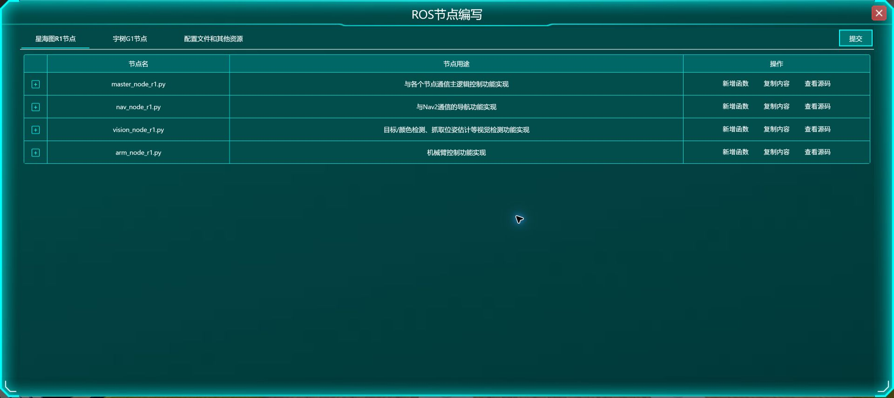

**历史截图读法：** 找 `master`、`nav`、`vision`、`arm` 四行。它们是软件职责，不是四台机器人，也不是正式四模块的另一套名字。总控发起任务，导航回答怎么到，视觉回答看到什么，机械臂执行抓放。完整动作通常需要多个节点配合。

**看哪儿：** 从“设置唤醒词”沿连接读到三个“创建发布者”和一个“创建订阅者”。这个图展示初始化结构；没有展示每个发布者的完整字段，也不证明接收消息或动作已经成功。积木的画布位置只是排版，要结合连接、端口语义和参数理解先后。

**闭眼复述：** “创建发布者”是准备发送通道，“发布话题”才是发消息；创建一个回调入口，也不代表该回调已经发生。三人岗位是建议分工；四节点是程序职责；正式模块是题目能力入口。

## S02：训练曲线与机器人动作是两张成绩单

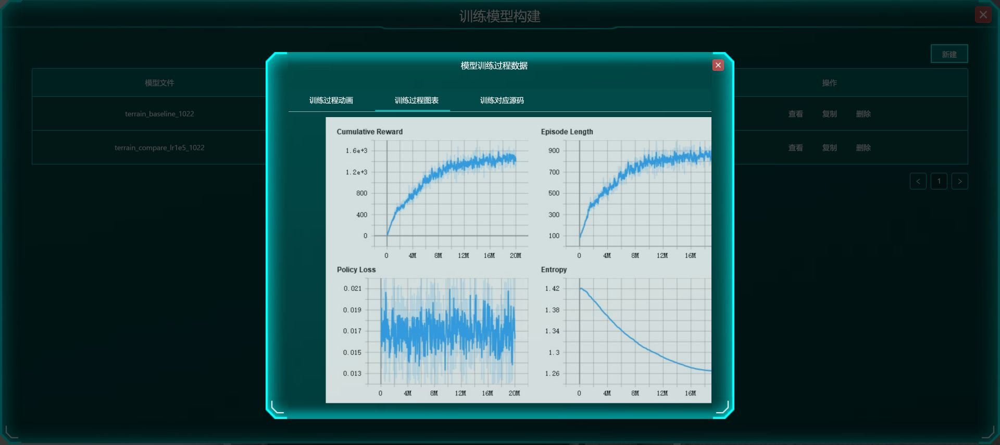

**看哪儿：** 左上累计奖励，右上回合长度，左下策略损失，右下熵。先认清纵轴代表什么，不要把所有曲线都理解成越高越好，也不要从一张图推断所有地形通过。

**记忆钩子：** 奖励是训练时的评价信号；策略根据观察产生动作；训练参数影响学习过程。一个只追求静止稳定的奖励可能让机器人不愿跳舞，一个只追动作的目标又可能忽略站稳。真正要回到题目要求看推理动作、稳定性和分项报告。

**闭眼复述：** “训练完成”只说明过程到达结束状态；模型列表、训练曲线、推理表现和最终评分是不同证据。任务3历史的100%是动作完成度记录，不是正式100分。

## S03：同一张图，五种不同答案

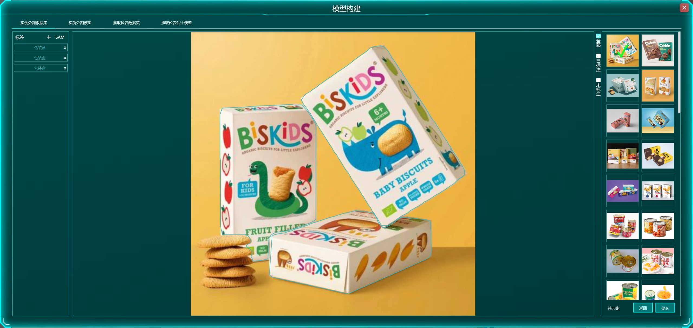

**看哪儿：** 图中三个包装盒各有轮廓，左侧有三个标签项。它让你直观看到“实例”：同类物体也要逐个区分。分类只回答图像类别；检测给目标框；分割进一步给像素范围；深度与相机内参可以恢复三维点；抓取位姿还需给出夹爪姿态。

**记忆钩子：** 标签像姓名牌，方框像收纳盒，掩码像剪影，点云像空间中的沙粒，位姿像有位置和朝向的夹爪。它们不能互相冒充。选择目标时先对上类别，再按置信度或题目规则筛选；“最自信的碗”不能代替“所需的水壶”。

**闭眼复述：** 我知道目标是什么，不等于我知道机械臂该以什么姿态接近它。模型高指标也不能替代抓放结果。

## S04—S05：地图、当前位置、目标箭头各管一件事

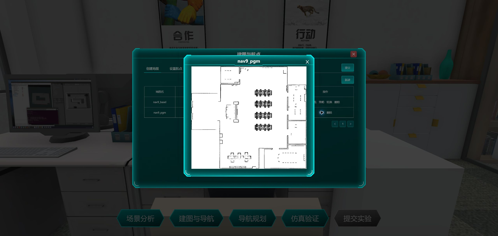

**看哪儿：** 墙体、门和桌椅轮廓。地图描述环境；定位估计机器人当前位姿；全局规划选路线；局部控制随障碍变化调整运动。截图只是一张预览图，不是可以导入平台的地图文件，也不能仅靠它证明定位正确。

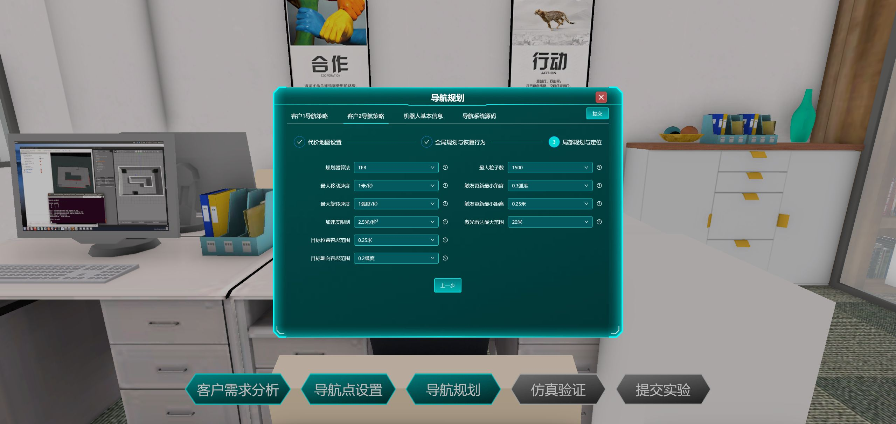

**看哪儿：** 左下的目标位置容差和目标朝向容差。单位不同，作用不同。图中历史值0.25米、0.2弧度是当时配置，不是所有正式场景的答案；本任务历史仍缺完整航点和仿真报告。

**记忆钩子：** 停车既要停进位置，也要车头方向正确。目标点是圆点，目标朝向是箭头。障碍膨胀区域可以理解为机器人给自己预留的安全空间，但设得越大并非总越好，过大可能把可走通道封死。

**闭眼复述：** 地图已经生成，不代表机器人知道自己在哪。点位数量正确，不代表坐标、朝向、路线和避障全部正确。建图进度99%也不是地图准确度99%。

## S06：标定是“尺子之间的关系”，不是把数字背下来

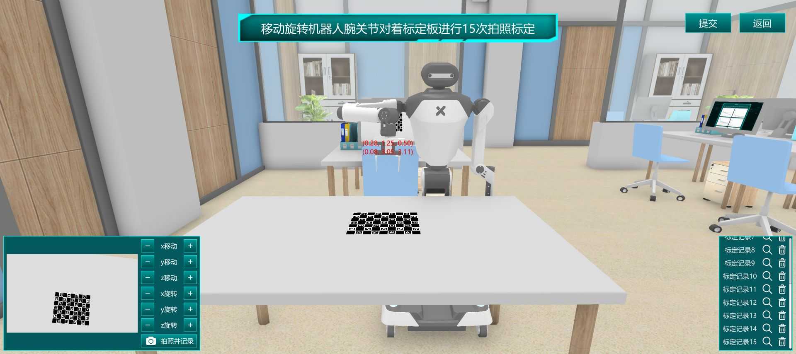

**看哪儿：** 左下移动与旋转操作、相机中的标定板、右侧记录列表。改变观察姿态后采集多组数据，用来求坐标关系；不能把不同记录理解成复制同一张照片15次。截图能证明当时的操作界面和记录状态，不能据此给出误差合格结论。

**记忆钩子：** 桌上同一个杯子，相机说“在我前方”，基座说“在我左前方”，物体没有移动，数字却会变。TF将同一个几何对象换到另一个参照系描述。输入已经在目标坐标系时，重复变换会再次偏移。

**必须分清：** 像素位置加有效深度、相机内参，能得到相机坐标中的三维点；三维点只有位置。完整六维位姿还包含朝向，需要其他估计或已定义的姿态约定。不能在动画中把“像素→三维点”画成“自动得到完整抓取位姿”。

**闭眼复述：** 每个坐标数据我都能说出单位、坐标系、来源和是否已经变换；本题标定不能直接拿别题数值替代。

## S07：抓取成功要通过六道门

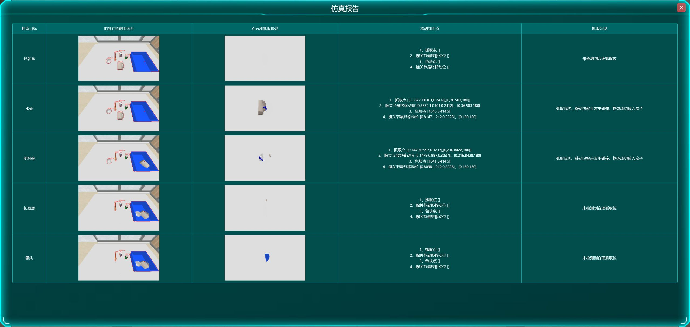

**看哪儿：** 同时比较“检测到的点”和“抓取结果”。水壶、塑料碗在这轮成功；包装盒、长颈鹿、罐头的抓取点为空。画面里有目标，不代表模型已经生成可用抓取候选。

**六道门：** 找对目标 → 有合理候选 → 坐标和手别正确且可达 → 有可行路径 → 机械臂执行 → 真实夹住并放到指定区域。这里的六步是教学归纳，不是平台固定六个积木。

**闭眼复述：** IK回答关节能否达到目标姿态，路径规划回答如何绕障过去，执行回答是否真的动起来，夹持检查回答物体是否被拿住。第一个缺失输出在哪一层，就先在那里排查。

## S08：通信图要在箭头上写“运的是什么”

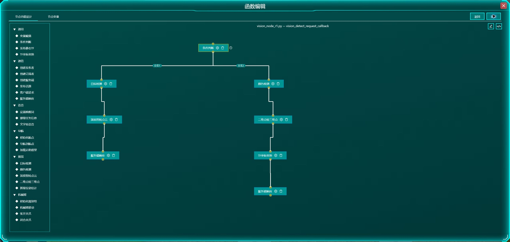

**看哪儿：** 左支“目标检测→深度图转点云→服务端响应”，右支“颜色检测→二维点转三维点→TF→服务端响应”。左边交给抓取链的数据与右边交给放置链的数据用途不同。截图展示结构；具体服务、字段和类型要结合 [03 任务14参考纠错](03_任务14实战攻略.md) 核对。

**记忆钩子：** 话题像广播；服务像发请求并收到对应响应。ROS本身不替你判断物体有没有抓住。一个字段的名字只是合同的一部分，还要知道类型、单位、坐标系与接收方用途。

**特别容易混的字段：** 任务14资料里，服务返回点云字段为 `Point_Cloud`，转交抓取话题时使用 `Pcloud`；不是全链所有位置都复制同一个字段名。手别布尔值按该题接口核对，不把某个机器人的历史约定当通用规则。

**闭眼复述：** 每条箭头都能补全“谁发送→谁接收→什么类型的数据→哪个字段→收到后调用哪个函数”。

## S09：状态机像有条件开门，不能见到消息就冲过去

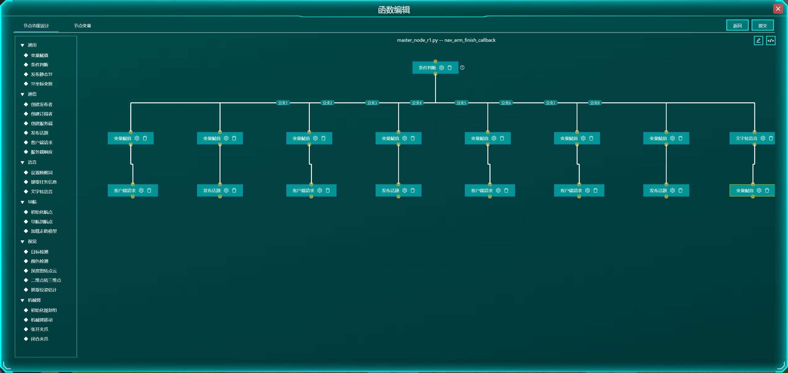

**看哪儿：** 条件判断连到多个分支；各分支可能发视觉请求、发下一导航目标或结束任务。这个截图不是完整的状态数值表，不能仅按画布从左到右猜每个状态编号。

**记忆钩子：** 发导航命令是按下出发按钮，导航完成回调才是到达回执。订阅回调负责接收目标；动作完成回调负责反馈结果，这两个事件不能合并理解。只接受与当前机器人、当前阶段、预期事件匹配的反馈，避免旧消息或其他阶段消息让状态乱跳。

**闭眼复述：** 我现在在哪一阶段？正在等哪一个事件？事件表示成功还是失败？如果不匹配，应该继续等，而不是盲目状态加一。

## S10：同一份失败报告里，可能有两种完全不同的故障

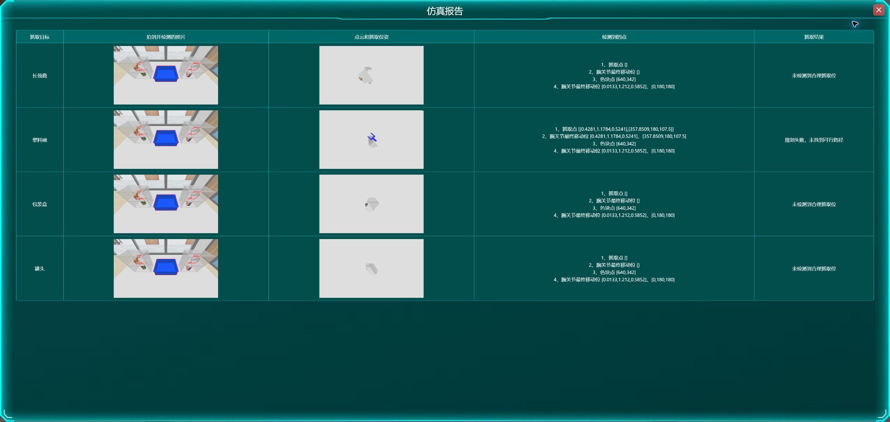

**看哪儿：** 三项写“未检测到合理抓取位”，塑料碗写“规划失败，未找到可行路径”。前者没有可用候选，后者已经有候选但后面的路径规划未成功。不能给这四项都套上“加规划时间”的同一个答案。

**记忆钩子：** 沿着数据链往后走，找到第一处不满足输入要求的地方。先检查目标/点云，再检查候选/坐标，再检查规划组/碰撞，再检查执行/夹持，最后检查反馈。顺序是一种诊断方法，不是保证所有问题只来自一个原因。

**闭眼复述：** 一次只改一个可解释因素，并记录前后条件；如果场景、顺序也变了，就不能把所有差异归因于那个参数。任务12历史3→5的规划时间对照报告未读，不能说加到5已经修好。

## S11：交接要交证据，不能只交一句“好了”

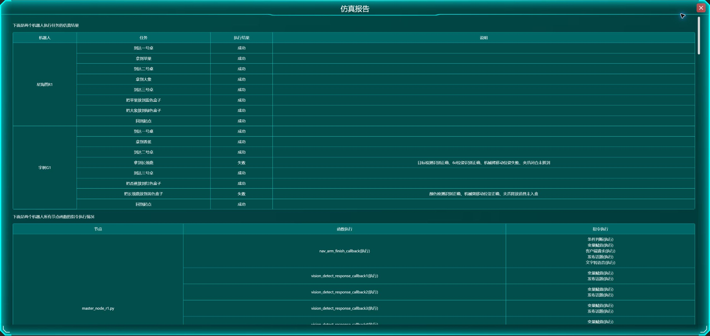

**看哪儿：** 上半部具体子任务结果，与下半部函数执行记录分开读。本轮R1八项成功；G1六项成功、两项失败。函数执行记录不能抹掉上面的抓放失败。该图是用户重置前历史，不是当前练习成绩。

**三人建议分工：** A负责运动与视觉，B负责建图定位与导航，C负责抓取与ROS；所有人都要能解释整条链。交接时至少说清资源名/版本、数据与坐标约定、保存回读情况、实际验证了什么、还有什么未解决。资源已保存和运行时实际用了该资源，也要分开确认。

**闭眼复述：** “我保存了某配置，重开仍在；本次报告的某两项达到要求，另两项失败；下游收到某种数据，单位和坐标系如下。”这种交接比“完成了”更有用。

## 最后一分钟：不看图回答这十二句

1. 一项完整任务为什么需要反馈闭环？
2. 积木先后、变量类型、回调各解决什么问题？
3. 观察、动作、奖励与训练参数有什么区别？
4. 分类、检测、分割、点云和位姿各输出什么？
5. 建图与定位有什么区别？
6. 航点的位置与朝向为什么要同时检查？
7. 一个三维点还缺什么才成为完整六维位姿？
8. 无候选、无IK解、无路径、未夹住分别属于哪一层？
9. 话题与服务、字段名与字段类型有什么区别？
10. 发出命令、收到消息、收到动作完成回调有什么区别？
11. 如何找到第一个缺失或错误的输出？
12. 如何向队友交代已完成、已验证与未解决的边界？

若只能背句子、不能举一个具体例子，就到对应 S 站再做一道题。看懂图和听完配音只是开始；能用自己的话解释一个错例，才更接近比赛时读懂陌生题面。

动画已将72段配音、脚本和样式内嵌在 `video/player.html` 中，可单独保留这个文件观看；若要从动画跳回对应S课程，仍需保留它与学习站的相对目录。当前交付为可暂停、选章节和调速的Remotion互动动画，完整时长7分52秒。
