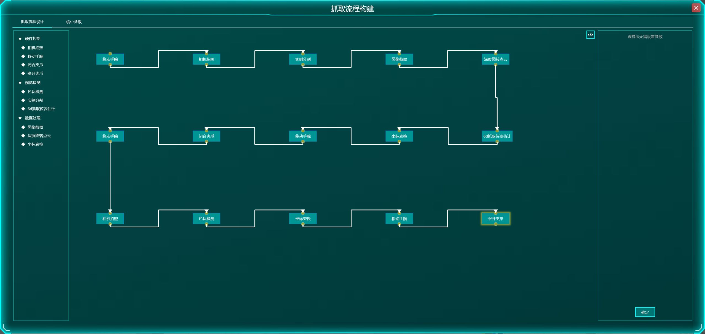
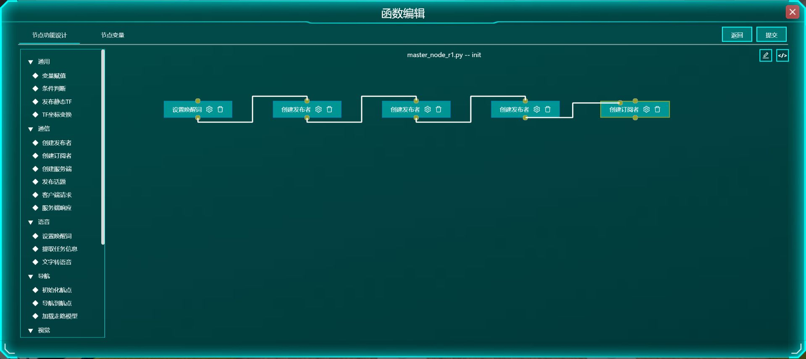

# 赛前速通：没实战过，也先看懂界面与解题顺序

更新：2026-10-24。 **先读前两节，再按题目找对应流程；不用先做模拟题。**  本页把已归档官方练习要求和本账号历史操作翻译成操作思路，帮助你认界面、认输入输出，不承诺几分钟获得实操熟练度。

 **边界：**  已看到的“机器人展会表演”题名，不足以确定正式动作、顺序和分值；下面取物、导航、舞蹈是练习对应方法，实际以现场题面为准。代理仍暂停平台操作；任务14旧截图/三轮报告均在你重置前，不能当成当前配置。本文仅供赛前阅读。

## 1分钟：比赛到底在干什么

把机器人拆成一条链： **接到任务 → 去目的地 → 站稳并朝向目标 → 识别/表演/抓放 → 收到结果 → 下一步 → 返回结束。** 

-  **运动控制：**  身体怎么走、跑、跳、跟舞蹈轨迹。输出是身体动作。
-  **定位导航：**  地图在哪里、自己在哪里、去哪、怎么绕障。输出是到点结果。
-  **视觉感知：**  看到什么、目标在哪、抓取候选是什么。输出可能是类别、框、掩码、点云或位姿。
-  **ROS集成：**  谁下命令、谁收数据、等谁完成、何时进入下一步。输出是整条任务链。

三人可分A运动与视觉、B导航、C抓取与集成；这是协作建议，四模块仍都要有人负责。 **先看题面给了哪些模型、地图、标定和函数：已有资源就正确选择，不要见“模型”就重新训练。**  历史任务14官方已提供这些资源，主要考调用与集成。

## 5分钟必读：所谓“编程”，你到底要做哪些动作

主要是 **填表单、拖拽功能块/节点、连接流程、选择变量和回调** ，不只是拖动数值滑杆，也不能把所有编辑器当成同一种Scratch：运动1—3主要填观察/动作/奖励等表单；视觉4—6与抓取10—12搭算法流程；任务14在ROS节点的函数里搭指令积木。

| 界面里的东西 | 它实际管什么 | 你要怎样理解 |
|---|---|---|
| 功能块/流程节点 | 一步处理或动作 | 如图像采集、目标检测、机械臂移动；摆在旁边不代表已经连接 |
| 箭头/连线 | 顺序或依赖关系 | 先看端口和该编辑器说明；别只按画布左右猜先后 |
| 参数 | 这块怎么做 | 模型、阈值、速度、目标来源、输出存哪里；任务14点齿轮填写 |
| 变量 | 有名字、能保存当前值的容器 | 数字存状态，字符存航点名，图像存相机数据，点云/位姿存空间结果 |
| 函数 | 一段可被调用的流程 | init做初始化；自定义函数放某段处理；不是一个变量 |
| 回调 | 某事件发生后才调用的函数 | 导航完成才回调；不是刚发导航命令就执行抓取 |
| 条件分支 | 根据当前值选路 | “物体”走点云分支，“颜色”走盒子位置分支；比较运算符也要填 |

 **执行关系与数据关系要分开想。**  “先拍照，再检测”讲执行；“检测读哪张图、结果存哪个框变量”讲数据。有的编辑器靠连线取父节点输出，有的在参数中选变量；本平台不能一概说成两种固定颜色的线。任务14画布连执行顺序，具体图像、点云、回调字段主要在参数中引用。

 **一个最小例子：**  相机回调把实际图像存入`Vision_Color_Image` → 目标检测读取该变量 → 框存到`Vision_Box` → 深度图和框生成目标点云。输入框里写普通文字“Vision_Color_Image”，不一定等于选择这个变量；要选正确的赋值/引用来源。

 **通用操作顺序：**  看题面资源 → 放功能块 → 填参数与数据来源 → 连线/分支 → 绑定完成回调 → 保存 → 重开面板核查 → 先看局部输出 → 再仿真看分项报告。保存、训练提交、仿真、最终“提交实验”是不同动作；看清确认提示，正式交卷按现场规定完成。

## 怎么训模型：先分清两种训练

### 运动任务1—3：教机器人怎样动

已核实入口为 **“训练模型构建”** 。教学顺序：选机器人与动作 → 选观察量 → 定义动作 → 配奖励与重置 → 填训练参数 → 提交训练 → 模型完成后点“查看” → 进入“推理仿真验证”选择该模型；改动后按页面“重新加载算法”复验。

-  **观察** 是策略能看到的姿态、速度、关节等信息； **动作** 是它输出的关节控制量。
-  **奖励** 鼓励稳定、前进或跟轨迹，惩罚偏离； **重置** 规定摔倒/偏差过大/回合结束时重新开始。奖励不是比赛评分。
-  **学习率** 控制每次学习改多少； **训练步数** 是练习预算； **批量** 是一次更新处理多少样本。没有“把滑杆全拉最大”的通用答案。
- 训练完得到策略； **推理** 才是用策略实际走/跳/舞。必须检查不倒、方向、速度、动作偏差，不能只看“已完成”。

历史实测走1m/s、跑3m/s、跳1.5m/s正常；复杂地形1.34m/s；舞蹈完成率100%。这些是各自场景结果，不是正式保分参数或100分。

### 视觉模型：先给正确例子，再让模型学习

以任务4已核实界面为例： **“分类算法构建”→“训练数据构建”→“新建”** ，选图贴标签并保存数据集；再到 **“视觉模型构建”→“新建”** ，选数据集、模型和参数，点 **“提交训练”→完成后“查看”** 指标；然后到 **“算法流程构建”** 搭链， **在模型块绑定新模型** ，选输入运行，最后看3D场景报告。其他题按对应入口操作，不能假设按钮完全同名。创建了模型不会自动保证流程已用它。

分类给整图贴类别；检测框住目标并选类别；分割贴合物体轮廓；行为识别使用视频；2D抓取调矩形方向/开度，6D抓取检查预设候选、调整并区分正负。 **epoch是反复学习训练集的轮次；数据增强是让训练样本产生变化；分类头数量要对应实际类别。**  不要用测试时的亮度调整代替正确训练标签。

 **照一个真实例子认识训练框（任务4历史配置，不是现场通用答案）：**  数据集27张、7类表情 → ResNet、分类头7 → batch size 4、number_workers 1、SGD、学习率0.001、15轮 → 增强“处理流程3：随机裁剪→旋转→颜色抖动” → 提交训练并查看。随后在流程的ResNet节点选这个模型；输入尺寸224，标准化均值0.485/0.456/0.406、标准差0.229/0.224/0.225。这些归一化参数是模型输入约定，不能随意调成看起来好看的数。该模型历史accuracy 0.8371，实际场景仍有误判。

## 视觉任务4—6：看到什么，下一步按什么

| 练习入口 | 怎么搭、填什么 | 得到什么、先查什么 |
|---|---|---|
| 4“分类算法构建” | 明亮：采集→尺寸变换→标准化→ResNet；昏暗先加亮度调整/均衡。训练与推理分类头均核对7类 | 类别＋置信度。查图是否进来、模型是否绑定、类别数和预处理是否一致 |
| 5“检测算法构建” | 危险品直接检测；陌生人/读数在检测后加图像截取，再接人脸/OCR。屏幕标注框文字 | 框＋类别；后续再有人脸/文字结果。框对而读数错，先查裁剪区域、大小与OCR，不先重训全部模型 |
| 6“识别算法构建” | 通用行为模型处理视频；个性化流程根据姿态/条件判断。逐一测试规定行为 | 动作类别或条件触发。单帧姿态不自动等于一段行为；查视频、类别、条件和阈值 |

不要被高指标误导：历史任务4模型accuracy为0.8371，3D样本仍有误判和低置信度；任务6也有跌倒混淆。 **模型指标、当前这一次输出、整题成绩分别看。**  任务6官方应用类别与实际标注菜单有差异，详见12，不照着“五标签菜单”猜分类头。

## 导航任务7—9：先有图，再知道在哪，最后才谈去哪

1.  **任务7“建图策略制定”：**  看场景 → 选建图算法与路线 → 保存策略 → 选客户仿真 → 生成/预览地图 → 查报告。地图要覆盖房间、门口、走廊；进度99%不能当已完成。历史小场景86.6%、大场景79.2%，不是两场景全达标。
2.  **任务8“导航策略制定”：**  核地图 → 在“导航点设置”长按拖出航点 → 放到可站位置 → 调朝向 → 保存 → 配代价地图、规划器/控制器等 → 仿真。图钉靠近桌子不够，还要面向服务目标且不压障碍；历史任务8仅部分配置，17点未齐、无仿真报告，不当成已跑通示例。
3.  **任务9“建图与导航”：**  3D建图得到PCD → 预览 → 转换成PGM并预览 → 设置10点及朝向 → 配导航 → 选择地图仿真。历史地图92%、10点到达且碰撞0；点位合理性没有独立最终分。

 **AMCL帮机器人在地图上定位；全局规划找大路线；局部控制绕眼前障碍；代价地图把危险区域扩出来。**  卡住先查地图/定位/航点，再查障碍膨胀和规划，不把“速度加大”当万能办法。单位、半径与通道宽度要一起看。

## 抓取任务10—12：不是识别出来就能抓

已归档路径： **手眼标定 → 模型构建 → 抓取流程构建 → 仿真验证 → 报告。**  标定采不同位置/旋转，按实际记录数核对；旧练习要求15次，正式数量以题面为准。

 **通用链（示意）：**  初始姿态 → 拍照 → 检测/分割 → 取当前目标区域 → 深度/点云与抓取估计 → 坐标变换 → 移到抓取位 → 闭爪 → 抬起 → 找盒子 → 移到放置位 → 张爪。

- 任务10相机在手上，2D抓取矩形含位置、方向和夹爪宽；11/12相机在手外，6D抓取位姿包含三维位置和朝向。不能混用标定矩阵。
-  **像素不是米，3D点不是完整6D位姿。**  相机系与基座系要用本题标定/TF对应；输出已转基座系就不要再变一次。
-  **IK** 检查能否找到关节姿态； **路径规划** 检查如何避障到达；闭爪动画出现仍要看是否真的夹住并放入。
- 候选为空先查检测/分割、裁剪、深度与抓取模型；有候选但规划失败，再查坐标、可达范围、碰撞与规划条件。

历史任务11曾有15个块却丢了14条线：补线后选节点点右侧 **“确定”** ，关掉再开面板才确认保留。最后一次连线也要保存。任务10首轮2/7、任务11为2/5、任务12首轮0/4完整成功， **这些是定位错误的案例，不是包过答案。** 

## 任务14：从空白开始，应按什么顺序接系统

入口 **“ROS节点编写”** ；先看“配置文件和其他资源”。这里master/nav/vision/arm是四个软件职责，不是视觉流水线中四个图像处理块。每个节点内部再有函数和积木。

1.  **先建变量与函数。**  master存状态数字和任务字典；nav存忙标志、航点字符；vision存彩色/深度图、框、点云/位姿；arm存点云、位姿、臂名与夹爪名。名字可自定，类型和引用须一致。历史每台19函数15变量只是一套实现，不是所有赛题照抄数量。
2.  **填各init，先把通信创建并保存。**  master设置唤醒、创建导航/抓/放发布者、完成订阅；nav初始化航点、完成发布者、导航订阅；vision订阅彩色/深度并创建定位服务；arm初始化规划组、完成发布者、抓/放订阅。订阅和服务都要绑定对应回调。
3.  **再写回调里的数据。**  相机回调把`color_image`/`depth_image`赋给图像变量；导航回调从`Navigation_Address`取航点，置忙后导航，完成回调清忙并发完成。若参数下拉“No Data”，先检查init通信和回调绑定是否已保存，不把字段名当普通文本硬填。
4.  **补视觉两分支。**  物体：检测框→目标点云→服务响应；颜色：中心像素→结合深度转3D→TF到基座→响应Pose。物体点云由arm估计抓取位姿后再做TF，颜色Pose已在基座系，放置不重复TF。
5.  **补抓放。**  抓取收到点云→按Hand选臂/夹爪→抓取位姿估计→TF→移臂→完成回调闭爪；放置收到位姿→同一只手移臂→完成回调张爪；抓/放完成回调还要发布`_finish.is_Finish=1`，否则master收不到这段结束的信号。这个信号也不代替画面里的实际抓放结果。R1历史映射false左、true右；别把发命令当动作已完成。
6.  **最后接master状态机。**  唤醒后解析任务字典；按本练习方案发布本机器人相机的静态TF，给后续相机→基座变换提供关系；状态设为“等到桌1”，再发导航。到达反馈才请求视觉；视觉返回才发抓取；抓取完成才去下一桌。每次都问：现在等导航、视觉还是机械臂？先更新状态，再发下一动作；不要收到任意完成消息就状态加一。
7.  **逐函数保存，再整体验证。**  每个函数里按“拖指令到画布→点齿轮填参数→从端口拖线→函数内提交”完成；函数保存后还要模块内提交，再回主页仿真验证，区别于最终锁定的“提交实验”。 任务14参数缺项会红光，条件需比较来源、运算符和值；只有条件判断允许多出线。此规则不能搬到任务10—12的另一种流程编辑器。先核资源和一台机器人，再迁移另一台并核相机TF、手别、唤醒及走路模型差异。

 **通信只记一个合同：**  master发`_nav.Navigation_Address`；视觉`_locate`请求`Detect_Type/Detect_Name`，返回`Point_Cloud/Pose`；发抓取时点云字段叫`_grab.Pcloud`，放置叫`_deploy.Fpose`；`_finish.is_Finish`大小写全程一致。话题像发通知，服务像发问题等答案，二者别混建。

## 上场前最后记住的解题步骤

 **读要求和已有资源 → 列必做数量/场景/结果 → 分工 → 先连一条最小完整链 → 保存并核查 → 看最早失败输出 → 只改相关一项 → 重测 → 按正式要求交卷。** 

三人交接要说“用哪个模型/地图、输入输出是什么、哪里已保存、什么结果实测成功、还卡哪里”，不要只说“我弄好了”。同一模块不要同时进入修改。历史R1八子任务成功、G1六成功两失败，说明函数都执行也可能任务没完成。

来源：[10 官方指导要求](10_官方任务要求与评分.md)、[12 历史实测与排错](12_全任务实测与排错手册.md)、[03 任务14详细搭建](03_任务14实战攻略.md)、[18 概念讲义](18_超级速通_全能图形化任务链.md)。本页没有新增实验结果，不把历史参数变成正式标准答案；正式比赛按纪律独立完成。
