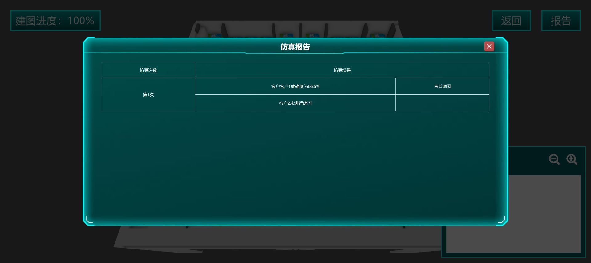

> 历史阶段记录：截至2026-10-23 03:01。后续已有新报告，本文件保留当时排查过程；当前状态请先读[12 全任务实测与排错](../../../12_全任务实测与排错手册.md)。代理实验现已暂停，不按本文旧下一步自动恢复。

# 导航任务7—9实测记录与证据复核

更新日期：2026-10-23（UTC+8）。本文件起初离线复核2026-10-22保存的截图、需求与指导书；现追加主代理10月23日现场操作的新配置和进行中状态。新结果按对应日期、保存文件与现场记录注明，不把离线审阅当实测。用户授权继续练习配置和仿真，明确禁止会锁定实验的最终评分提交。

截图中的字段值、上轮代理工作消息、官方要求和下一步建议分开记录。参数面板截图不自动证明随后保存成功，也不证明模型或导航完成。任务7—9的最终评分均未提交，最终成绩未取得。

## 任务7 机器人2d建图

实测状态：客户1建图完成并取得86.6%报告；10月23日客户2GMapping和第4路线已现场回读选中，3倍速重跑最后观测99%，尚无完成报告；最终评分未提交。

### 已有运行报告

2026-10-22保存的报告中，左上角“建图进度”为100%；第1次报告明确显示“客户1准确度为86.6%”，同一张截图的第二行当时仍写“客户2未进行建图”。这只能证明报告生成时客户1已完成，不能用客户1数值代替客户2。

86.6%超过任务7官方明确的80%地图准确度目标，但本次没有取得最终评分；客户2也还需要独立结果。官方大场景评分文字有20/40分不一致，不能由此替平台推算总分。详见[官方任务要求](../../../10_官方任务要求与评分.md)。

### 客户1已证实的可运行配置

| 配置 | 截图确认值 | 证据 |
|---|---|---|
| 算法 | Karto，卡片有绿色勾 | [算法选择图](task7-9/task7_c1_karto.png) |
| 最小移动距离 | 0.15m | 同上 |
| 最小转向角度 | 0.1rad | 同上 |
| 回环搜索最大距离 | 3m | 同上 |
| 缓存扫描最大距离 | 5m | 同上 |
| 匹配搜索空间大小 | 0.1m | 同上 |
| 路线 | 四张路线卡中的第4张，右下卡有绿色勾 | [路线选择图](task7-9/task7_c1_route.png) |

这补齐了第三方材料中被红勾挡住的Karto最小移动和转向值。第4路线图覆盖办公室两侧工位通道、后部区域，并回到已走过区域；其作用是提高覆盖并建立回环。只改算法名字而不选择路线，不能复现本次结果。

### 客户2配置与10月23日新回读

| 项目 | 已保存证据可说明什么 | 尚不能说明什么 |
|---|---|---|
| 路线 | 10月23日[第4路线回读](task7_customer2_route_readback_1023.txt)明确记录green-check；旧[路线卡](task7-9/task7_c2_route.png)也有绿色勾 | 未有客户2完成报告，不能写准确度达标 |
| GMapping参数 | 10月23日[算法回读](task7_customer2_algorithm_readback_1023.txt)为粒子260、最大探测6m、线性更新2.6m、角度更新0.6rad、最小匹配100分；主代理现场确认此卡green-check | 旧[参数截图](task7-9/task7_c2_gmapping.png)未见勾的缺口已由新现场回读补齐；新参数文本本身不包含勾选图标，不将它单独当图形证据 |
| 建图运行 | 本轮重新仿真为3倍速，控制中断前最后观测99%，来自主代理现场操作记录 | 99%不是完成报告，不以时间推定成功，也没有准确度数值 |

### 界面故障与处理记录

首次“建图策略制定”只显示暗色遮罩，未见算法列表；刷新和重进多次仍复现，[空白证据](task7-9/task7_blank_strategy_panel.png)已保留。用户手动打开后，代理接续到正常策略面板并完成客户1配置/仿真。这证明存在可恢复路径，**未定位唯一根因**，不能笼统认定网络、平台服务或自动化必有故障。

漫游使用SWAD，须先点场景使其获得输入；但现有证据没有完整漫游进度或探索得分，不把“看过场景”写成“场景分析满分”。[配套硬件页](task7-9/task7_hardware.png)显示使用NanoBot A001建图小车，激光雷达测距20m、角分辨率0.5°、扫描30Hz，不支持3D建图；这是本题2D硬件说明，不用于替代任务9的3D硬件选择。

### 下一步应做什么

1. 打开客户2已运行的仿真报告，确认是否完成、准确度及地图实际覆盖。
2. 新会话先核对GMapping和第4路线的已存配置仍在；本轮已有回读，不无理由重配。只有尚未运行或报告不佳时才保存修改并复验。
3. 分别查看两客户地图，记录门口、通道、墙体重影和缺失区域；最后只保存可继续修改的练习状态，不点最终评分。

## 任务8 机器人2d导航规划

实测状态：已阅读两客户需求，保留两客户参数编辑截图和1个充电点草稿；17航点未完成、两场景导航尚无运行报告；最终评分未提交。

### 17个航点必须对应哪些实际目标

依据[客户需求文字](task7-9/task8_customer_requirements.txt)、[客户1需求图](task7-9/task8_customer1_requirements.png)、[客户2需求图](task7-9/task8_customer2_requirements.png)。下面编号是题面图示编号，不是自行假定的地图坐标。客户2图的上半部在保存截图中被滚动裁切，因此第5—8处具体门口位置需回到原需求图或场景确认，不猜像素或世界坐标。

| 客户 | 图示编号 | 航点目标 | 放置与作用检查 |
|---|---:|---|---|
| 1 | 1 | 充电桩 | 默认起点和最后返回点；图示位于左后侧通道附近 |
| 1 | 2 | 零食架 | 下午3点取零食、收回剩余零食的位置；面向后部货架 |
| 1 | 3 | 零食桌 | 摆放、等待员工领取的位置；图示在右前侧桌边 |
| 1 | 4 | 工位1旁柜子 | 图示左排靠后的工位，点放柜前可通行位置 |
| 1 | 5 | 工位2旁柜子 | 图示左排中部工位 |
| 1 | 6 | 工位3旁柜子 | 图示左排靠前工位 |
| 1 | 7 | 工位4旁柜子 | 图示右排靠后工位 |
| 1 | 8 | 工位5旁柜子 | 图示右排中部工位 |
| 2 | 1 | 前台充电桩 | 默认起点与导览结束的返回点 |
| 2 | 2 | 门口迎宾位置 | 客户进门后迎接，应留出门口通道 |
| 2 | 3 | 文化墙 | 介绍企业文化的位置，朝向应面向展示区域 |
| 2 | 4 | 第1个参观部门门口 | 只需门口参观，不深入办公区 |
| 2 | 5 | 第2个参观部门门口 | 具体位置按完整需求图，不凭裁切图猜 |
| 2 | 6 | 第3个参观部门门口 | 同上 |
| 2 | 7 | 第4个参观部门门口 | 同上 |
| 2 | 8 | 第5个参观部门门口 | 同上 |
| 2 | 9 | 会议室 | 引导客户落座后回1；图示右侧圆桌会议室 |

客户1任务链为1→2取零食→3摆放/领取→需要时4—8配送→2归还剩余→1充电；本导航练习不用实现抓取或人脸识别。客户2为1→2迎宾→3文化墙→4—8部门介绍→9会议室→1。实际自动仿真执行顺序以场景为准，不把该教学链写成需手工录入的固定代码。

### 当前点位只到1个草稿

[点位草稿图](task7-9/task8_one_waypoint_draft.png)显示场景中只有“充电桩”标记，底部仍有零食架、零食桌、工位1—5待拖出。该图不证明充电点坐标/朝向符合验收，也没有点位保存成功截图。不能写“8个小场景点位已完成”，更不能写“17点都能到达”。

上轮遇到的操作问题是拖底部航点时，有时只平移了场景视角。官方手册规定从底栏拖出标记，选中后用黑色旋转图标改朝向，右上角“提交”保存该模块。下一次操作应先确认确实出现新增标记和对应名称，再调朝向、保存并重开核对；不能反复盲拖后按次数认定创建成功。该模块保存与首页最终“提交实验”是不同操作。

10月23日主代理再次尝试自动拖点仍只平移镜头，本轮没有新增代理点位。用户现场确认：**要先长按再拖，图钉或文字均可按住。** 这是手工交互方法的用户确认，尚未取得代理按此方法新增/保存点位的成功证据。恢复后先验证一次长按拖动确实生成标记，再继续17点，不把用户说明写成点位已完成。

### 两客户参数：逐格按截图读取

官方任务8计分表写“两客户合计48个参数”。以下表按当前截图的可见界面控件逐项列出，共25行/客户；**可见控件数与官方计分参数数不必一一对应，本表不改写官方48项或推导新的评分公式。**

“框内值”指截图时选择框清楚显示的值；“待回读”指当时下拉展开但框内为空；“被菜单挡住”不作猜测。即便值在框内清楚，也还需重新打开配置确认最终保存状态。上轮代理虽报告两客户策略已点提交确认，但没有保存后重新打开的完整截图；不能把聊天概述替代回读证据。

| 组/字段 | 客户1截图框内值 | 客户2截图框内值 | 证据/边界 |
|---|---|---|---|
| 代价地图：机器人半径 | 0.34m | 0.34m | C1/C2代价地图图 |
| 膨胀半径 | 0.5m | 0.5m | 同上 |
| 障碍物检测范围 | 5.5m | 5.5m | 同上 |
| 障碍物检测高度 | 1.5m | 1.5m | 同上 |
| 观察源 | 激光雷达、相机 | 激光雷达、相机 | 两项均显示为已选标签 |
| 全局地图更新频率 | 1Hz | 1Hz | 同上 |
| 局部地图更新频率 | 10Hz | 10Hz | 同上 |
| 局部地图滚动窗口 | 开启 | 开启 | 同上 |
| 滚动窗口尺寸 | **待回读** | **待回读** | 两图均下拉展开且框内空；可见选项1×1、3×3、5×5m，不能据选项写已选3×3 |
| 全局：寻路算法 | A* | A* | C1/C2全局图 |
| 允许进入未知区域 | 允许 | 允许 | 同上 |
| 恢复行为 | 旋转、退后、等待 | 旋转、退后、等待 | 三项均显示已选标签 |
| 最大旋转速度 | 1rad/s | 1rad/s | 同上 |
| 最小旋转速度 | 0.4rad/s | 0.4rad/s | 同上 |
| 旋转加速度限制 | **待回读** | **1.5rad/s²** | C1框内空，C2框内清楚是1.5；都可见0.6/1.5/3.2选项，不能替换成参考3.2 |
| 局部：规划器算法 | TEB | TEB | C1/C2局部图 |
| 最大移动速度 | 1.5m/s | **1m/s** | C2框内与展开列表选中粗体均是1；不是参考1.5 |
| 最大旋转速度 | 1rad/s | **被展开菜单挡住** | 不能把C1值复制进C2实测栏 |
| 加速度限制 | 2.5m/s² | **被展开菜单挡住** | 同上 |
| 目标位置容忍范围 | 0.25m | 0.25m | C1/C2局部图 |
| 目标朝向容忍范围 | 0.2rad | 0.2rad | 与第三方整理文本0.25rad不同；应以实际可选值和报告验证 |
| 最大粒子数 | 1500 | 1500 | 同上 |
| 触发更新最小角度 | 0.3rad | 0.3rad | 同上 |
| 触发更新最小距离 | 0.25m | 0.25m | 同上 |
| 激光雷达最大范围 | **待回读** | 20m | C1框内空、下拉显示5/20/50m；C2框内清楚20m |

原图：[C1代价地图](task7-9/task8_c1_costmap.png)、[C1全局](task7-9/task8_c1_global.png)、[C1局部](task7-9/task8_c1_local.png)、[C2代价地图](task7-9/task8_c2_costmap.png)、[C2全局](task7-9/task8_c2_global.png)、[C2局部](task7-9/task8_c2_local.png)。

**下一次优先回读六处：** 两客户滚动窗口尺寸；客户1旋转加速度；客户1激光范围；客户2被遮挡的最大旋转速度和加速度。另核实客户2的1m/s、1.5rad/s²是否为最终有意选择，而非下拉动画中误选。应先选中、关闭菜单、读回框内值，再保存，随后重开配置；不能单凭点击目标文字就认定写入成功。

### 还缺的实测闭环

- 按17点表完成每个点的可通行位置和朝向，考虑0.34m底盘半径及膨胀层，不将标记放入柜子、桌子或墙内。
- 保存点位并重新打开核对数量、名称、位置、朝向。
- 回读并保存两客户所有策略参数。
- 两场景分别仿真，逐目标记录实际到达与碰撞次数；保存报告。任务8官方文字为到点51分、最多扣9分，余下口径未展开，不自行推算最终满分。

## 任务9 机器人3d建图与导航

实测状态：10月23日已新建PCD建图任务，选第2参数卡与第1路线，最后观测75%建图中；完成/预览、PGM转换、10航点、30导航参数与导航报告尚未完成；最终评分未提交。

此前的面板空白是历史状态，本轮主代理已恢复“建图与航点”并创建地图。输入名为`nav9_baseline_1023`，列表实际显示`nav9_basel`，创建于**2026-10-23 02:48:34**，类型PCD。不能确定是字段长度限制还是显示截断，不补猜原因。主代理最后观测为**75%建图中**；名称、时间、类型、进度由本轮现场操作记录提供，尚无完成报告或预览截图。

| 本轮已选项目 | 值 | 证据层级 |
|---|---|---|
| 参数卡 | 第2张 | 主代理现场选择记录；[参数文字](task9_map_algorithm_config.txt)显示四张卡的值，本身不含选中标记 |
| 点云采样间隔 | 3 | 第2张卡可读值 |
| 特征点滤波尺寸 | 0.35m | 同上 |
| 地图滤波尺寸 | 0.45m | 同上 |
| 优化迭代次数 | 4 | 同上 |
| 激光检测距离 | 60m | 同上 |
| IMU噪声权重 | 0.1 | 同上 |
| 路线 | 第1张/左上，已选中 | [本账号截图](task9_route1_selected.png)可见选中边框，与第三方image37逐图一致 |

本轮点路线卡眼睛打开独立详情页，已保存[路线详情文字](task9_route1_description.txt)和[详情截图](task9_route1_description.png)，独立页面已关闭。顺序为1→文化墙→2、进3、公共区4—7两遍、8/9、会议10、休闲区（路线图中11）后回1；公共区由左侧斜坡上下，休闲区由上斜坡进出，转角先旋转再前进。1—11是建图路线区域，不是11个导航点，官方仍为10个。

接续先在已存列表找02:48:34创建、显示`nav9_basel`的PCD，读取当前进度或结果，不重新创建覆盖。再按[任务9官方指导书](../任务9_当前平台指导书.pdf)完成：场景漫游覆盖缓坡/台阶/抬高区→完成并预览PCD→过滤转换、生成并预览PGM→10航点位置/朝向→30导航参数→选择对应PGM实际导航→逐点到达/碰撞报告。配置已选择、PCD建图完成、地图质量达标和导航通过是不同阶段。

## 10月23日后段浏览器连接中断与恢复点

主代理控制连接超时后reset，任务4/7/9原标签均返回`Debugger unattached`，已请用户从课程新开对应实验。该错误是本轮浏览器控制连接状态，不能据此认定平台建图失败或已保存结果丢失。

恢复顺序：任务7客户2先看99%之后是否形成报告；任务9先读已有PCD进度与预览；任务4先回读已有数据/流程。不要因旧标签失联覆盖现有对象。任务8尚无新增点，按用户确认的长按方式进行单点验证后再批量补齐。用户要求用完界面及时关闭：主代理已关闭已保存的任务5/6/3/1页、旧课程入口及路线详情页，不为导航续接重开无关已完成页。新面板恢复问题已发出，等待用户恢复；无新的完成报告可补。

## 2026-10-23工具阻断与工作范围

更早的导航续接子代理可用工具没有旧的Browser Use/CUA入口，尝试最新Computer Use的只读Chrome状态捕获时收到：

> Computer Use has been stopped for this turn because it could not determine the current browser URL on Windows with enough confidence to enforce policy. Stop your work and send a final message noting why Computer Use ended.

此后该子代理没有再发送窗口/浏览器输入，也没有通过其他方式绕过。它是**本次子代理原生窗口工具的安全停止**，不是任务7—9平台不可用的证明，也不覆盖其他会话原有浏览器工具的独立状态。本文件后来按新指令仅从本地已有证据整理。

## 证据清单与续接要求

最初复核`task7-9/`的17个文件（16PNG、1TXT），本阶段新增2份客户2回读TXT、1份任务9参数TXT、1张任务9路线PNG以及路线详情TXT/PNG，共23个证据文件。SHA256清单见[导航证据清单](导航7-9证据清单.json)。原图保持不改；对数值的识别以上表和原图为准，不通过裁切或补字掩盖未知值。现场进度与创建时间等没有对应独立截图的项目已明确归于主代理操作记录。

新一轮真正取得客户2地图报告、完整航点或任务9结果后，应追加新证据与时间，再更新本文件和12实测手册的状态；不要把本次离线复核日期写成新的平台运行日期。
